# Project Thessa — Bevy Exit and Engine Migration Plan

**Status:** Active migration  
**Language:** English  
**Updated:** 2026-10-19 (native sky/audio, shadow receiver, flight-clock/input controls, system map)
**Review snapshot:** repository architecture known through the full-stack merge (`main` past `40aed83`), plus renderer/RCBT/Vulkan decisions made through 2026-09-16.

> This document is intentionally operational. The goal is to stop adding Bevy-specific work that will have to be rewritten during the engine extraction.
>
> Carve-out: the `docs/38` indexed-terrain repairs are disposable-bridge work
> (shared WGSL/geometry and material-ancestor mapping contain no Bevy API;
> acknowledgement belongs to the bridge) — see §38:249-252.

## 1. Decision

The current source-to-consumer retirement ledger is
[doc 66](66_BEVY_RETIREMENT.md). It tracks the full requested host replacement,
including non-rendering functions; the native sky slice below is not that gate.

The native flight-clock follow-up now replaces fixed unpaused/x1 server votes
with explicit pause/warp intent, retains authoritative acknowledgement, and
reuses canonical launch-site reset locally or `Command::Reset` remotely.
Window F8, brackets and Backspace do not conflict with the retained camera
arrows; CLI/HUD expose the same demands. Focus loss/suspension neutralize held
axes/gestures without an engine cut. Existing authority stepping/work limits,
transport framing and time-based sky/audio remain their owners; no new physics
clock or local server fallback is added. Native capture now reports fixed-step,
rails and debt counters with explicit scripted-time versus frame-wall semantics.
See doc 66 and `artifacts/native-flight-clock-2026-10-19.json` for checks and gaps.

The [native system-map follow-up](67_NATIVE_SYSTEM_MAP.md) supersedes earlier
old-client-only map-camera snapshots below. Both hosts share neutral scope,
selection, Kepler and rails-projection helpers; native egui adds six scopes,
f64 framing/orbit/pan/zoom, body/PRIMARY tracking and exclusive map/flight input
ownership. Its bodies and PRIMARY use one newest-authority epoch, separate from
3D scene interpolation. The subsequent follow-up extracts/reuses the server's
single native bake worker for local physics and shares dominant-body
apsis/escape/wake readouts with the legacy host. Both maps now consume the
optimizer's executable cached coast interval using shared solver guards;
neither map requests a conditional zero-thrust/zero-aero forecast. Generalized
powered/live JIT futures remain unimplemented, not replaced by coast curves.
The shared-instrument follow-up (doc 57) now supplies dominant-body kinematics,
air/load/apsis and wheel/canopy details to both decks. Native speed/cue and
Datum/AGL selectors are session-only; missing remote observations stay
unavailable rather than masquerading as reconstructed forces. Remaining
guidance/flight-command/appearance adapters still prevent full host retirement.

Native F1/F2/F3 now provide controls help, flight-HUD visibility and telemetry/
fleet visibility. Help temporarily replaces other widgets and captures manual/
camera input without pausing the authority or cutting thrust; ordinary visibility
edits retain held pilot keys. Hidden instruments release their navball callback,
and F2 leaves an active map usable. These are session-only presentation flags,
not new graphics requests or authoritative acknowledgements. See doc 66 for the
remaining readout/guidance adapters and visibility evidence.

The [CBT sphere experiment](61_CBT_SPHERE_EXPERIMENT.md) now isolates persistent
conforming bisector topology from render-patch grid LOD. The original test-only
unit sphere is advanced by the canonical consumer and native selection below;
it must not be mistaken for full-client migration acceptance.
The [parallel follow-up](62_CBT_PARALLEL_TRANSACTIONS.md) now commits disjoint
compatibility-chain/diamond transactions concurrently and measures a 128K pool.
The [canonical surface consumer](63_CBT_CANONICAL_SURFACE.md) then converts
active bisectors into planet-scale vertices sampling the existing height and
material residency through heap depth 58, without a second streamer or cache.
Acceptance targets canonical surface correctness and working native consumers,
not Bevy visual/implementation parity; a conservative height-bound LOD input
now charges relief for its screen area, and a diagnostic caster reaches the
shared shadow atlas with an independent metric sphere oracle. A diagnostic
ocean geometry adapter reuses the spectral field/materials and resolved ocean
policy, with seam-safe filtering and optical-only fallback. Shared publication
epochs now drive borrowed bisector BLASes and canonical water/material hits in
the existing RayScene. Native `[terrain_topology]` now selects Low/Medium/High
persistent topology for both window and headless production frames. It reuses
the shared raster BRDF, atlas, ocean and RayScene, with one ordered emitted epoch
before all consumers, and keys shadow reuse on that revision. Disabled or
unsupported falls back to regular patches without topology resources/dispatches.
The mode suppresses legacy grid generation/compaction and classifies actual
camera-relative emitted datum geometry through the existing transaction planner.
Per-tile error/convergence, temporal/equal-error acceptance, primary terrain RT
reflections and the wider platform/UI/effect migration remain open. See doc 63.

The audited native sky follow-up in [doc 65](65_NATIVE_SKY_AUDIT.md) now consumes
the shared aurora model, flux-normalized stars/source discs and depth-clipped
clouds in both window and headless paths. Cloud primary, receiver-shadow and
reflected-ray consumers share one weather/geometry/phase publication and WGSL
transport implementation. Primary aurora is depth-clipped with correctly ordered
cloud extinction, including orbital foreground terrain. Richer atmospheric
transport and visual/platform acceptance remain open; this is not full client
replacement.

Native raster follow-up: [doc 60](60_NATIVE_SHADOW_CASTER_REVIEW.md) records
conservative non-ocean terrain caster rejection, independently compared with
full-caster depth/image output. Ocean keeps full caster coverage; the isolated
diagnostic is not evidence of a complete-client or production-FPS speedup.

Bevy is no longer a long-term architectural foundation for Project Thessa.

It is now treated as a **bootstrap host** while Thessa grows its own engine through a strangler-fig migration:

1. Keep the game runnable through Bevy.
2. Move engine-owned subsystems behind Thessa-owned APIs.
3. Replace Bevy subsystems one at a time.
4. Reduce Bevy to a compatibility/host bridge.
5. Remove the bridge when no engine subsystem depends on it.

The primary invariant is:

> **New engine code must not require a rewrite solely because Bevy is removed.**

This is not a rewrite project. Existing working code remains usable until a replacement exists.

---

## 2. Review of current systems and Bevy coupling

This review is based on the current architecture known from the repository snapshot and the subsequent renderer work.

| System | Current coupling | Assessment | Required direction |
| --- | --- | --- | --- |
| `sim-core` / gravity / orbital simulation | Low / none | Good boundary already. Simulation is conceptually independent of rendering. | Keep engine-agnostic. Do not introduce Bevy ECS types into the simulation API. |
| Headless/server-side simulation | Low | Good candidate for the canonical simulation runtime. | Keep using the same simulation crates as the client. No renderer/window dependencies. |
| Client app bootstrap | High | Bevy currently owns lifecycle, world, scheduling and renderer startup. | Reduce this to `bevy_bridge`; application logic must move behind Thessa-owned APIs. |
| Terrain cube-sphere / tile streaming | Medium–high | Core policy is Thessa-specific, but the current mesh/entity/material delivery path is tied to Bevy. | Split topology/generation/streaming from presentation. Renderer backends consume neutral terrain descriptors. |
| Terrain cache/jobs/wanted/visible state | Medium | The state model is reusable; execution and delivery are the likely coupling points. | Move jobs to Rayon and keep cache/state structures free of Bevy task/entity types. |
| RCBT / CBT topology | Low by design, if kept separate | This should become one of the cleanest reusable engine subsystems. | Keep `rcbt-core` backend-neutral. GPU support lives separately. Bevy integration must remain a thin adapter. |
| Procedural mesh generation | Medium–high | Current path is likely shaped around Bevy `Mesh`/asset upload semantics. | Define Thessa-native procedural output and GPU-ready layouts; convert to Bevy only in the bridge. |
| `thessa-atmosphere` / atmosphere logic | Medium | Physical/stellar logic is reusable; render integration and shader resources are Bevy-specific. | Separate physical atmosphere state from backend resources/passes. Multiple stars are a core invariant. |
| Stellar irradiance / angular size / eclipses | Low conceptually | This is already a Thessa world-model feature, not a Bevy feature. | Keep as engine/world data; renderer consumes `StarEmitter[]`. Never encode a single-Sun assumption. |
| Atmosphere shader path | High | Shader registration, resources and render passes are tied to the current renderer path. | Move under `thessa-render`; expose Vulkan and wgpu implementations behind the same engine-owned contract. |
| Auto exposure / temporal render state | High | Usually tied to Bevy render graph/resources. | Move into renderer-owned passes/resources. |
| Solari | Very high | Solari dictates RT scene construction and lighting architecture, and its cost model does not match Thessa. | Freeze integration. Use only as temporary/reference implementation while FastRT is built. |
| Ray tracing scene / BLAS / TLAS | High | Currently inherited from Solari/Bevy. | Move to a standalone RT infrastructure layer owned by Thessa. |
| Temporal AA / upscaling | High | Existing Bevy/DLSS plumbing is useful as reference but should not define the engine API. | Create a backend-neutral temporal contract; DLSS/OSS/native TAAU are implementations. |
| wgpu GPU resources | High where exposed | wgpu is useful as a portability backend but its memory model is too restrictive for the reference path. | Do not expose `wgpu::*` outside backend/bridge code. |
| Vulkan | New primary backend | Needed for explicit memory topology, RT control and UMA fast paths. | Treat native Vulkan as the reference/high-performance backend. |
| UMA shared buffers | Not expressible well enough through current high-level path | Important for APU/laptop performance and procedural workloads. | Add shared/persistently mapped allocations to the engine memory API. |
| Bevy Tasks | Replaceable | No reason to preserve them as an engine dependency. | Rayon becomes the CPU execution engine; Tokio remains for async I/O/network work. |
| Bevy ECS | Replaceable | Once renderer/tasks/assets leave Bevy, retaining Bevy only for ECS has little value. | Introduce a Thessa ECS/scheduler later in the migration, after subsystem boundaries stabilize. |
| Bevy Assets | Medium | Useful during bootstrap but should not own runtime engine state. | Introduce engine asset/cache interfaces gradually; bridge to Bevy while needed. |
| Window/input/platform | High but low priority | Rewriting platform plumbing gives little value. | winit lifecycle/input and system decorations; do not write custom Wayland/X11/Win32 plumbing. |
| UI/HUD/debug tooling | Medium–high | Production UI still follows the Bevy host. | egui overlay on the owned renderer; keep game/simulation state independent from UI state. |

### Immediate conclusion

The largest migration risk is **not** `sim-core`. It is continuing to implement renderer, terrain presentation, temporal, RT, GPU memory and task orchestration directly against Bevy/wgpu APIs.

That work must stop leaking upward now.

---

## 3. Freeze rules — effective immediately

Do not add new architectural dependencies on:

- `bevy_render` as a public engine API;
- Solari as a long-term lighting/RT API;
- `wgpu::*` types outside renderer backend or Bevy bridge modules;
- `bevy_tasks` for new engine-level scheduling;
- Bevy `Entity`, `World`, `Commands`, `Query`, `Res`, etc. inside engine-owned crates;
- Bevy `Mesh` as the canonical output of procedural geometry;
- Bevy asset handles as the canonical identity/storage model for engine runtime resources;
- Bevy render-graph nodes as the only implementation of a new rendering feature.

Bevy-specific code is allowed only when it is one of:

1. a thin adapter to an engine-owned subsystem;
2. a temporary implementation that can be deleted as one unit;
3. minimal glue required to keep the current game runnable.

**Do not polish temporary Bevy paths.**

---

## 4. Target dependency direction

```text
game/
    ↓
thessa-engine APIs
    ↓
engine subsystems
    ↓
backend interfaces
    ├── Vulkan
    ├── wgpu
    ├── winit / egui
    └── Bevy bridge (temporary)
```

Forbidden direction:

```text
engine subsystem
    ↓
Bevy type
    ↓
"we will abstract it later"
```

The bridge adapts Thessa to Bevy, never the opposite.

---

## 5. Target engine layout

The exact crate names can change, but the dependency boundaries should converge toward:

```text
engine/
├── app/
│   ├── plugin registry
│   ├── resources
│   ├── events
│   └── lifecycle
│
├── ecs/
│   ├── world
│   ├── query
│   └── schedule graph
│
├── sim/
│   ├── gravity
│   ├── orbital
│   ├── vehicles
│   ├── colonies
│   └── gameplay simulation
│
├── jobs/
│   └── Rayon execution backend
│
├── render/
│   ├── api/
│   ├── graph/
│   ├── memory/
│   ├── vulkan/
│   ├── wgpu/
│   ├── terrain/
│   ├── atmosphere/
│   ├── lighting/
│   ├── fast_rt/
│   └── temporal/
│
├── assets/
│
└── platform/
    └── winit_egui/

bridges/
└── bevy/
```

Reusable engine crates remain MIT.

Game-specific code remains GPL-3.0-or-later.

No DirectX-facing engine API is introduced.

---

## 6. Plugin-first architecture

The engine core should stay small.

Most functionality should be installable as plugins:

```text
Core
├── App
├── PluginRegistry
├── World
├── Scheduler
└── Render API

Plugins
├── VulkanPlugin
├── WgpuPlugin
├── TerrainPlugin
├── AtmospherePlugin
├── FastRtPlugin
├── TemporalPlugin
├── NetworkingPlugin
├── PhysicsPlugin
└── AssetPlugin
```

The API should remain **semantically close to Bevy where that is useful**, because the migration is a strangler-fig replacement and we want Bevy plugins to be mechanically portable.

Example:

```rust
pub trait Plugin: Send + Sync + 'static {
    fn build(&self, app: &mut App);

    fn finish(&self, _app: &mut App) {}
    fn cleanup(&self, _app: &mut App) {}
}
```

This is not an attempt at source compatibility.

The goal is:

> Porting a Bevy plugin should normally mean replacing glue and registration code, not rewriting the subsystem.

Keep the good architectural ideas:

- plugins register systems/resources instead of owning a virtual `update()` loop;
- declarative scheduling;
- main-world/render-world separation;
- explicit extraction;
- pipelined CPU simulation and rendering.

---

## 7. ECS and scheduling

Bevy ECS is not a long-term dependency.

However, replacing ECS is **not** the first migration step. First stabilize subsystem boundaries so the ECS replacement does not force another rewrite.

The target scheduler has two layers:

```text
Thessa scheduler
    dependency graph / phases / declared access

Rayon
    actual CPU execution / work stealing
```

Do not write another general-purpose thread pool.

Work classes should be explicit:

```text
Simulation
ProceduralGeneration
Streaming
RenderExtraction
GpuPreparation
Background
```

Typical frame/tick flow:

```text
input snapshot
      ↓
simulation
      ↓
barrier
      ↓
gameplay / post-physics
      ↓
barrier
      ↓
render extraction
      ↓
GPU submit
```

The dedicated server uses the same simulation/ECS/scheduler crates without platform/render/UI crates.

Tokio remains appropriate for:

- network I/O;
- filesystem I/O where async is useful;
- HTTP/services;
- multiplayer control-plane work.

---

## 8. Renderer policy

### 8.1 Native Vulkan is the reference backend

Native Vulkan is the high-performance/reference renderer.

New renderer capabilities are designed against:

- the real GPU;
- Vulkan capabilities;
- explicit synchronization;
- explicit memory topology;
- explicit RT and queue control.

They are **not** designed around the lowest common denominator of WebGPU.

### 8.2 wgpu remains useful

wgpu remains:

- a portability backend;
- a convenient fallback;
- a possible macOS path;
- a fast way to keep broad hardware coverage.

But wgpu limitations must not shape engine-owned APIs.

Never expose these outside the backend boundary:

```rust
wgpu::Buffer
wgpu::Texture
wgpu::BindGroup
wgpu::Device
wgpu::Queue
```

Engine code uses Thessa descriptors/handles/capabilities.

---

## 9. Memory model and UMA

The memory API describes **intent**, not wgpu semantics.

Minimum memory classes:

```text
DeviceOnly
CpuToGpu
GpuToCpu
Shared
```

The Vulkan backend chooses the actual memory type and strategy.

On UMA, `Shared` should permit a true fast path:

```text
Rayon / CPU procedural work
          ↓
persistently mapped shared allocation
          ↓
flush/barrier if required
          ↓
GPU consumes the same allocation
```

Do not force:

```text
CPU allocation
→ staging allocation
→ GPU copy
→ final allocation
```

when the hardware exposes unified memory.

This matters especially for:

- RCBT/CBT state;
- terrain patch descriptors;
- generated vertex/index data;
- instance data;
- indirect draw/dispatch arguments;
- streaming metadata;
- RT instance metadata;
- dynamic procedural tables.

On discrete GPUs the same engine intent may transparently select a staged path.

The allocator/capability layer should be able to distinguish at least:

```text
SharedCoherent
SharedNonCoherent
Staged
DeviceOnly
```

---

## 10. Procedural-first engine policy

Procedural generation is not an asset-preprocessing feature in Thessa. It is a runtime architectural requirement.

A subsystem must support cheap local changes to the world.

RCBT/CBT already demonstrates the desired cost model:

> The cost of changing the world should scale with the amount of topology actually changed, not with the maximum size of the representation.

CPU procedural work is first-class.

Do not move work to GPU merely because it concerns rendering.

On APU/UMA systems the preferred path can intentionally be:

```text
available CPU budget
      ↓
procedural generation / topology / culling hints
      ↓
shared GPU-readable data
      ↓
GPU spends budget on raster/shading/RT
```

Use profiling, not ideology, to choose CPU vs GPU execution.

---

## 11. RCBT ownership

RCBT should remain independent from Bevy and from Project Thessa-specific policy.

Preferred split:

```text
rcbt-core
    topology, updates, invariants, CPU implementation

rcbt-wgpu / GPU backend(s)
    optional GPU implementations

bevy-rcbt
    thin Bevy adapter only

Project Thessa
    terrain policy, planetary semantics, streaming decisions
```

If native Vulkan-specific RCBT paths become useful, add them without changing the core data model.

The Bevy adapter is disposable.

---

## 12. Terrain migration

Terrain should stop producing Bevy rendering objects as its canonical output.

Target flow:

```text
planet / terrain state
        ↓
RCBT + procedural topology
        ↓
terrain generation / streaming
        ↓
backend-neutral patch/render descriptors
        ↓
renderer backend
        ├── Vulkan
        └── wgpu
```

The Bevy bridge may temporarily convert those descriptors into Bevy meshes/materials/entities.

That conversion must not leak back into the terrain core.

Move the existing cache/jobs/wanted/visible model behind a terrain-owned interface. Replace Bevy task execution with Rayon where applicable.

---

## 13. Atmosphere and stellar lighting

A single-Sun model is forbidden as a fundamental renderer assumption.

The renderer consumes:

```text
StarEmitter[]
```

with at least:

```text
direction
angular radius
radiometric / spectral contribution
visibility / eclipse factor
```

`N = 1` may have an optimized fast path, but never a different architecture.

Atmosphere and lighting must naturally support:

- multiple stars;
- different spectra/colors;
- different angular sizes;
- partial and total eclipses;
- surface views;
- atmospheric flight;
- orbit;
- deep-space views;
- planet-scale coordinate ranges.

Separate:

1. physical atmosphere/world state;
2. derived LUT/data preparation;
3. backend-specific GPU resources/passes.

Only layer 3 is renderer-backend-specific.

---

## 14. Solari policy

Solari is now a **temporary/reference implementation**, not a foundation.

Do not expand Solari-specific architecture.

Reasons:

- measured overhead is too large for the target performance model;
- its path-tracing-first lighting architecture does not match FastRT;
- RT work is insufficiently sparse/adaptive for Thessa's goals;
- RT scene and lighting ownership are too tightly inherited from Bevy/Solari.

Keep it only until equivalent functionality is replaced.

Use it for:

- visual comparison;
- regression/reference scenes;
- temporary lighting while the replacement is incomplete.

---

## Implementation checkpoint (2026-10-15, `feat/fastrt-stage1`)

This isolated branch is not a replacement of the production Bevy client yet.
`thessa-fastrt` supplies classification, including deterministic duplicate-key
ordering by `(key, RtClass declaration order)`. `thessa-fastrt-wgpu` supplies
Cartesian ray × AABB compute, **not** a BVH/BLAS/TLAS. Its pool independently
sizes rays, boxes and output/readback, checks negotiated device buffer,
binding and dispatch limits before allocation, and guards logical dispatch
tails. `pooled_bytes()` exposes actual persistent memory use.

`thessa-render-wgpu` owns headless or surface-compatible instance/adapter/device/queue, capability
probing, explicitly opt-in experimental features, byte roundtrips and clear
readback. Texture readback uses 256-byte-aligned rows and returns tightly
packed RGBA8, including non-aligned widths. Hardware probe capabilities are
not a promise that default device limits support every experimental pipeline.

`ViewUniformBlock` retains the 464-byte CBT ABI but shader world coordinates
mean **camera-relative render space**: subtract the camera/render origin in
f64 before narrowing; upload zero camera position; reject non-finite f32
matrices as well as singular/non-finite f64 inputs, inconsistent camera origins
and non-affine camera transforms. Tile frames must use the
same `TileAnchor::to_gpu(camera_body_m)` origin. The body transform is a
rotation in this space, never a second absolute translation.

Portable WGSL assemblies, geometry capacities and tile anchors now live in `rcbt-core`; the Bevy
adapter re-exports its old precision path. Tile transport also rejects f32
narrowing overflow. The fourth-order normal stencil was rejected by an
actual quantized HeightPage GPU regression: a 100 m step causes ~1.2° of
false slope two cells before the cliff. Production now uses bounded two-tap
secants (five bilinear height evaluations including the center rather than
nine for interior fourth-order). Tests exercise all six cube faces, borders,
and a planar parent/child LOD seam; this is not full visual acceptance on
arbitrary game terrain. The analytic smooth-field test is explicitly only a
mathematical comparison, not a terrain-quality claim.

`terrain::TerrainRenderer` now executes the **same** geometry, classifier and
raster WGSL as the Bevy adapter, using persistent packed pages, tile-local
geometry, triangle compaction/history and GPU indirect draw arguments.
Camera-only frames do not regenerate geometry. `update_pages` validates all
ordinals, duplicates and stable-slot capacities before publication and
regenerates only dirty patches, without CPU meshes or readback. Camera
coordinates remain body-fixed. Bounded raw material residency, direct stellar
lighting and native migration-viewer presentation are now available (below);
body motion, networked game-world streaming and full scene/effect integration remain unported.
Byte roundtrip is still not production snapshot publication parity.

Run the dependency-independent screenshot/latency harness:

```sh
cargo run --release -p thessa-render-wgpu --example terrain_frame -- terrain.png
```

Radeon 880M / RADV, 1280×720, 64 synthetic HeightPages, 129,024 active triangles,
120 measured frames after 30 warm-up frames (2026-10-15, one run): 0.997 ms
median, 1.219 ms p95, reciprocal median 1003.4 offscreen frames/s. Timing
includes camera upload, classification, indirect raster and GPU completion;
excludes initial setup (92.32 ms) and screenshot readback. Dirty publication
+ geometry + GPU completion measured 0.062 ms median for one patch and
0.552 ms for all 64. This is **not game FPS**, a Bevy comparison, or a complete
client replacement. Hardware regressions also check CPU position/height
parity, unchanged clean geometry, static pixel determinism, nonempty raster,
unaligned screenshot extent, and looking-away culling.

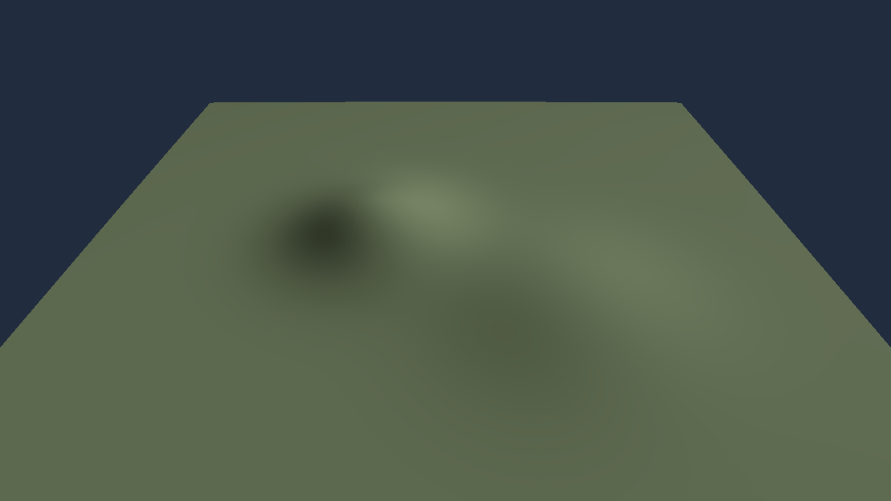

Normal-stencil screenshot A/B on this smooth fixture (same code at `015aabd`,
isolated reference worktree changes only the stencil back to fourth order):
mean absolute RGB difference 0.00174/255, p99 0, max 2; 4,272 of 921,600 pixels
change. [Fourth-order reference](artifacts/owned-terrain-fourth-order-reference.png)
and [difference ×16](artifacts/owned-terrain-normal-diff-x16.png).
This near-equality does not excuse the cliff ringing: the quantized step GPU
test, not this smooth screenshot, establishes that regression. These A/B
captures do not establish an FPS gain; ordinary camera frames do not rerun
geometry and timing variance must not be attributed to the normal stencil.

Three later alternating runs per stencil, 100 dirty-publication samples per
run after 30 warm-up iterations (same 64-page fixture):

| Dirty upload + geometry + completion | Fourth-order median of run medians | Secant median of run medians |
| --- | ---: | ---: |
| 1 page | 0.044 ms | 0.044 ms |
| 64 pages | 0.507 ms | 0.441 ms |

The 64-page result is ~13% lower in this sample, but ranges overlap
(0.450–0.560 ms vs 0.436–0.544 ms). Do not extrapolate to game FPS or claim
a stable universal speedup. Static-frame medians of run medians were
1.030 ms vs 1.034 ms; one reference run had a 120.791 ms p95 outlier.
[Raw measurements](artifacts/owned-terrain-normal-ab.json) retain that outlier.

Previous checkpoint verification: workspace fmt and all-target/all-feature clippy,
workspace lib/bin and integration tests, then all 25 Bevy-CBT ignored GPU
tests passed (1,770 successful tests across these invocations). Own backend,
quantized cliff/LOD, dirty update, pixel/culling, view and slab regressions
are included. The embedded-server cleanup fixture now keeps PID scratch in
the crate's `target/test-tmp`, exposes shell stderr and allows 250 ms rather
than 25 ms for the timeout fixture to start under parallel load; child-exit
and reap assertions remain intact. No production server behavior changed.

Measured on Radeon 880M / RADV, release `batch_slab`, synchronous end-to-end
packing/upload/dispatch/readback (2026-10-15, one run):

| Rays × boxes | Persistent pool | Scalar CPU | GPU end-to-end |
| --- | ---: | ---: | ---: |
| 4096 × 256 | 33,693,712 B | 7.46 ms | 3.94 ms |
| 16384 × 256 | 134,750,224 B | 25.30 ms | 15.89 ms |

For 4,194,304 pairs the old six pair-sized buffers used 402,653,184 B;
the new pool is 128.51 MiB instead of 384 MiB (~66.5% reduction). These
are batch query timings, **not** game FPS or a before/after latency claim.
Regression tests cover device-limit planning, non-power-of-two tails,
changing/shrinking batch shapes, unaligned rows and astronomical camera
translation invariance.

### Canonical material/presentation slice (2026-10-15)

`rcbt-core::material_page` now owns the immutable `CbtMaterialPage` payload
and `MaterialPages` source map; `material_cache` owns the existing slot policy,
ancestor mapping and world-addressed directory. Bevy re-exports the old paths
and `CbtRenderMaterialPages::source_pages()` borrows the exact neutral snapshot,
without repacking/cloning pixels. `lighting::SurfaceLighting` owns the shared
seven-vec4 direct-light prefix, with finite/nonnegative/unit-direction checks.

`TerrainRenderer::with_material_capacity` explicitly bounds raw texture-array
residency; `update_materials` consumes independent demand and immutable source
generations. Resident ancestors are protected first under exhaustion; layers
stay stable across priority changes; warm revisits do not reupload; changed
generations upload only dirty pages. Removed/stale sources disappear from the
GPU directory before sampling. Fixed-capacity directory hashing uses the bound
array's actual length (padding a smaller hash table would be incorrect).
Invalid cube IDs/incomplete mip chains fail before any publication. The raw
backend requires all eight mips; compact microstore upload is **not ported**.
Default construction reserves one material layer; callers choose larger budgets
explicitly. `update_lighting` validates then uploads direct illumination without
turning on ocean/cloud/city/RT effects. Material upload counters expose page,
byte and currently published resident counts.

`apps/terrain-native` is a GPL migration viewer with **no Bevy runtime
dependency**. It reuses `canonical_launch_setup` (source-checked frozen erosion
and the game's HIGHLANDS bookmark), the real bounded LOD selector, quantized
height builder, material builder and ancestor pages. The initial material slice
baked one static resident partition; the live-streaming continuation below
replaces that startup snapshot. Ephemeris-derived directions/irradiance and the
existing atmosphere blackbody/inverse-square helpers supply up to three stars
at EPOCH; the terrain axes match the launch survey. There is no fixed fake sun.
Atmospheric transport/eclipses are not represented in this slice. Manual EV100
and vsync flow through `RequestedGraphics -> ResolvedGraphicsSettings`; the
viewer explicitly warns that other graphics settings/effects are unported.

The same scene drives offscreen readback and a winit-owned native surface:
compatible-adapter selection, sRGB format negotiation, resize/depth recreation,
zero-size suspension, surface-lost recreation, outdated/suboptimal recovery,
timeout/occlusion skips, close and basic keyboard orbit/zoom. There is no CPU
frame copy/blit, CPU mesh or Bevy render world. The later egui checkpoint below
extends this shell; it does not replace the complete production client.

```sh
cargo run --release -p thessa-terrain-native
cargo run --release -p thessa-terrain-native -- --headless terrain.png --frames 120
```

Window controls: Left/Right orbit; Up/Down zoom; Esc exit. `--frames N` bounds
either mode for smoke runs. `--graphics PATH` selects settings (default
`graphics.toml` from the working directory). Only manual exposure and vsync are
currently consumed. This path intentionally does not claim HDR/tonemapping,
auto-exposure, atmosphere/clouds/ocean/shadows, RT, ships, HUD/UI, networking,
moving-body parity with `thessa-client`.
The screenshot is coarse and lacks the game's effect stack: it demonstrates
canonical page/material transport, **not visual acceptance or client parity**.

Historical static-slice measurement (not the current live workload): Radeon
880M / RADV, 1280×720, 64 canonical height tiles, 85 material pages
(7,427,300 payload bytes across eight mips), 48,384 drawn triangles, 120 measured
frames after 30 warm-up frames: 1.291 ms median / 1.651 ms p95 in one run
(774.7 reciprocal median offscreen frames/s). Timing is camera upload +
classification + raster + GPU completion, **not GPU-only timing**; excludes
startup (2.03 s canonical CPU bake), initial material publication and screenshot
readback. A native Wayland smoke run presented 120 frames in 1.286 s (93.3
presentation requests/s, including compositor/presentation pacing; individual
display feedback was not measured). Neither number
is game FPS, a Bevy comparison, or an improvement over the different synthetic
fixture above.

[Raw capture metadata](artifacts/owned-canonical-terrain-2026-10-15.json) records
the timing boundary and screenshot digest.

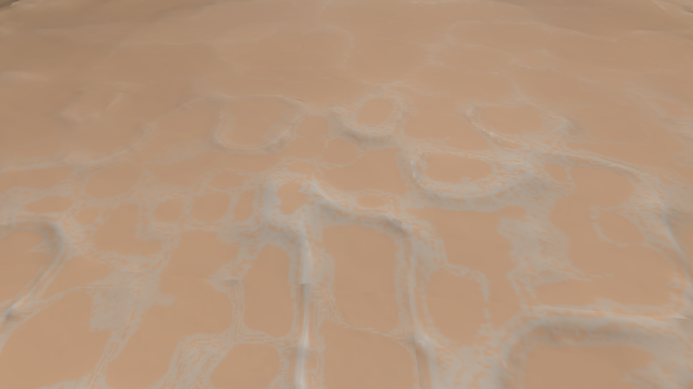

Regression coverage includes raw material pixel changes and ancestor fallback,
unchanged-generation zero uploads, dirty reupload, atomic invalid publication,
removal back to fallback, coarse-first exhaustion, warm reuse, stale-generation
masking, fixed directory hashing, shared linear-light mip parity and checked
orbit camera uniforms. The original Bevy material/microstore consumers use the
same payload via re-exports; they have not been removed or silently disabled.

Historical verification for the material slice: workspace fmt, all-target/all-feature clippy,
workspace lib/bin and integration tests, plus the separate Bevy-CBT `render`
ignored-test invocation all passed (1,775 successful tests across these runs;
24 hardware tests in that final invocation). Native material/raster hardware
regressions ran as ordinary tests. The normal runtime dependency tree for
`thessa-terrain-native` contains no Bevy crates. The canonical offscreen capture
and 120-frame native Wayland smoke run also completed successfully.

### Live terrain streaming continuation (2026-10-15)

`crates/terrain-stream` (GPL game code, no renderer/ECS dependencies) now owns
the extracted two-tier selector, motion trigger/debounce, velocity bias,
fine-selection hysteresis, complete-cover construction, ancestor dependencies,
height priority, material refinement/dependency/priority rules, capacity-one
mailboxes and Rayon executor. **Both** `thessa-client` and the native viewer
consume those policies/executor. The existing `worldgen-rocky::streaming`
resident-cover and deterministic LRU functions remain the shared cover policy.
No selector or terrain scheduler lives in the native application's scene code.
The Bevy client still owns its mesh fallback, cache/assets, topology-planning
and resource-publication glue; complete `WorldTerrain` lifecycle extraction is
not finished. The new renderer-free runtime does not yet replace that glue.

The native runtime synchronously bootstraps six height/material roots, then
polls at most eight height and four material builds without waiting for them.
Only quantized heights are built for GPU geometry, not CPU meshes. Camera-only
frames poll bounded mailboxes without rebuilding dependencies/LRU priorities.
Coverage uses ready families or cached ancestors/previous finer cover while
replacements load. Height-cache admission counts both residents and in-flight
results against 1,024 entries and protects the drawn cover and bootstrap roots.
If exhausted, refinement stalls and is counted rather than evicting drawn
pages or allocating without bounds. Material sources retain at most 1,024 pages
after each tick (up to four completed pages transiently before eviction).
Material generations are monotonic across rebuild/eviction; material refinement
is independent of matching height keys. The old client's material completion
path no longer discards finer pages just because no height page shares the key;
its existing source-budget trimming still applies. The GPU array reserves at most 256 raw
layers, with the shared coarse-ancestor-first fallback under exhaustion.
These are diagnostic viewer budgets, not newly supported `graphics.toml`
quality tiers or a replacement for production graphics capability resolution.

`TerrainRenderer::with_capacity` reserves a fixed geometry/page pool;
`publish_partition` validates IDs/ancestor overlap, frames, radii, duplicates,
capacity and assigned height-slot sizes **before** mutation. It reuses the
existing core `SlotCache`, retaining slots across reorder, reclaiming removed
slots, zeroing inactive metadata and invalidating history on dirty/reused slots.
Only dirty/new slots regenerate geometry; pipelines and buffers stay alive.
Sparse interior holes and an empty partition cannot retain old indirect draws.
Source generations identify unchanged bytes; direct `update_pages` invalidates
that shortcut. `update_pages` and `update_view` now take mutable renderer access
because they maintain publication/camera state. Initial construction still
requires at least one patch; subsequent partitions may be empty.

Headless `--prestream-seconds N` (default 3) controls excluded initial streaming;
it is a time budget, **not** a convergence guarantee. `--sweep` advances the
diagnostic orbit by 0.006 rad per frame (including 30 excluded warm-up frames).
Both options require headless mode. Measurement includes selection, mailbox
polling, publication/dirty uploads, camera upload, classify/raster and GPU
completion; p50/p95/p99/max are reported, with CPU streaming timings separately.
Screenshot readback,
CPU/bootstrap/GPU setup, pre-stream and warm-up are excluded. This is neither
GPU-only timing nor game FPS, and asynchronous completion changes capture
residency between runs. Publication/regeneration counts, upload bytes (excluding
the six initial material pages), cache sizes, pending work and capacity refusals
are printed cumulatively since bootstrap (including pre-stream/warm-up), with
measured-window selection/publication counts separately. A moving camera sweep
is not a moving-body/networked-game test.
The window's stream clock survives surface suspension/recreation with its
selection history; a recreated surface must not reset selection debounce time.

Regression coverage adds out-of-order family completion, capacity refusal,
hard height-cache admission, extracted-selector equivalence/debounce, material
refinement area/budget, and hardware slot reorder/reclamation, dirty-only work,
invalid-publication atomicity, sparse/empty draw removal and source-generation
invalidation after direct page edits.

Sequential release captures on Radeon 880M / RADV (1280×720, 10 s pre-stream,
30 warm-up + 1,200 measured frames each):

| Workload | Median | p95 | p99 | Maximum | Final geometry |
|---|---:|---:|---:|---:|---|
| Stationary camera, live material stream | 2.740 ms | 4.907 ms | 8.683 ms | 24.217 ms | 287 tiles, 297,216 drawn triangles |
| Moving camera, live height/material stream | 2.563 ms | 3.717 ms | 9.203 ms | 14.151 ms | 292 tiles, 313,344 drawn triangles |

The sweep published 75 geometry partitions during measurement (132 including
pre-stream/warm-up), with 1,180 regenerated patches total and no capacity
refusals. Its CPU streaming p95/p99/max were 1.077/6.371/11.046 ms; stationary
CPU max was 16.062 ms. Selection/publication hitches remain work to do, not
something the median hides. Material work was still pending at capture end.
The window smoke requested 600 presentations in 5.074 s (118.3/s including
compositor pacing, vsync requested off); display feedback was not measured.
These are not game FPS or a performance comparison against the earlier
64-tile snapshot/Bevy/large_cbt: workload and rendered detail differ.

[Capture metadata](artifacts/owned-streaming-terrain-2026-10-15.json) includes
source/binary identity, timing boundaries, counters and screenshot digests.
[Sweep frame](artifacts/owned-streaming-sweep-2026-10-15.png). Shading and thin
dark edge artifacts at sharp relief remain unaccepted; effects are still absent.

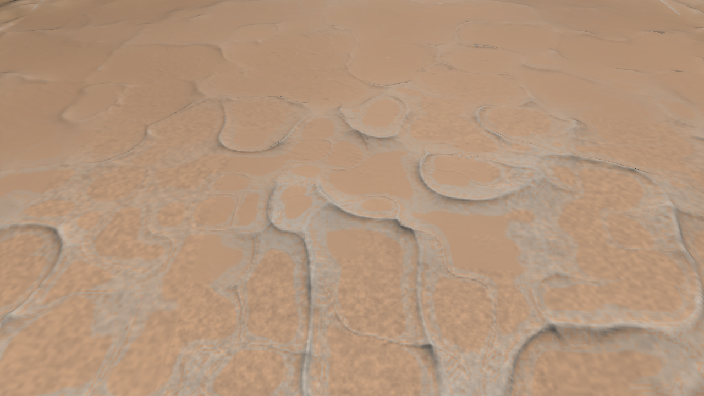

Verification: workspace fmt; all-target/all-feature clippy with Rust warnings
denied; 1,715 workspace lib/bin + 43 integration + 24 separate Bevy-CBT ignored
hardware tests passed (1,782 total). Owned slot/raster regressions run as ordinary
hardware tests. Runtime dependency inspection still finds no Bevy in the native
viewer. Headless stationary/sweep captures and the native window smoke passed.

Next production boundary: move the remaining `WorldTerrain` cache/publication
glue onto the shared lifecycle, port f64 moving-body/camera transforms and the
actual scene/effect passes. Keep the old client runnable; remove each Bevy
consumer only after its production replacement works. GPU conforming bisector
split/merge topology and FastRT acceleration structures remain unimplemented.

### egui shell checkpoint (2026-10-15)

The selected UI integration is **winit + egui**, superseding the GPUI proposal.
egui, egui-wgpu and egui-winit 0.37 are MIT OR Apache-2.0 and already use the
workspace's wgpu 30 line. The HUD embeds the game's existing OFL-1.1 Noto Sans
asset (egui 0.37 has empty default features); Latin/Cyrillic/digit glyph coverage
is regression-tested to prevent a silently text-less/tofu HUD.
Slint is not introduced; neither is a GPUI backend
fork, a renderer downgrade or another logical device. Existing game-specific
application/streaming crates retain GPL-3.0-or-later; reusable engine crates
retain MIT. This decision does not relicense existing code.

`apps/terrain-native` enables its optional `hud` feature by default. The window
requests system/toolkit window decorations (appearance follows compositor policy),
while egui-winit handles widget input, pointer cursor,
clipboard, IME output and native scale-factor conversion. Camera shortcuts are
suppressed when egui consumes the keyboard event; lifecycle/resize/redraw events
still reach the window handler. This is a single-window integration, not a
general multi-viewport desktop framework.
Window/HUD state is released in winit's `exiting` callback, before the consumed
event loop destroys its native display; egui-winit's clipboard must not outlive
the display handle it borrows. Suspension also drops/recreates this state.

The HUD reports residency, pending work, publications, regeneration, material
upload bytes from post-construction updates, capacity refusals and host frame
wall time (including waits, not GPU timing or game FPS). It provides
orbit/distance/reset controls and session-only
manual EV100/VSync edits. Graphics edits update `RequestedGraphics`, resolve
against the existing backend capabilities, then update exposure/presentation.
VSync reconfiguration is deferred until the acquired surface frame is presented.
The source `graphics.toml` is never rewritten.

GPU composition uses the **same device, queue, command encoder and final color
target** as terrain. The HUD pass uses `LoadOp::Load`, alpha blending and no
depth attachment. There is no scene texture import, intermediate scene copy,
GPU-to-CPU readback or second device. egui still builds/tessellates UI on the CPU
and uploads its own mesh/font resources; this is not a claim of zero CPU work
or zero upload. The sRGB surface path uses egui's sRGB-aware output shader.

```sh
cargo run --release -p thessa-terrain-native
cargo run --release -p thessa-terrain-native -- --no-hud --frames 600
cargo run --release -p thessa-terrain-native -- --headless terrain-hud.png --hud --frames 600
cargo run --release -p thessa-terrain-native --no-default-features
```

`--no-hud` does not create egui CPU/GPU state or run a UI pass;
`--no-default-features` also removes the UI dependencies. Headless mode remains
terrain-only by default to preserve its benchmark boundary; explicit `--hud`
includes UI construction/upload/drawing in frame latency and the capture.
Readback is confined to captures/tests and excluded from measured frames.

Regression coverage includes passive-widget camera preservation (unbounded
keyboard orbit must not be clamped by a slider), pointer capture, and an ignored
hardware test for preserving scene pixels outside the HUD across target resize,
1.0/1.5 native scaling and complete HUD recreation. Run that hardware test with
`cargo test -p thessa-terrain-native -- --ignored` on the development GPU.
The same command runs a native-display regression that launches both HUD and
terrain-only windows and requires clean process exit, covering the clipboard
display-lifetime failure found by the Wayland smoke run. CI without a display
leaves that explicitly ignored test disabled.
This is a migration HUD, not production flight/menu/editor UI or visual parity.

Verification: workspace fmt; all-target/all-feature workspace clippy and
no-default-feature viewer clippy with warnings denied; 1,717 workspace lib/bin,
43 integration, 24 existing ignored Bevy-CBT GPU and two new ignored viewer
GPU/native-display tests passed (1,786 successful tests). The runtime dependency
graph contains one wgpu version (30.0.1), no Bevy and no toolkit default font
bundle. All 33 newly resolved Rust packages offer permissive license choices.

Final stationary A/B/B/A observations on Radeon 880M, 1280×720, 600 measured +
30 warm-up frames per run and 10 seconds of pre-stream: terrain-only medians
**2.526 / 2.661 ms**, HUD medians **2.618 / 2.757 ms**. Each ended with 287 tiles,
297,216 drawn triangles and zero measured geometry publications/refusals.
Material jobs remain asynchronous and clocks/scheduling are not locked, so this
is not an isolated constant-overhead estimate or a game-FPS claim. The resized
native Wayland run requested 1,200 presentations in 10.058 seconds (119.3
requests/s), captured the owned window at 1188×813 physical pixels and exited
cleanly. Compositor/resize/capture work is included; displayed-frame feedback is
not measured.

[Raw measurements, counters and limitations](artifacts/owned-egui-hud-2026-10-15.json)
and [native window capture](artifacts/owned-egui-window-2026-10-15.png).

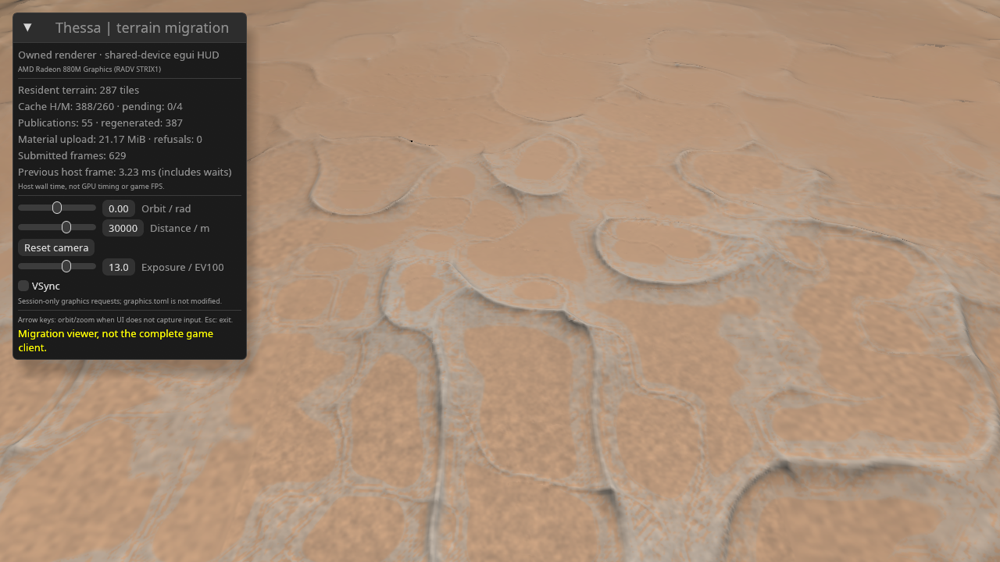

### Shared material lifecycle continuation (2026-10-15)

The next isolated slice (`feat/terrain-material-lifecycle`, based on the egui
checkpoint) removes duplicated material ownership from the two hosts:

- MIT `rcbt-core::material_source::MaterialPageStore` owns the immutable
  `Arc<MaterialPages>` directory, per-page identities, publication revision,
  ordered source priority and hierarchical budget trimming. Completed batches
  COW the directory once; mip payloads remain shared. Empty batches, unchanged
  priorities, missing removals and satisfied budgets preserve revision/directory.
  Removal and reinsertion cannot reuse a page generation. Revision exhaustion
  is rejected before mutation, not saturated into an aliased dirty identity.
- GPL `terrain-stream::material::MaterialStream` owns nonblocking completion
  polling, refined material demand, regional-ancestor build dependencies,
  deduplication, job admission and source-cache policy. Both `WorldTerrain`
  and the native `TerrainStream` use this implementation. Geometry remains
  independent: no matching height tile is required to accept a material result.
- The existing 512-demand/refinement and level-17 caps remain. The material job
  limit is four, reduced to two for new admissions while at least four height
  jobs are pending; existing jobs are not canceled when pressure changes.
  Hosts retain the 1024-page default source budget. Polling can transiently add
  up to four completed pages; reconcile trims before publication. Budget zero
  starts no jobs. Selection epochs follow the host's accepted/debounced view;
  changing pixel angle also invalidates refinement (including stationary resize).
- Worker disconnection frees the job slot, reports a failure count and permits
  current demand to retry without failing the native frame. Both hosts log it.
- Bevy's `CbtRenderMaterialPages` is now only a resource/publication wrapper.
  A revision check through a **shared** `ResMut` borrow occurs before mutable
  dereference; unchanged frames do not set Bevy's change flag. Render extraction
  shares the directory. The compact microstore still owns its derived decoded
  shadow representation, preserving source generations and encoding only dirty
  pages; it is not moved into the game lifecycle.
- Height-cache eviction no longer pins height entries merely for material jobs
  or deletes material pages sharing the same tile ID. The independent material
  budget/hierarchy decides material eviction; CPU fallback asset removal and
  height publication remain in their existing Bevy bridge.

The producer/store lifetime must span a renderer cache lifetime: source
revisions are local monotonic identities, not globally unique across unrelated
stores. Resetting a source owner requires resetting its renderer consumer too.
No new dependency, unsafe code, GPU device, readback or intermediate scene
target is introduced. The canonical field, material bytes, WGSL, graphics
settings and same-target egui composition are unchanged. This closes the
**material lifecycle slice**, not all `WorldTerrain` ownership or the production
Bevy migration. Remaining work includes height-cache/asset/ECS lifecycle,
moving bodies, full scenes/effects and the production client/UI lifecycle.

Regression coverage includes COW/no-op snapshots, monotonic reinsertion,
bounded hierarchy trimming, revision exhaustion, regional-to-exact scheduling,
job pressure/deduplication, disconnected-worker retry, receiver teardown,
pixel-scale invalidation, geometry-independent residency, Bevy change flags,
compact shadow reuse, and actual GPU dirty/reinsert/fallback raster output.
`cargo bench -p thessa-rcbt-core --bench material_source` measures source-only
snapshot/dirty-batch work at 1024 sources and 512 priorities; it is not a
whole-renderer or game-FPS benchmark.

Final verification: fmt and all-target/all-feature workspace clippy with Rust
warnings denied, no-default-feature viewer clippy, **1,728** workspace lib/bin +
**43** integration + **24** Bevy-CBT ignored GPU + **2** viewer GPU/native-exit
tests passed (**1,797** total). No dependencies or licenses changed; the native
runtime still contains one wgpu version and no Bevy. Local diff/ownership review
confirmed a single material writer per host and a thin Bevy publication boundary.

Radeon 880M stationary A/B/B/A, HUD enabled, 1280×720, 600 measured + 30 warm-up
frames and 10 seconds pre-stream per run: old release medians **2.540 / 2.491 ms**,
new release **2.489 / 2.563 ms**. All runs ended with 287 tiles, 297,216 triangles
and no measured geometry publication or capacity refusal. Material work remains
asynchronous and clocks/scheduling are not locked; this is not an isolated
speedup/overhead estimate. The sweep exercised 50 measured geometry publications
without refusal. The native Wayland window requested 1,200 presentations in
10.232 seconds and exited cleanly (117.3 requests/s, not displayed/game FPS).

The source-only microbenchmark uses 1024 independently allocated synthetic
material pages and 512 priorities. Median clone/drop cost including the priority
Vec was **60 ns**, satisfied-budget check **20 ns** (timer-floor scale), a
four-page COW update **14.277 µs**, and four removals/reinsertions with a retained
snapshot **14.416 µs**. Page construction and all renderer work are excluded;
these measurements are metadata costs, not end-to-end performance claims.

[Raw measurements and validation](artifacts/owned-material-lifecycle-2026-10-15.json),
[stationary capture](artifacts/owned-material-lifecycle-2026-10-15.png), and
[sweep capture](artifacts/owned-material-lifecycle-sweep-2026-10-15.png).
Captures retain the existing unaccepted terrain shading/dark-relief artifacts;
this slice does not claim visual parity or fix them.

### Shared height lifecycle continuation (2026-10-15)

`feat/terrain-height-lifecycle` continues from the material-lifecycle checkpoint.
Both hosts now use the same renderer-free height lifecycle instead of owning
parallel job maps, residency/LRU records and admission/eviction code:

- MIT `rcbt-core::height_source::HeightPageStore` owns a COW directory of
  immutable `Arc<HeightPage>` payloads and local monotonic source revisions.
  Content-equal publication is a no-op; a completed batch copies the directory
  at most once and shares unchanged residual vectors. A changed page or an
  eviction/reinsertion receives a fresh producer revision (not a per-ID version
  reset to one). Revision exhaustion rejects the source batch before mutation.
  Resetting a producer requires resetting its renderer consumer.
- GPL `terrain-stream::height::HeightStream<Resident, Built>` owns height jobs,
  residency, LRU epochs, source publication and bounded admission. Built/resident
  payloads are opaque generic values: the shared code names no Bevy, wgpu, asset,
  entity or mesh types. Native payloads are `()`; the old client's host callback
  converts CPU-built meshes/images into its existing asset handles.
- Inputs are the accepted tile demand, current drawn cover, selection epoch,
  `SelectionView`, existing canonical field and explicit `HeightPolicy`.
  Outputs are completed/failing job counts, dirty tile identities, admission
  pressure and moved retired payloads. Retirements include **replacements** as
  well as LRU evictions; the host releases each returned asset bundle once.
- The current GPU page builder is shared too: unchanged 33x33 canonical field
  samples and 0.5 m absolute quantization budget. CPU fallback mesh/material
  builders remain in the Bevy host; GPU jobs still do not build these assets.
- Policy preserves eight in-flight jobs, 1024 GPU/native cache entries and
  512 CPU-fallback entries. Admission now counts **resident + pending** results
  for both clients; it evicts cold pages before spawning, rather than allowing
  the old client's pending jobs to overrun its cache after completion. The drawn
  cover, demand dependencies and pending jobs are protected. The native six-root
  bootstrap stays pinned; the old client keeps its existing backdrop/bootstrap
  policy. Protected over-budget state is retained/reported, never turned into
  holes to satisfy a smaller budget. Protected resident pages may temporarily
  prevent further refinement until capacity is available. Native counters report
  refusals; the old host logs entry into capacity pressure without per-frame spam.
- Nonblocking polling drains every ready mailbox even if another build failed
  or disconnected. Failed slots are released, logged/reported and retryable;
  the native frame no longer fails merely because one worker disconnected.
- Bevy's `CbtRenderPages` now only publishes/extracts the neutral snapshot.
  The shared `ResMut` revision check precedes mutation, avoiding extraction on
  clean frames. Asset creation/removal stays in `present_cpu_tile` and
  `release_height_assets`; LRU/admission no longer names `Assets` or `Handle`.
  The former poll/upload perf scopes are combined as
  `world.terrain_job_poll_and_asset_upload`; spawn scope includes admission/LRU
  and host retirement. Counter budgets remain cache entries, not byte limits.
- Native publication also notices changed **visible page content** when the
  cover's tile IDs did not change, rather than waiting for another LOD switch.
  Page versions still prevent unchanged geometry from regenerating on the GPU.

The height source is the sole owner of residual vectors. A separate small
TileKey map tracks LRU/opaque host payloads; the native path now pays that extra
metadata/map/Arc overhead to share immutable extraction snapshots, not a second
copy of every height vector. No new dependency, unsafe code, logical GPU device,
scene readback or intermediate render target is introduced. Material residency,
physics, canonical generation, WGSL and shared-target egui composition are
unchanged. The old client remains supported and runnable.

This closes the **height source/cache/job/admission/retirement slice**, not the
entire Bevy migration. `WorldTerrain` still integrates selection/topology and
camera/ECS presentation; CPU fallback asset construction, global client/window
lifecycle, moving bodies, production game assets/effects/UI/networking and
FastRT acceleration structures remain outside this slice.

Regression coverage includes COW/content no-ops, monotonic reinsertion, revision
exhaustion, mixed success/failure batches, bounded admission including pending
results, protected-cover pressure, root pinning, deterministic LRU, one-time
replacement/eviction retirement, receiver teardown, invalid-address rejection
before asset conversion, real Bevy asset retirement, unchanged Bevy change
flags, same-cover height edits and GPU regeneration from source revisions.
The source-only benchmark is
`cargo bench -p thessa-rcbt-core --bench height_source` (1024 33x33 pages).

Final verification: workspace fmt and all-target/all-feature clippy with Rust
warnings denied, no-default-feature viewer clippy, **1,739** workspace lib/bin +
**44** integration + **24** Bevy-CBT ignored GPU + **2** viewer GPU/native-exit
tests passed (**1,809** total). The native runtime still contains no Bevy and
one wgpu version (30.0.1); no dependency/license changed.

Radeon 880M stationary A/B/B/A with HUD, 1280×720, 600 measured + 30 warm-up
frames and 10 seconds pre-stream: old medians **2.701 / 2.560 ms**, new
**2.789 / 2.611 ms**. Geometry matched (287 tiles, 297,216 triangles, no measured
geometry publications/refusals). New medians were slightly higher; asynchronous
material work and unlocked clocks/scheduling prevent isolating migration
overhead or claiming a speedup. Stream CPU medians were 1 µs old / 2–3 µs new.
The sweep exercised 55 measured geometry publications without refusal, retaining
coarse coverage while its final six height jobs were pending. The native window
requested 1,200 presentations in 10.250 seconds and exited cleanly (117.1
requests/s; not displayed-frame feedback or game FPS).

Source benchmark medians: shared snapshot **40 ns**, eight equal completions
**371 ns**, eight dirty completions with a retained snapshot **16.150 µs**, and
eight evictions/reinsertions **17.012 µs**. Fixtures contain 1024 independently
owned 33x33 residual vectors (~2.23 MB). Baking and per-sample fixture cloning
are outside the timed region; dirty samples include directory COW and old
snapshot release. These are source-publication costs, not full lifecycle/GPU
or whole-renderer performance estimates.

[Raw measurements/validation](artifacts/owned-height-lifecycle-2026-10-15.json),
[stationary capture](artifacts/owned-height-lifecycle-2026-10-15.png), and
[sweep capture](artifacts/owned-height-lifecycle-sweep-2026-10-15.png).
Existing terrain shading/blur/dark-relief artifacts remain unaccepted.

### Body/camera frame continuation (2026-10-16)

`feat/body-camera-frames` continues from `5a1c01e` (height lifecycle).

**Ownership and API.** MIT `thessa-render-core` owns only reusable presentation
geometry: `BodyFrame` and `ViewParams`, with glam as its only dependency and
unsafe forbidden. It does not own simulation state, celestial attitudes,
projection policy, wall time, assets, ECS, Bevy, wgpu or a GPU device. The old
`render-wgpu::view::ViewParams` path re-exports the neutral type; the existing
464-byte WGSL uniform ABI remains in the wgpu consumer without layout changes.
No GPL code/content is moved into MIT. The pre-existing flight period selection
is shared in GPL `flight-authority::presentation`; it retains the exact period
preference (explicit rotation period, tidally locked design period, otherwise
80 hours) and x/z/-y axes.

`BodyFrame::new(body_position_m, body_to_world, render_origin_m)` validates finite
positions, subtraction and a unit quaternion (squared-length tolerance 1e-12).
It subtracts the body and render origin in f64 **before** rotation/narrowing.
Point mapping includes translation; direction mapping does not.
`view_in_body` maps an origin-local render camera into the body's coordinates,
preserving projection/exposure. Inputs must use the same presentation sample;
an absolute astronomical camera must not be passed as an origin-local camera.
The wgpu consumer still validates affine/invertible/finite camera/projection
matrices and compatible camera origins before uploading anything.

**Both hosts.** Bevy terrain now uses this frame for CPU tile placement, GPU
body-transform publication, clearance mapping, and camera/forward/stream-origin
selection. Bevy `Transform` is still a local presentation consumer, never an
authoritative astronomical position. Reading the final camera now happens
**after** clearance edits, fixing the previous pilot path's pre-clamp selection
eye. The controller, survey UI, interpolation owner and ECS scheduling remain
in the old host; this slice does not claim to have ported them.

The native viewer keeps its existing body-attached orbit camera. Its render
camera is expressed relative to the reference body's current origin, using a
sample of baked translation and the same uniform terrain spin as flight.
Camera/selection and stellar directions are transformed through the same body
frame; light displacement/distance uses ephemerides sampled at the same time.
The absolute camera is never formed by adding a metre-scale offset to the
astronomical body position. Changed sample lighting is uploaded through the
existing direct-light buffer only; unchanged times do no ephemeris/light work.
A failed sample preserves the prior complete pose/lighting. Body motion alone
does not dirty height pages or regenerate geometry.

**Presentation controls, not a second simulation clock.** Defaults still use
`SimTime::EPOCH`. `--sim-time SECONDS` selects a frozen sample in either host
mode. Headless `--sim-step SECONDS_PER_FRAME` adds a deterministic time offset
per rendered frame, including the 30 excluded warm-up frames. Pre-stream uses
the initial sample. Signed time/steps are allowed for diagnostic rewind; all
sample times must be finite. Streaming debounce still uses host elapsed time;
it is not physics time. No wall-time-driven physics, server warp policy or
authoritative state changes are introduced. The HUD and final headless log
report presentation time; logs also report the body's inertial position.

```sh
# Frozen later pose with the normal window/HUD:
cargo run --release -p thessa-terrain-native -- --sim-time 72000
# Sample baked motion/lighting across the run, keeping the camera body-attached:
cargo run --release -p thessa-terrain-native -- --headless moving-body.png --hud --frames 600 --prestream-seconds 10 --sim-step 120
```

**Numerical boundary.** This does not recover detail already lost in absolute
input coordinates: at 2e12 m a binary64 component has ~0.244 mm ULP. Common
translations at the canonical ~4.82e12 m body position have ~0.977 mm component
ULP; the same origin-attached policy avoids adding camera offsets there. Common
translations with representable offsets cancel exactly in the core regression;
the native body-attached origin avoids absolute offset addition altogether.
Moving-frame tests pin round-trip camera error below 4 nm around a 3.2 Mm body
for normal composed unit rotations. The maximum accepted quaternion length
error can contribute micrometre-scale error at that radius; it is not a global
nanometre guarantee. Final GPU geometry still uses the existing f64 tile-camera
subtraction and hi/lo f32 transport; existing height quantization is unchanged.

**Scope limits.** The attitude is the flight runtime's existing **uniform-spin
approximation**, not a new exact tidal-lock/libration, axial-tilt, pole-precession
or prime-meridian model. Gravity harmonics retain their separate existing frame.
Direct terrain lighting still omits eclipses, atmosphere and shadows. The
sampled body is a frame/light source, not a newly rendered planet object.
Multiple moving scene objects, authoritative interpolation/networking, flight
camera/controller migration, game assets/effects/UI, device recovery and FastRT
acceleration structures remain unfinished. No additional device, scene readback
or intermediate color target is introduced; captures/tests alone read back.
The old survey's local orbit offsets and ECS camera rotation are still f32;
this is extraction of their body/rebase boundary, not replacement of every
camera calculation with f64.

The live-flight continuation below supersedes this checkpoint's local moving-
vehicle limitation; native networking and production controller migration
remain open.

Regression coverage includes a hand-computable quarter-turn, representable
astronomical common translations, 100 moving-origin/rotation camera round trips,
invalid/overflow poses and the tolerated quaternion-roundoff envelope; period
precedence and axis handedness; final post-clearance Bevy camera selection;
time-consistent canonical pose/lights and failed/unchanged sample handling; and
CLI finite-time/headless validation. A real GPU fixture compares identical
non-clear raster output across eight moving-body/origin samples, verifies the
draw count and unchanged vertex buffer, and checks that the same height
partition regenerates zero patches. A native GPU regression isolates pose/light
publication, verifies a changed lit image, and checks unchanged height geometry.
Full-loop sampled motion is additionally exercised by the captures below.

The reusable transform benchmark is
`cargo bench -p thessa-render-core --bench frames`: 1024 point transforms versus
direct quaternion/translation arithmetic, plus one origin-local camera mapping.
It excludes ephemeris/stellar sampling, selection/streaming, GPU transfers and
rendering; compiler barriers and the timer are part of the harness.

Final gates passed: fmt, workspace all-target/all-feature clippy with Rust
warnings denied, no-default-feature viewer clippy, **1,748** workspace lib/bin +
**47** integration + **24** Bevy-CBT hardware + **3** native GPU/window tests
(**1,822** successful tests). The native runtime contains no Bevy and still has
one wgpu version (30.0.1). No external dependency, unsafe code, device or render
target was added; the new internal core crate is MIT and depends only on glam.

Radeon 880M stationary A/B/B/A with HUD, 1280×720, 600 measured + 30 warm-up
frames, 10 seconds pre-stream: old medians **2.577 / 2.547 ms**, new
**2.633 / 2.640 ms**. All ended at 287 tiles / 297,216 triangles with zero
measured geometry publications/refusals. New medians were higher; the HUD gained
a telemetry row, and material scheduling/clocks differ, so these runs neither
isolate mapping overhead nor establish a speedup. Microbenchmark medians were
**2.685 µs** for 1024 shared point transforms (direct arithmetic **3.477 µs**)
and **30 ns** for one camera mapping. Compiler-barrier shapes differ; the short
camera sample is near timer-floor scale, not proof of universally free adapters.

With `--sim-step 120`, the complete native loop sampled body motion through
**75,480 s** while keeping the body-attached 287-tile cover and doing **zero**
measured geometry publications; illumination changed with the sample. The
combined camera sweep/rewind (`--sim-time 72000 --sim-step -60 --sweep`) exercised
**55** measured publications with no refusal and ended at 34,260 s. A later-pose
native Wayland window requested 1,200 presentations in 10.793 seconds and exited
0 (**111.2 requests/s**, not displayed frames or game FPS).

The old Bevy client was also built and launched in surface-survey mode with its
existing unattended screenshot/exit path (`THESSA_AUTOBENCH=1`,
`THESSA_AUTOBENCH_VIEW=surface`, `THESSA_SCREENSHOT_AT_S=6`). It rendered a
COAST frame via `gpu_mesh`, saved a screenshot and exited 0. The embedded server
binary was absent, so it used the existing local-simulation fallback; ALSA/JACK
reported device diagnostics. This smoke does not validate networking/audio,
equal-scene visual quality or compare performance.

[Measurements/validation](artifacts/owned-body-camera-frames-2026-10-16.json),
[epoch capture](artifacts/owned-body-camera-frames-2026-10-16.png),
[moving-body capture](artifacts/owned-body-camera-motion-2026-10-16.png), and
[sweep/rewind capture](artifacts/owned-body-camera-sweep-2026-10-16.png).
The [legacy Bevy smoke](artifacts/owned-body-camera-bevy-smoke-2026-10-16.png)
is a separate scene/window, not a side-by-side parity comparison.
The moving sample is deliberately shown without manufactured ambient light;
its very dark direct-lit terrain is not missing coverage or a claim of complete
night-side rendering. Existing visual artifacts remain unaccepted.

### Shared static mesh/rigid-instance continuation (2026-10-16)

The next slice removes X-15 source ownership from Bevy `WorldAsset` without
replacing the old client. MIT `render-core::mesh` defines triangle vertices,
indices, material/image/texture references and rigid-instance inputs without
ECS, asset-server, GPU or game dependencies. MIT `render-assets` decodes a
bounded **embedded static GLB subset** into these descriptors. Node hierarchy
transforms are flattened once; inverse-transpose normals and mirrored winding
are preserved. Dense accessor/view ranges use checked arithmetic before reader
creation. Input file size, vertices, indices, nodes, image edges and total
decoded RGBA bytes have explicit caller-supplied limits. No URI/file/network
resolution is performed. Sparse accessors, animations/skins, extensions,
non-triangle geometry, attributes other than POSITION/NORMAL/TEXCOORD_0,
emissive and transparent
materials are not part of this subset; unsupported semantic input is rejected.
This is not a general streaming asset manager, hot reload or full glTF support.

The old pilot converts that neutral source to Bevy meshes/images/materials;
base color uses sRGB while normals/metallic-roughness/AO use linear textures.
Its bridge generates tangents and preserves double-sidedness and shared ORM/AO
images. Non-unity normal/AO strengths are explicitly rejected by that bridge
rather than silently lost. Source loading is synchronous once during startup,
not asynchronous Bevy loading. Other assets (including docking demo WorldAsset)
remain unmigrated. The original X-15 calibration and visual basis move unchanged
to GPL `flight-authority::presentation`; they are not copied into MIT libraries.
Regression inspection found the GLB's actual X extent is **17.794085 m**, not
the inherited nominal `16.77 m` source-length constant. The old `15.45/16.77`
scale remains for compatibility, yielding ~16.393 m visual extent; this slice
does not claim a corrected physical mesh calibration.

MIT `render-wgpu::mesh::MeshRenderer` uploads persistent vertex/index/albedo
buffers/textures once. A bounded instance buffer receives complete validated
pose publications, with f64 camera subtraction before f32 narrowing. Invalid
camera/light/instance/capacity updates preserve the prior GPU data and draw
count; empty publication produces no mesh pass. Each primitive is drawn with
one indexed instanced draw. `draw_stats()` and the final native log expose
submitted instances, draw calls, triangles and frame-upload bytes; existing
`drawn_triangles` still counts terrain only. The same device, queue and encoder load the terrain
color **and depth**, draw opaque meshes, then draw HUD. There is no scene
readback, intermediate scene texture or second device. An absent preview creates
no mesh GPU resources and performs no per-frame mesh work. Frame staging reuses
its CPU allocation. Device recovery, asset unloading, culling/LOD, heterogeneous
asset registries and indirect scene submission are future layers.

The native shader is deliberately only **sRGB base-color + Lambert direct/
ambient lighting**, sharing the terrain exposure and body-space stellar sample.
Normal/ORM/AO sources are retained but not uploaded/used by this shader; no
normal mapping, metallic BRDF, shadows, mip-chain generation or material-parity
claim is made. This is diagnostic basic mesh bring-up, not a new configurable
production effect. Any production material/effect extension must enter the
shared requested/resolved graphics quality pipeline before promotion.

`--vehicle-preview` loads the shipped source and samples the **existing**
`FlightAuthority::new` initial position and attitude at epoch, not a decorative
animation or second integrator. This is the constructor's north-pole
compatibility snapshot, **not** the old client's later PostStartup COAST-site
relocation (`initialize_launch_site`). Position/attitude and asset basis are mapped
through the same flight/render convention as the old pilot. The camera orbits
that snapshot at 8–180 m (reset 32 m); normal terrain-only distances are unchanged.
Nonzero presentation time/step is rejected before graphics loading. Moving
instance translation/rotation is exercised by GPU regressions, but live flight,
snapshot interpolation, input/network lifecycle and controller/UI migration
remain unfinished. Do not describe this snapshot as a complete moving-object
production consumer.

The live-flight continuation below adds a separate `--flight` mode and shared
pose/interpolation inputs without changing this frozen preview's contract.

Regressions pin the shipped geometry/image/material inventory, nested nonuniform
and mirrored node transforms, image/sampler/color-space roles, file/resource
budgets, invalid byte ranges/component types/indices and external-URI rejection.
Real GPU coverage checks exact textured pixels, retained existing color/depth,
instance translation/rotation, identical output after an astronomical common
translation, multiple/empty instances and atomic rejection. A native hardware
test draws the actual model over terrain. The exact-pole starter pose exposed
an undefined geographic east; the preview uses a finite orthonormal tangent
there, and close-camera regressions cover all orbit quadrants/distances.

```sh
cargo run --release -p thessa-terrain-native -- --vehicle-preview
cargo run --release -p thessa-terrain-native -- --vehicle-preview --headless x15.png --hud --frames 600 --prestream-seconds 10
cargo bench -p thessa-render-assets --bench decode
cargo bench -p thessa-render-wgpu --bench mesh
```

The X-15 source has two primitives, 86,214 vertices, 78,465 triangles and six
2048² source images (**96 MiB** decoded RGBA). Native uploads only the two
base-color images (**32 MiB**, one mip), plus ~3.53 MiB geometry; Bevy consumes
all six material images. The source CPU snapshot remains resident in the viewer;
source residency/retirement and mip generation are explicitly not optimized yet.
No new unsafe code or external dependency version is introduced. Decoder
dependencies are permissive; reusable libraries remain MIT and game code GPL.
The model remains **CC BY 4.0**, by **cmoreau**; attribution/source/license links
in `assets/models/north_american_x-15_plane.LICENSE.txt` must accompany distribution.

Validation gates: fmt, workspace all-target/all-feature clippy with Rust
warnings denied, no-default-feature viewer clippy, **1,753** workspace lib/bin +
**52** integration + **24** Bevy-CBT hardware + **4** native GPU/window tests
(**1,833** successful tests). The native runtime still contains no Bevy and
uses one wgpu version (30.0.1).

Radeon 880M measurements, 1280×720: terrain-only-with-HUD A/B/B/A against
`6608a48`, 600 measured + 30 warm-up frames and 10 s pre-stream per run, gave
old medians **2.582 / 2.605 ms** and new **2.558 / 2.612 ms**. Every run ended
at 287 tiles / 297,216 terrain triangles with zero measured geometry
publications/refusals. The distributions overlap; asynchronous material work
and unlocked clocks prevent a speedup or universal zero-overhead claim.

The normalized static-mesh microbenchmark (120 measured + 30 warm-up frames,
host update/encode/submit/device-completion latency, no readback) measured
**0.041 ms** for the zero-instance draw floor, **0.157 ms** for one X-15
(78,465 triangles), and **2.712 ms** for 32 instances (2,510,880 triangles).
It excludes asset decoding/upload, terrain, UI and streaming; this zero-lit,
single-mip synthetic workload is not GPU-timestamp timing, production scene
parity or a comparison against Bevy/Solari/FastRT acceleration structures.
Full static CPU source decode measured **140.452 ms median**, 10 samples,
excluding file IO, GPU upload and source destruction.

The complete native initial-flight preview with HUD measured **3.544 ms**
median; the camera sweep measured **3.062 ms**, with 58 measured terrain
publications and no refusals. Both submit one mesh instance, two draws and
78,465 mesh triangles, with **640 bytes** of successful frame uploads. They
have a different terrain cover/camera from the A/B runs, so subtracting those
timings does not isolate mesh cost. The dark polar ground and mostly dark
reverse view reflect the unchanged direct-only illumination: no atmosphere,
sky/ambient model or shadows were manufactured for these screenshots. Geometry
visibility is tested separately with controlled GPU fixtures; these captures
are not final visual acceptance.

The native Wayland preview requested 1,200 presentations in **10.226 s** and
exited 0 (117.3 requests/s, **not** display feedback or game FPS; whole-process
elapsed time was 11.838 s). The debug Bevy client loaded the shared model,
rendered its paused pilot scene, saved a screenshot and exited 0. Its embedded
server binary was absent, so the existing local-simulation fallback ran;
ALSA/JACK diagnostics mean audio/networking were not validated. The COAST pilot
and native constructor snapshot have different poses/cameras/lighting and are
not a side-by-side material/visual parity test. Existing old-client sky/terrain
artifacts are not repaired by this asset slice.

[Measurements/validation](artifacts/owned-mesh-assets-2026-10-16.json),
[terrain-only frame](artifacts/owned-mesh-terrain-2026-10-16.png),
[initial X-15 preview](artifacts/owned-mesh-x15-2026-10-16.png),
[camera-sweep preview](artifacts/owned-mesh-x15-sweep-2026-10-16.png), and
[legacy pilot smoke](artifacts/owned-mesh-bevy-pilot-2026-10-16.png).

### Live flight-presentation continuation (2026-10-16)

The next slice adds an actual moving-vehicle consumer without introducing a
second integrator. GPL `flight-authority::presentation::FlightPose` is a checked
immutable visual sample: `SimTime`, f64 reference-body-relative inertial
position and unit authoritative attitude. Local hosts copy the authority's
existing precise relative coordinate. Network hosts subtract baked body
translation at the snapshot's **own** time, retaining the existing absolute
wire-position precision limit rather than pretending to recover lost bits.
Conversion into the existing pilot visual basis is shared game policy; no
clock, queue, ECS or renderer handle enters this semantic input.

The old pilot publishes both local and interpolated-network poses through this
contract. Failed ephemeris/pose conversion now preserves the **complete** prior
position/attitude/time instead of updating attitude/time while retaining an old
position. This never adopts a presentation sample into authority. Existing
snapshot interpolation arithmetic moves unchanged to GPL
`flight-net::presentation::interpolate_snapshot`: clamped position/velocity/
angular-velocity lerp, normalized shortest-path attitude slerp and interpolated
time, with all other metadata copied from the latest snapshot. The old receive
timestamp/inbox/one-interval delay owner stays in the embedded link. There is
no new interpolation queue, extrapolation, prediction or wire-format change.

Native `--flight` initializes the **same** `FlightAuthority::new` plus
`initialize_world_site` COAST setup used by the old client's PostStartup path.
It shares the canonical immutable `Arc<PlanetField>` already owned by the
terrain stream; no duplicate field generation or second terrain/physics source
is introduced. `advance_with_budget` uses the existing fixed-step equations,
resources, aero, thermal/contact and Navball attitude-hold control. This is a
local diagnostic flight host, not a second solver or a multiplayer authority.
There are no new flight-input controls, controller/UI port or autopilot mode.
`--vehicle-preview` keeps its previous frozen north-pole constructor snapshot.

The completed authority time stages one celestial/body-frame/light sample,
one rigid mesh instance and the tracking orbit-camera center/basis. Body-space
mesh rotation includes the inverse sampled body spin, not only translation.
All values publish together after validation. Renderer/stream selection sees
the same body-local camera and light frame as the mesh. An unchanged completed
time skips pose/ephemeris/light publication; an invalid demand changes neither
authority nor presentation. A physics error stops further demand, clears engine/
manual command/backlog like the old host and retains the last complete visual
sample; it is not an authoritative rollback. Final logs report authority and
presentation time, position, step/backlog and stop status. HUD distinguishes live
flight and a stopped last-valid view; it does not mutate flight commands.

Window mode feeds elapsed demand through the old local client's **0.1 s clamp
and 8 ms cooperative work budget**, at 1× requested time. Suspended surface
recreation resets the elapsed baseline; long drawing gaps do not create an
unbounded catch-up queue. This is not the server's shared warp policy. Headless
mode requests deterministic elapsed time per rendered frame, default **1/60 s**,
including the 30 warm-up frames, with no wall work budget. `--flight-step` is
headless-only, requires `--flight`, and must be finite with `0 < step <= 0.1 s`.
Pre-stream remains frozen at launch; physics only advances in rendered frames.
The authority owns the actual lattice time and remainder, not the frame count
or requested elapsed total. `--sim-time` / `--sim-step` must remain zero in live
flight; `--flight` and `--vehicle-preview` are mutually exclusive. These are
validation controls, not a new configurable graphics effect or warp system.

Local presentation deliberately follows the latest completed local state,
matching the old client's `sync_view`; it does **not** apply network delay or
invent another smoothing scheme. The shared network interpolation is still
consumed by the old embedded path, not a claim of native network transport.
Live remote snapshots, fleets, prediction/reconciliation, camera/controller
migration, player inputs, production UI and the remaining client lifecycle
remain unfinished. The orbit camera, simple base-color/Lambert material,
inherited asset calibration and unported atmosphere/shadows remain unchanged.

```sh
cargo run --release -p thessa-terrain-native -- --flight
cargo run --release -p thessa-terrain-native -- --flight --headless flight.png --hud --frames 600 --prestream-seconds 10
cargo run --release -p thessa-terrain-native -- --flight --flight-step 0.008333333333333333 --headless flight-120.png --frames 1200
cargo bench -p thessa-flight-authority --bench presentation
```

Regressions compare the native canonical live host against direct production
authority advancement, checking exact completed time/relative position/attitude,
nonstatic motion, source-geometry retention, shared sample/light/body/camera
publication and rejection atomicity. Unit tests pin relative-coordinate
preservation, the millimetre-scale absolute-source error envelope at canonical
astronomical positions, sample-time ephemeris subtraction, invalid samples,
interpolation metadata/endpoint/clamp/antipodal-quaternion behavior and the old
pilot's complete-pose failure regression. CLI misuse is rejected before loading
assets/GPU. Hardware tests draw the actual advancing model into the existing
terrain color/depth targets, alongside the previously tested generic moving
rigid-instance path. No new unsafe code, external dependencies, device, scene
readback or intermediate scene target is required.

**Validation and measurements.** On the Radeon 880M, the terrain-only 1280×720
HUD A/B/B/A run (600 measured + 30 warm-up frames, 10 s pre-stream) measured
baseline **2.581 / 2.684 ms** and new **2.646 / 2.636 ms** medians. Every run
ended at 287 tiles / 297,216 terrain triangles with zero measured geometry
publications or capacity refusals. These overlapping measurements include async
material work and unlocked clocks; they establish neither a speedup nor an
isolated adapter tax. The preserved baseline executable is the exact `77ee5d4`
build previously recorded in the static-mesh checkpoint.

The live local-flight and live-plus-camera-sweep captures measured **3.066 /
3.176 ms** medians, reaching **10.5 s** completed authority/presentation time
with identical final relative coordinates and no stopped flight. They include
full local physics demand, streaming, rendering, HUD and GPU completion, **not**
isolated renderer time or game FPS. Camera movement and terrain detail differ
from terrain-only and frozen-preview workloads; do not subtract these numbers
to infer physics/mesh cost or compare them as an equal scene to Bevy. Both runs
submitted one mesh instance / two draws / 78,465 mesh triangles / 640 frame
upload bytes. Their 62 / 83 measured terrain geometry publications had zero
capacity refusals. The sweep ended with 8 height / 3 material jobs pending,
so its final cover was still converging rather than proof of completed residency.

The checked-pose microbenchmark measured **90 ns** median for one pose and
**21.410 µs** for 1,024 poses (1,000 samples each; p95 **101 ns / 45.676 µs**).
This covers validation/axis/visual-basis conversion and timer/barriers only,
excluding physics, ephemeris, assets, streaming, GPU upload/render and waits.
Native Wayland live-flight smoke requested **1,200** presentations in **27.066 s**
(**44.3 requests/s**, not display/game FPS), exited 0, and finished at **12.4 s**
completed simulation with **0.002792447 s** backlog and no flight stop/refusal.
Window elapsed clamping and cooperative scheduling do not promise real-time
simulation; this run does **not** establish 1× realtime throughput. No new
investigation or optimization of that host scheduling/performance is claimed.

Captures and machine-readable methodology/results are recorded in
`artifacts/live-flight-presentation-2026-10-16.json`.

Final gates passed: fmt, workspace all-target/all-feature clippy with warnings
denied, no-default-feature viewer clippy, **1,758** workspace lib/bin + **52**
integration + **24** Bevy-CBT hardware + **4** native GPU + **2** native-window
tests = **1,840 successful tests**. Native-window regressions exercise both
HUD/terrain-only and live-flight HUD/no-HUD teardown; live tests require
positive and equal authority/presentation time with no stopped flight.
Local review covered authority/presentation ownership, sample atomicity,
sample-time precision, body-space rotation, source-Arc reuse, host clock
boundaries, the unchanged network receive policy and GPL/MIT separation.
The debug legacy Bevy pilot also ran **unpaused**, saved a flight screenshot
and exited 0 using the existing local fallback (embedded server executable
absent). Its different camera, game UI, effects and elapsed time are not visual
or equal-workload performance parity; audio and networking were not validated.

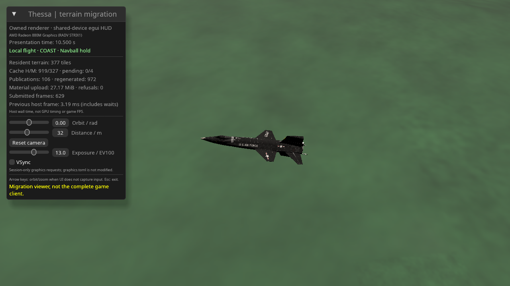

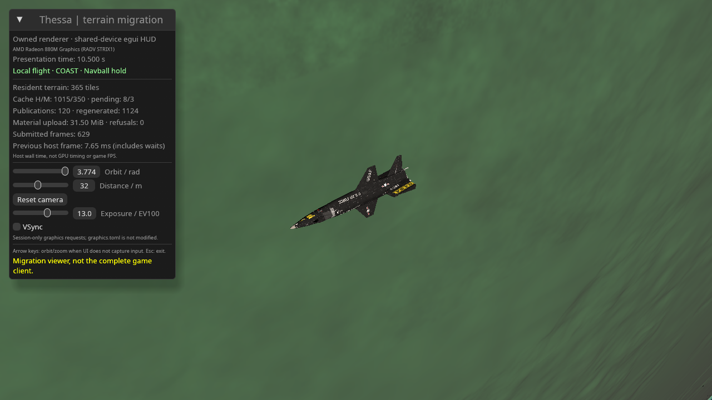

### Owned pilot-camera continuation (2026-10-16)

The next slice migrates the flight camera controller without touching physics.
GPL `flight-authority::camera::FlightCamera` owns the existing pilot camera
policy with glam-only math and no Bevy/wgpu/clock/ECS handles: quaternion
orbit (no polar clamp), chase framing that follows craft attitude, camera-axis
pan, exponential scroll zoom and reset. Gesture factors, limits, clamps and the
eye/target/up basis are extracted unchanged from the shipped pilot; overflow
and degenerate frames fail closed (previous view kept, no NaNs) instead of
poisoning the camera. Hosts own gestures, frame placement and look-at
construction, so the same offsets drive Bevy `Transform` in the old client and
body-space `ViewParams` in the native viewer.

The old pilot stores the shared controller in `PilotHudState` and converts its
offsets through the unchanged look-at; mouse drags, wheel, `V` chase toggle
and <code>Backquote</code> reset keep their legacy factors and gating. Autobench
camera orbits and the HUD camera button use the same setters. The native
vehicle/preview view recovers the body-frame craft orientation from the
published mesh instance (so the camera always agrees with the rendered mesh),
stages eye/target/up in body space and builds the same perspective the survey
view uses. The terrain-only survey view is deliberately untouched: it mirrors
the old map/survey camera, and changing its framing would invalidate the
terrain-only A/B workload comparison. Camera gestures verifiably never touch
`FlightAuthority`: a dedicated regression advances the live trajectory with
the camera orbiting/zooming/panning/chasing and still matches direct
authority advancement exactly.

Native input mapping: arrows yaw/zoom the active camera, `V` toggles chase in
vehicle mode, <code>Backquote</code> resets the active camera, right-drag orbits
and middle-drag pans from presses outside the HUD, wheel zooms when the HUD
does not consume it. The HUD shows the chase checkbox and distance slider in
vehicle mode (the single-angle orbit slider belongs to the survey view only)
and a one-shot camera reset. Headless `--chase` selects chase framing for
`--flight`/`--vehicle-preview`; `--sweep` yaws the shared orbit in vehicle
mode and the survey angle otherwise. These are validation controls, not a new
graphics effect or warp system.

```sh
cargo run --release -p thessa-terrain-native -- --flight
cargo run --release -p thessa-terrain-native -- --flight --chase --headless flight-chase.png --hud --frames 600 --prestream-seconds 10
cargo bench -p thessa-flight-authority --bench camera
```

Regressions pin the shipped defaults/factors/clamps, invalid-demand
no-op preservation, bit-exact offsets against a verbatim copy of the legacy
math across orientations/frames/states, the ported chase-framing layout, polar
pole traversal without clamping, survey-view independence from the shared
camera, gesture/physics separation and finite degenerate fallbacks. Hardware
tests render the actual advancing model in both orbit and chase framing into
the existing terrain color/depth targets. CLI misuse (`--chase` without a
vehicle mode) is rejected before loading assets/GPU. No new unsafe code,
external dependencies, devices, scene readback or intermediate scene targets.

**Validation and measurements.** On the Radeon 880M, the terrain-only 1280×720
HUD A/B/B/A run (600 measured + 30 warm-up frames, 10 s pre-stream) measured
baseline **2.523 / 2.698 ms** and new **2.707 / 2.647 ms** medians. Every run
ended at 287 tiles / 297,216 terrain triangles with zero measured geometry
publications or capacity refusals; the survey framing is untouched, so this
A/B stays an equal workload. These overlapping measurements include async
material work and unlocked clocks; they establish neither a speedup nor an
isolated adapter tax. The preserved baseline executable is the exact `77ee5d4`
build from the static-mesh checkpoint.

Live local-flight runs reached **10.5 s** completed authority/presentation
time with identical final relative coordinates in all three camera modes and
no stopped flight: orbit **3.247 ms**, chase **2.802 ms** and yaw-sweep
**2.958 ms** medians (600 measured + 30 warm-up frames, HUD, 10 s frozen
pre-stream). They include full local physics demand, streaming, rendering,
HUD and GPU completion, **not** isolated renderer/camera cost or game FPS.
Terrain detail differs between runs (410,112 / 375,552 / 368,640 triangles;
42 / 34 / 79 measured geometry publications, zero refusals), so do not compare
these medians as an equal scene or subtract them to isolate camera cost. All
runs submitted one mesh instance / two draws / 78,465 mesh triangles / 640
frame upload bytes. The frozen preview measured **3.061 ms** with 349 tiles /
426,240 triangles. Its default orbit azimuth faces the unlit broadside at the
polar-night site: the framing is verified broadside-centered at 32 m
(`cos(view, nose) = 0` in the regression geometry), and a yawed diagnostic
shows the fully lit side. No ambient/fill light is manufactured; this is the
pre-existing direct-only lighting boundary, not a camera regression.

The shared-controller microbenchmark measured **120 ns** median per
eye/target/up computation and **36.669 µs** for 1,024 (1,000 samples each;
p95 **130 ns / 76.813 µs**), covering basis/orbit/pan math and timer/barriers
only. The checked-pose bench is unchanged (**90 ns / 21.971 µs** medians).
Native Wayland chase smoke requested **1,200** presentations in **10.159 s**
(**118.1 requests/s**, not display/game FPS), exited 0, and finished at
**10.142 s** completed simulation with **0.007690 s** backlog, no flight stop
and no refusals. Window elapsed clamping and cooperative scheduling do not
promise real-time simulation; this run does **not** establish 1× realtime
throughput.

Captures and machine-readable methodology/results are recorded in
`artifacts/owned-flight-camera-2026-10-16.json`.

Final gates passed: fmt, workspace all-target/all-feature clippy with warnings
denied, no-default-feature viewer clippy, **1,768** workspace lib/bin + **52**
integration + **24** Bevy-CBT hardware + **4** native GPU + **3** native-window
tests = **1,851 successful tests**. Native GPU live-flight coverage renders both
orbit and chase framing of the advancing model into the existing terrain
color/depth targets. Native-window regressions exercise terrain-only HUD/no-HUD
teardown, live-flight HUD/no-HUD advance with equal
authority/presentation time and no stopped flight, and chase advance with
`chase=true` telemetry. Local review covered camera/pose ownership, bit-exact
framing migration, fail-closed invalid/degenerate handling, gesture/physics
separation, survey-workload preservation, host clock/gesture boundaries and
GPL/MIT separation (no game logic moved into MIT crates, no new crate).
The debug legacy Bevy pilot also ran **unpaused**, saved a flight screenshot
and exited 0 using the existing local fallback (embedded server executable
absent). Its different camera, game UI, effects and elapsed time are not visual
or equal-workload performance parity; audio and networking were not validated.

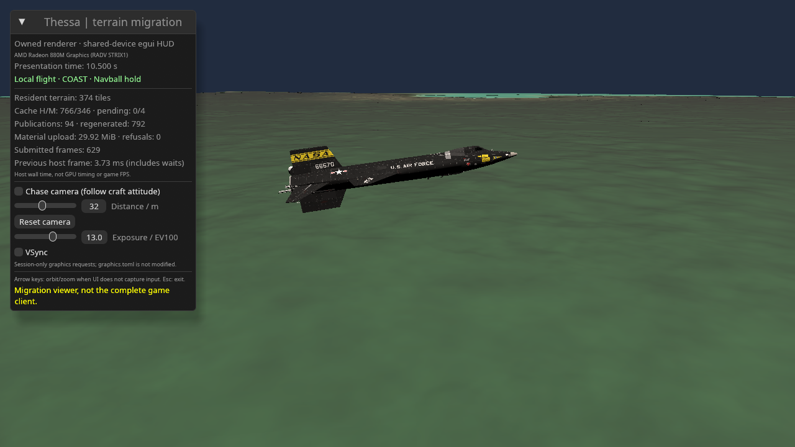

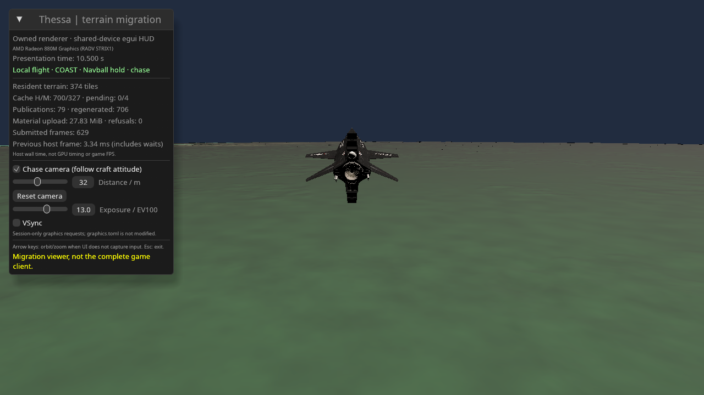

### Owned flight-input continuation (2026-10-16)

The next slice wires player flight control into the native live authority
without changing the solver. GPL `flight-authority::input` owns the existing
pilot intent policy with glam-only math and no device/clock/ECS handles:
`WASDQE` stick mapping (`S-W, D-A, E-Q`), 0.55/s throttle slew with `0..=1`
clamping, cut/full presets, engine toggle and the 0.25 precision factor.
Invalid demands fail closed. The old pilot keeps its split intent-vs-server-
acknowledgement fields and adopts the shared mapping/slew/precision
functions; the native viewer bundles intent in `FlightInput` and pushes it
into its local authority every rendered frame (throttle slew, throttle/engine
copy, scaled stick). The compatibility starter arms full legacy throttle with
the engine on, so both clients inherit the same initial intent.

Native mapping: `WASDQE` stick from the held set (rebuilt every frame, repeats
never stick an axis), `Shift`/`Ctrl` slew, `X`/`Z` cut/fill, `Space` engine,
`C` cycles the control law (`Navball -> Rate -> Direct -> MouseAim`, the same
shared cycle the old client's mode HUD owns), `T` SAS, `CapsLock` precision.
Headless `--throttle 0..=1` and `--engine-on` preset intent deterministically
(rejected without `--flight`, before assets/GPU load); headless frames hold no
keys, so default runs reproduce the previous trajectory exactly. The HUD
mirrors throttle/engine/precision/SAS plus a one-shot law-cycle button and a
stick readout in live mode only. Telemetry reports `throttle/engine/
control_mode/sas` alongside authority/presentation time. All retained pilot
wire intents are now native: part commands (RCS/wheels/gear/chutes) cross the
normal server wire through the shared queue with transactional overflow stop,
flyby assist is a direct port (F7/`--flyby`/HUD, demands-only with
takeover/focus-loss cancellation), the typed `ExecuteManeuver` kick is
`--maneuver-kick`, and mouse-aim and the mode HUD are also native.

The runtime-control row is native too: window `F4` overlays the shared
`thessa_perf::PerfCollector` (frame wall/CPU p50/p95/p99/max, sim budget,
world/streaming counters, memory, level, capture status), `Shift+F4` writes
the standard JSON+CSV capture of ring contents since the start, `F5` cycles
the profiling level, and scopes only run while the overlay is visible or a
capture is active (otherwise the per-frame cost is a wall/CPU record). The
windowed overlay never presents CPU submit as GPU time — hardware GPU
intervals stay the serial headless `--perf-capture` path; the legacy
`THESSA_AUTOBENCH` warp-ladder script is an old-client view harness that is
not carried.

```sh
cargo run --release -p thessa-terrain-native -- --flight
cargo run --release -p thessa-terrain-native -- --flight --throttle 0.5 --headless input.png --hud --frames 600 --prestream-seconds 10
cargo bench -p thessa-flight-authority --bench input
```

Regressions pin the shipped stick table (including opposite cancellation),
slew factors/clamps/convergence, presets/toggles, invalid-demand preservation,
the old client's Bevy-key wiring, intent staging vs authority adoption,
mode cycling, SAS control, telemetry keys and CLI misuse. A 600-step
regression holds the pushed trajectory exactly equal to direct production
authority advancement while a cut-throttle/engine glide diverges past the
100 m pinned bound, proving the input path drives the solver instead of
shadowing it.
No new unsafe code, external dependencies, devices, scene readback or
intermediate scene targets.

**Validation and measurements.** On the Radeon 880M, the terrain-only 1280×720
HUD A/B/B/A run (600 measured + 30 warm-up frames, 10 s pre-stream) measured
baseline **2.563 / 2.686 ms** and new **2.551 / 2.597 ms** medians. Every run
ended at 287 tiles / 297,216 terrain triangles with zero measured geometry
publications or capacity refusals; the input slice does not touch the survey
path, so this A/B stays an equal workload. Overlapping medians establish
neither a speedup nor an isolated adapter tax. The preserved baseline
executable is the exact `77ee5d4` build from the static-mesh checkpoint.

Default, chase and explicit-preset live runs all reached **10.5 s** completed
authority/presentation time with identical final relative coordinates and no
stopped flight: default **3.242 ms**, chase **2.803 ms**, `--throttle 1
--engine-on` **3.051 ms** medians. The preset run reproduces the inherited
starter demand bit-for-bit (identical coordinates), proving the preset path
is transparent rather than a second demand source. All runs report
`throttle=1.000 engine=true control_mode=Navball sas=true` and submit one
mesh instance / two draws / 78,465 mesh triangles / 640 frame upload bytes
(42 / 38 / 45 measured terrain publications, zero refusals). These include
full local physics demand with the owned input push, streaming, rendering,
HUD and GPU completion, **not** isolated input cost or game FPS; camera cover
differs between runs, so do not compare medians as an equal scene.

The input microbenchmark measured **30 ns** median per stick+slew step and
**8.967 µs** for 1,024 (1,000 samples each; p95 **40 ns / 8.977 µs**), plus
482.358 µs per 100k bundled pushes ending at full throttle. This covers intent
math and timer/barriers only. Native Wayland smoke requested **1,200**
presentations in **10.100 s** (**118.8 requests/s**, not display/game FPS),
exited 0, and finished at **10.092 s** completed simulation with a **0.000329 s**
backlog, no flight stop and no refusals. Window clamping does not promise
real-time simulation; this run does **not** establish 1× realtime throughput.

Captures and machine-readable methodology/results are recorded in
`artifacts/owned-flight-input-2026-10-16.json`.

Final gates passed: fmt, workspace all-target/all-feature clippy with warnings
denied, no-default-feature viewer clippy, **1,774** workspace lib/bin + **52**
integration + **24** Bevy-CBT hardware + **4** native GPU + **4** native-window
tests = **1,858 successful tests**. Native-window regressions exercise
terrain-only HUD/no-HUD teardown, live-flight HUD/no-HUD advance, chase
advance with `chase=true`, and a full-thrust preset run reaching the authority
with `throttle=1.000 engine=true`. Local review covered input ownership,
factor exactness, preset transparency, staging/adoption separation, survey
preservation, gesture/held-key boundaries and GPL/MIT separation (no game
logic moved into MIT crates, no new crate). The debug legacy Bevy pilot also
ran **unpaused**, saved a flight screenshot and exited 0 using the existing
local fallback (embedded server executable absent); not an audio/network
test or equal-scene parity proof.

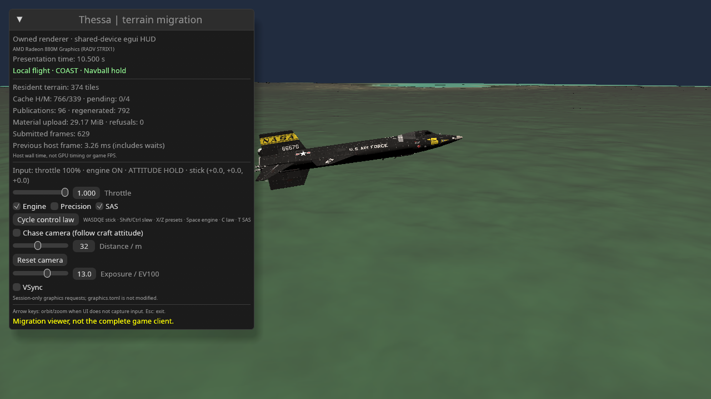


### Owned part-command continuation (2026-10-16)

The next slice ports the installed-subsystem commands that complete the
discrete control set: RCS, reaction wheels, landing gear and parachutes. The
authority endpoint is unchanged (`FlightAuthority::apply_part_command` with
the same explicit `VehiclePartCommand` values the old pilot sends); only the
native host learns to call it. The old client additionally forwards each
command to the server for multiplayer truth — a link the local viewer does
not have, so native application stays local-only by construction. No new
solver, wire format or shared math is introduced: this is host adoption of an
existing command contract with the old pilot's key bindings.

Native mapping: `R`/`Y`/`G`/`P` toggle through `Scene::apply_part_toggle`,
which reads back current state and issues the explicit enabled/disabled
command; the HUD mirrors four checkboxes that adopt on change only (no
per-frame command spam). Telemetry reports `rcs/wheels/gear/chutes`
alongside the input intent. Built-in commands are infallible for the starter
vehicle; an unexpected rejection stops the flight like a physics error
instead of panicking, preserving the last valid presentation. Starter states
are RCS/wheels on, gear down, chutes safe, so default runs reproduce the
previous trajectory exactly.

Regressions pin starter states, every toggle round-trip, absolute HUD
adoption, change-only application, key parity with the old pilot, no-op
without flight and telemetry keys. Old-client command ownership is untouched.
No new unsafe code, external dependencies, devices, scene readback,
intermediate scene targets, CLI surface or benchmarks (no new math enters;
command application is solver-internal).

**Validation and measurements.** On the Radeon 880M, the terrain-only 1280×720
HUD A/B/B/A run (600 measured + 30 warm-up frames, 10 s pre-stream) measured
baseline **2.539 / 2.770 ms** and new **2.531 / 2.755 ms** medians. Every run
ended at 287 tiles / 297,216 terrain triangles with zero measured geometry
publications or capacity refusals; the slice issues no commands by default,
so this A/B stays an equal workload. Overlapping medians establish neither a
speedup nor an isolated adapter tax. The preserved baseline executable is the
exact `77ee5d4` build from the static-mesh checkpoint.

Orbit and chase live runs reached **10.5 s** completed authority/presentation
time with identical final relative coordinates and no stopped flight (**3.107 /
2.903 ms** medians), reporting starter states throughout (`rcs=true
wheels=true gear=true chutes=false`). These include full local physics
demand, streaming, rendering, the extended HUD and GPU completion, **not**
isolated command cost or game FPS; camera cover differs, so do not compare
medians as an equal scene. Both runs submitted one mesh instance / two draws /
78,465 mesh triangles / 640 frame upload bytes (43 / 36 measured terrain
publications, zero refusals). Native Wayland smoke requested **1,200**
presentations in **12.470 s** (**96.2 requests/s**, not display/game FPS),
exited 0, and finished at **12.467 s** completed simulation with a
**0.000291 s** backlog, no flight stop and no refusals. Window clamping does
not promise real-time simulation; this run does **not** establish 1× realtime
throughput.

Captures and machine-readable methodology/results are recorded in
`artifacts/owned-part-commands-2026-10-16.json`.

Final gates passed: fmt, workspace all-target/all-feature clippy with warnings
denied, no-default-feature viewer clippy, **1,777** workspace lib/bin + **52**
integration + **24** Bevy-CBT hardware + **4** native GPU + **4** native-window
tests = **1,861 successful tests**. Local review covered command ownership,
explicit-command semantics, no-command trajectory identity, HUD spam
avoidance and GPL/MIT separation (no new crate, no game logic moved). The
debug legacy Bevy pilot also ran **unpaused**, saved a flight screenshot and
exited 0 using the existing local fallback; not an audio/network test or
equal-scene parity proof.

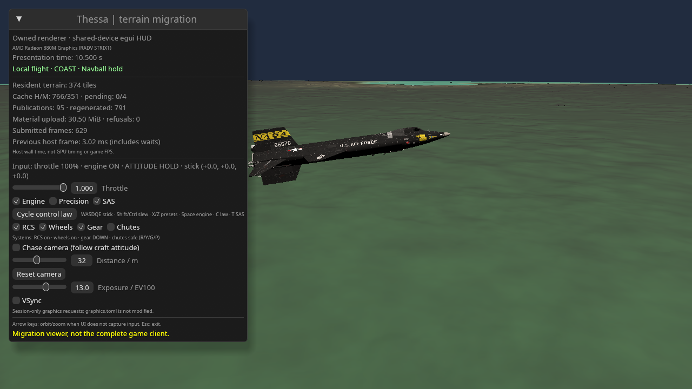

### Owned flight-data continuation (2026-10-16)

The next slice gives the native live view its first production instruments
without touching the solver: surface speed, vertical speed, datum altitude
and AGL altitude, read from the existing authority state every frame. The
sampling reuses the shared `local_air_kinematics` the old client's HUD
consumes, and the ground lookup mirrors the old client's AGL formula
verbatim (render-axes origin, spin-undo, same height call) — an early
iteration sampling the raw inertial direction read the wrong terrain by
~140 m and is pinned against by regression. Readout is reference-body only;
the old client's dominant-body display switching near other worlds stays
out of scope and is documented, not reimplemented. Failures (no flight,
failed ephemeris/atmosphere sample) yield `None`; the HUD omits that frame's
readout instead of publishing NaNs (it does not cache the previous values).
Telemetry gains `spd/vspeed/alt/agl` keys.

Regressions pin the 500 m launch AGL, the ~180 m/s launch energy, climb
under full thrust over 600 steps, the `None`-without-flight boundary and
telemetry keys. Old-client instruments are untouched. No new unsafe code,
external dependencies, devices, scene readback, intermediate scene targets,
CLI surface or benchmarks (sampling reuses solver-owned kinematics; per-frame
cost is one ephemeris sample plus one field height query).

**Validation and measurements.** On the Radeon 880M, the terrain-only 1280×720
HUD A/B/B/A run (600 measured + 30 warm-up frames, 10 s pre-stream) measured
baseline **2.510 / 2.569 ms** and new **2.542 / 2.588 ms** medians. Every run
ended at 287 tiles / 297,216 terrain triangles with zero measured geometry
publications or capacity refusals; sampling runs in live mode only, so this
A/B stays an equal workload. Overlapping medians establish neither a speedup
nor an isolated adapter tax. The preserved baseline executable is the exact
`77ee5d4` build from the static-mesh checkpoint.

Orbit and chase live runs reached **10.5 s** completed authority/presentation
time with identical final relative coordinates and no stopped flight (**3.092 /
2.830 ms** medians), reporting `spd=372.2 vspeed=+49.3 alt=942 agl=848` at the
completed time. These include full local physics demand, per-frame kinematics
plus one field height query, streaming, rendering, the extended HUD and GPU
completion, **not** isolated sampling cost or game FPS; camera cover differs,
so do not compare medians as an equal scene. Both runs submitted one mesh
instance / two draws / 78,465 mesh triangles / 640 frame upload bytes (45 /
36 measured terrain publications, zero refusals). Native Wayland smoke
requested **1,200** presentations in **10.116 s** (**118.6 requests/s**, not
display/game FPS), exited 0, and finished at **10.108 s** completed simulation
with a **0.001540 s** backlog, no flight stop and no refusals. Window clamping
does not promise real-time simulation; this run does **not** establish 1×
realtime throughput.

Captures and machine-readable methodology/results are recorded in
`artifacts/owned-flight-data-2026-10-16.json`.

Final gates passed: fmt, workspace all-target/all-feature clippy with warnings
denied, no-default-feature viewer clippy, agent QA unit tests (5 passed) and
the architecture boundary check (12 guarded crates), **1,778** workspace
lib/bin + **52** integration + **24** Bevy-CBT hardware + **4** native GPU +
**4** native-window tests = **1,862 successful tests**. Local review covered
kinematics reuse, the verbatim ground formula, reference-body scope,
fail-closed sampling and GPL/MIT separation (no new crate, no game logic
moved). The debug legacy Bevy pilot also ran **unpaused**, saved a flight
screenshot and exited 0 using the existing local fallback; not an
audio/network test or equal-scene parity proof.


### Owned navball continuation (2026-10-16)

**Later native follow-up:** [doc 57](57_NATIVE_FLIGHT_DECK.md) supersedes this
CPU128/30 Hz implementation only in the native viewer with native-pixel GPU
FastNavball and separate aircraft /FDAI-inspired spacecraft layouts. The dated
measurements and legacy Bevy path below remain intact.

The next slice ports the attitude instrument itself: the 128 px navball
sphere (nose-+X view, sky/ground blend, pitch ladder, horizon glow) renders
from the body-frame local up that the flight-data readout already carries.
The pixel renderer moves verbatim to GPL `flight-authority::navball` — pure
CPU RGBA with no clock, ECS, Bevy image or renderer handle — and the old
pilot keeps thin Bevy image wrappers around the same function. The native
HUD uploads the pixels as a shared-device egui texture with the shipped
rebuild policy (at most 30 Hz, only after real attitude travel), gated on
presentation time so headless captures stay deterministic. No new GPU device,
scene target, readback or toolkit beyond the existing egui path.

Regressions pin the dynamic deterministic sphere projection (level vs
pitched, transparent corners, degenerate-input fallback) in the shared crate,
the old client's continued rendering through the shared function, and the
native HUD branch rendering without touching controls. Old-client throttle
gating and texture lifecycle are untouched. No new unsafe code, external
dependencies, CLI surface or benchmarks (128² pixels render in microseconds
on existing paths; no new math enters beyond the moved renderer).

**Validation and measurements.** On the Radeon 880M, the terrain-only 1280×720
HUD A/B/B/A run (600 measured + 30 warm-up frames, 10 s pre-stream) measured
baseline **2.609 / 2.647 ms** and new **2.569 / 2.644 ms** medians. Every run
ended at 287 tiles / 297,216 terrain triangles with zero measured geometry
publications or capacity refusals. Overlapping medians establish neither a
speedup nor an isolated adapter tax. The preserved baseline executable is the
exact `77ee5d4` build from the static-mesh checkpoint.

Orbit and chase live runs reached **10.5 s** completed authority/presentation
time with identical final relative coordinates and no stopped flight (**3.223 /
2.885 ms** medians), carrying the owned navball beside the speed/altitude
readout. These include full local physics demand, per-frame sampling,
throttled navball uploads, streaming, rendering, HUD and GPU completion,
**not** isolated instrument cost or game FPS; camera cover differs, so do not
compare medians as an equal scene. Both runs submitted one mesh instance /
two draws / 78,465 mesh triangles / 640 frame upload bytes (42 / 36 measured
terrain publications, zero refusals). Native Wayland smoke requested **1,200**
presentations in **10.104 s** (**118.8 requests/s**, not display/game FPS),
exited 0, and finished at **10.092 s** completed simulation with a
**0.005070 s** backlog, no flight stop and no refusals. Window clamping does
not promise real-time simulation; this run does **not** establish 1×
realtime throughput.

Captures and machine-readable methodology/results are recorded in
`artifacts/owned-navball-2026-10-16.json`.

Final gates passed: fmt, workspace all-target/all-feature clippy with warnings
denied, no-default-feature viewer clippy, agent QA unit tests (5 passed) and
the architecture boundary check (12 guarded crates), **1,779** workspace
lib/bin + **52** integration + **24** Bevy-CBT hardware + **4** native GPU +
**4** native-window tests = **1,863 successful tests**. Local review covered
pixel-renderer move exactness, rebuild-policy parity, the shared-device
texture path and GPL/MIT separation (no new crate, no game logic moved). The
debug legacy Bevy pilot also ran **unpaused**, saved a flight screenshot and
exited 0 using the existing local fallback; not an audio/network test or
equal-scene parity proof.

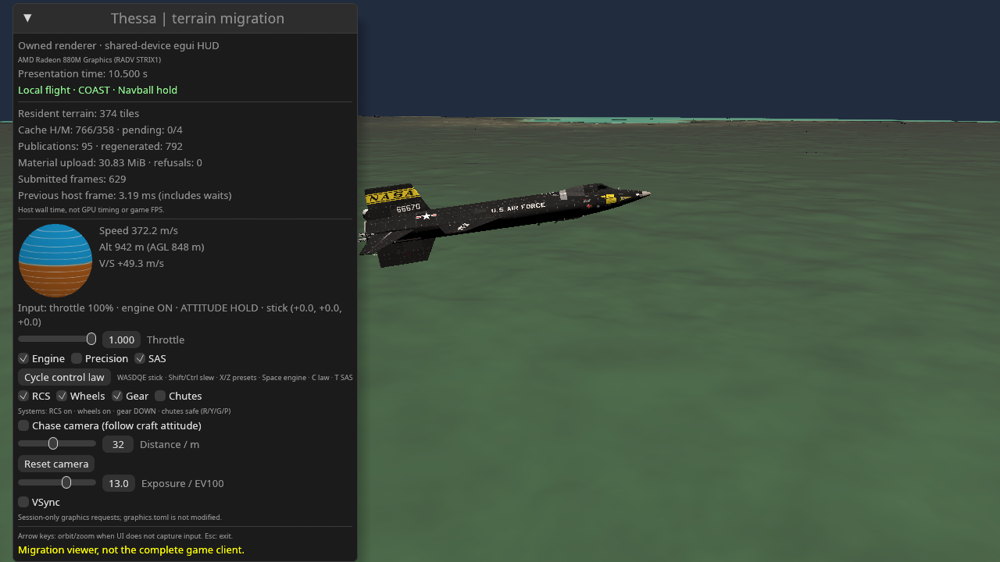

### Owned survey-camera continuation (2026-10-16)

GPL `flight-authority::survey::SurveyCamera` now owns the shipped surface
survey's quaternion orbit/free look, 0.004 rad/pixel right-drag gain,
exponential wheel zoom (0.1 per line), 80 m–2,000 km distance limits,
5 km default and per-site framing reset. The legacy Bevy survey and native
terrain-only viewer consume the same controller. Placement preserves the
original f64 north/east computation followed by the f32 matrix/offset path,
not a new quaternion basis. Exact poles use a finite fallback basis; invalid
site vectors are rejected. The shared radial minimum-altitude clamp retains
the host's terrain query plus the shipped 5 m clearance. This is presentation
policy, not an authoritative vehicle constraint or a physical force.

Native HUD buttons, window `F6` and `--site 0|1|2` select the shared
COAST/HIGHLANDS/VOLCANIC bookmarks (HIGHLANDS by default). Site selection
resets distance/free look, preserves orbit, and cannot mutate flight or the
constructor preview. Native right-drag orbits, Shift-right-drag turns free
look, wheel zooms and Backquote restores defaults. Existing HUD input capture
blocks gestures/shortcuts; middle-drag pan remains vehicle-only. The obsolete
single-angle survey slider and native scalar-orbit path are removed. No new
device, GPU scene pass, scene copy, readback or external dependency is added.
The celestial map/orbit UI and its camera remain old-client-only.

The native default changes from 30 km elevated framing to the shipped 5 km
survey framing. This deliberately breaks the earlier equal-terrain-workload
benchmark chain; do not compare those terrain medians as an adapter tax or
speedup. Native projection remains the existing 0.9 rad vertical FOV and
1 m–100,000 km depth range, not legacy Bevy projection parity. The old client's
projection and site-selection controls are unchanged.

Tests cover the original placement arithmetic, gesture gains, zoom clamps,
invalid inputs, poles, resets, site selection without flight mutation,
body/render-frame eye agreement, and valid camera-relative GPU ABI data.
Body attachment across sampled spin is bounded to 2 mm eye displacement at
the default distance and 1e-6 forward-vector error, accounting for the shipped
f32 offset boundary. This is numerical/camera verification, not blind visual
acceptance or full Bevy scene parity.

Validation: workspace all-target/all-feature clippy with warnings denied,
no-default-feature viewer clippy, **1,788** workspace lib/bin + **52**
integration + **24** Bevy-CBT hardware + **4** native GPU + **4** native-window
tests passed (**1,872** Rust tests), along with the five agent-QA unit tests
and the architecture check for 12 foundational crates. Hardware tests ran on
AMD Radeon 880M / RADV STRIX1; no adapter-dependent suite was skipped here.

At 1280×720 with HUD, 600 measured + 30 warm-up frames and 10 s pre-stream,
COAST/HIGHLANDS/VOLCANIC medians were **2.372 / 2.487 / 2.559 ms**; the new
quaternion sweep measured **2.768 ms** and 148 measured geometry publications.
All had zero capacity refusals. These are different scenes, not a ranking of
camera cost. Live-flight A/B/B/A against exact `d33f480` measured baseline
**3.235 / 3.132 ms** and new **3.214 / 3.181 ms**: overlapping medians, not a
speedup. All four reached the same 10.5 s authority/presentation state and
final coordinates, zero backlog and the same final terrain/mesh geometry.
Full local physics and GPU completion are included, not isolated render cost
or game FPS. Native Wayland requested 1,200 presentations in 10.089 s
(118.9 requests/s, not display feedback) and exited cleanly. The debug Bevy
HIGHLANDS survey also captured and exited cleanly, unpaused on its existing
local fallback; ALSA device warnings mean audio was not verified.

Reproduction, binary/capture hashes and per-run counters are in
`artifacts/owned-survey-camera-2026-10-16.json`. Captures show the current
terrain seams/LOD defects and missing native atmosphere/effects; they are
not visual acceptance, and the mismatched Bevy/native scenes are not a valid
blind preference comparison.

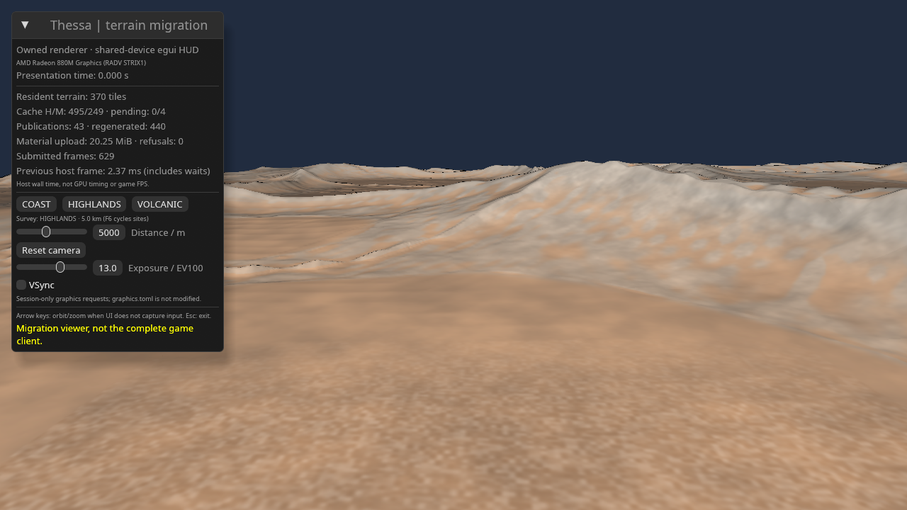

### Owned embedded-server transport continuation (2026-10-16)

The old client's stdio child link moves into GPL
`flight-net::embedded::EmbeddedLink`, preserving its framing/handshake,
reader-owned receive timestamps, two-arrival latest-wins inbox, generation
delivery, presentation interpolation clock, ordered input mailbox and
startup/drop cleanup. The Bevy host now owns only a resource newtype; no
second transport, task scheduler or interpolation implementation is added.
Game transport stays GPL and no reusable MIT renderer crate acquires game or
network policy. The module is native-only (not exported on wasm32).

`spawn` retains sibling `thessa-server` discovery; `spawn_server` accepts an
explicit executable path without a shell or extra arguments. Hosts still
choose fallback policy. The wire version/payloads and server are unchanged.
The moved input mailbox keeps the existing cap of 64 pending legacy edge
commands (Stage/Engine/Part/Reset); it does not newly establish a total bound
for arbitrary queued fleet/autopilot command variants. Extending that policy
and surfacing remote disconnects remain follow-up work, not transport parity
claims introduced by this extraction.

The nine existing interpolation/inbox/mailbox/startup regressions move with
their owner and replace Bevy math imports with the same workspace glam. A new
Unix framed-Welcome fixture verifies successful handshake followed by child
kill/reap on drop (startup timeout/early-exit reap tests remain). Scratch stays
under the owning crate's `target/test-tmp`, never the shared system temp tree.

`cargo run -p thessa-flight-net --example embedded_probe -- PATH_TO_THESSA_SERVER`
is a headless smoke against the real server executable: it receives nine
snapshots, sends validated throttle-cut/engine-off intent, requires server
acknowledgement and advancing time/tick, checks finite interpolated state and
drops the link. This is a protocol/lifecycle probe, not a new gameplay host,
render benchmark, native viewer snapshot adoption or fleet/prediction support.
Native viewer networking remains explicitly unported.

Source comparison against `ed57dc2` confirms the inbox/mailbox/child guards,
handshake worker threads and send/snapshot accessors are unchanged after
crate-path qualification, removal of the Bevy Resource derive and formatting.
The explicit executable-path wrapper and successful-handshake lifecycle test
are the only transport additions. No performance improvement is claimed for
moving the owner; the resource adapter has no extra worker, queue or allocation.

All gates passed: fmt, workspace all-target/all-feature clippy with warnings
denied (including a final rerun after tightening the probe's time-advance
assertion), no-default-feature viewer clippy, **1,789** workspace lib/bin +
**52** integration + **24** Bevy-CBT hardware + **4** native GPU + **4**
native-window tests = **1,873 Rust tests**, five agent-QA tests and the
12-crate architecture check. Hardware suites ran on Radeon 880M / RADV STRIX1.
The real-server probe received ticks 5→132 and simulation time 0.041667→1.1 s
and acknowledged throttle cut/engine off. Its 1.414 s startup/handshake
included 1.296 s of server launch-site setup; these are smoke diagnostics,
not isolated network latency or a benchmark win.

The debug Bevy pilot also captured and exited cleanly, **unpaused and linked
to the real server**, with remote stepping logged through 10 s / 1,200 ticks
(no local fallback). ALSA/JACK warnings leave audio unverified. Reproduction,
checks, binary/capture hashes and limitations are in
`artifacts/owned-embedded-link-2026-10-16.json`.

### Embedded-link bounds and disconnect continuation (2026-10-16)

This continuation supersedes the command-cap and observed-disconnect
limitations recorded in the transport extraction above. The input mailbox
now uses `flight-net::MAX_COMMANDS_PER_INPUT` for the **whole coalesced
packet**, including Pause/SetWarp votes and every ordered event variant.
The old four-variant counter let fleet/autopilot events accumulate without
that bound and could accept 64 legacy events plus two state votes, which the
server's existing validator then rejected. The mailbox now rejects overflow
transactionally, preserving previously accepted pending commands, and the
public link closes rather than silently discarding an event. Oversized
caller packets are refused before cloning. State votes still coalesce and
ordered events retain FIFO order; the wire format/server limit are unchanged.

The reader and writer share the existing input mailbox's close predicate.
Reader EOF/read/framing failure or writer encode/write failure now closes it
and wakes an idle writer; subsequent `send_input` returns false, letting the
old pilot's existing link-lost error path report the failure. `is_closed`
exposes that observed state to other native hosts. An accepted input is only
**queued**, not acknowledged by the server. A live but stalled peer still
needs a host deadline/heartbeat; there is no reconnect, full snapshot
validation or joined-worker guarantee in this slice. Native viewer snapshot
adoption and fleet rendering remain unported. No additional thread, queue,
dependency or renderer/device change is introduced.

Regressions cover full packets of fleet events plus state votes, coalescing
at capacity, transactional rejection, oversized caller packets, reader EOF
while the child remains alive, and broken stdin while stdout remains open.
All spawned fixtures are killed/reaped and keep scratch under the crate's
`target/test-tmp`. The real-server probe also returns early on observed
closure rather than waiting for its snapshot deadline.

Local gates passed: fmt, workspace all-target/all-feature clippy with warnings
denied, no-default-feature viewer clippy, **1,793** workspace lib/bin + **52**
integration + **24** Bevy-CBT hardware + **4** native GPU + **4** native-window
tests = **1,877 Rust tests**, five agent-QA tests and the 12-crate architecture
check. The 14-test transport suite additionally passed **20 repetitions**
(280 executions, reported separately rather than inflating the workspace
total). GPU/window suites ran on Radeon 880M / RADV STRIX1.

The real-server probe again acknowledged throttle cut/engine off and received
nine snapshots (ticks 5→150, simulation 0.041667→1.25 s). Startup/handshake
was 1.382 s including 1.262 s world setup; no isolated-latency or performance
win is claimed. The unpaused debug Bevy pilot stayed linked to the actual
server, captured and exited cleanly, with remote status logged through
10 s / 1,201 ticks; audio remains unverified due to device warnings. Evidence,
reproduction and hashes are in `artifacts/embedded-link-bounds-2026-10-16.json`.

### Native PRIMARY server-flight continuation (2026-10-16)

This slice supersedes the native snapshot-adoption gap in the preceding dated
checkpoints. `apps/terrain-native --server-flight` now hosts the same GPL
`flight-net::embedded::EmbeddedLink` as the legacy pilot. `--server PATH`
optionally selects the executable; otherwise it must be beside the viewer.
This is an explicit alternative to local `--flight`, not an automatic fallback
or an external TCP client. The existing server, wire format and renderer are
unchanged; no extra GPU device, scene pass, intermediate target or runtime
readback is introduced.

`flight-net::presentation` now owns the old pilot's replica-adoption and PRIMARY
input-construction arithmetic. Both clients consume it; the Bevy adapter retains
its HUD clock/votes, server timing counters and render wrappers. Before replica
mutation, the shared contract checks the sample-time ephemeris, finite rigid
kinematics, unit quaternion, throttle range and finite nonnegative timing/warp
metadata. Parachute telemetry retains the existing checked authority-adoption
contract. Native additionally refuses backwards tick/time; the old host still
permits its existing reset flow. This is not full hostile-server validation or
replication of fuel/electrical/structural inventories from the lean snapshot.

Three state domains remain separate:

- **Replica:** newest authoritative snapshot, used for input ticks and
  speed/altitude/navball readouts. Recomputing existing display loads does not
  advance physics, actuators, resources or the scheduler.
- **Presentation:** existing receive-time interpolation, without extrapolation.
  Its own time drives the mesh, reference-body frame, terrain spin, lights and
  camera in one checked publication; it cannot overwrite the replica.
- **Intent:** throttle/engine, stick, control mode, SAS and subsystem demands.
  Delayed acknowledgements cannot erase throttle/engine intent. Ordered part
  commands use the existing bounded mailbox; checkboxes indicate demands, not
  individual remote command acknowledgements. Acceptance means queued only.

Native fixes its current server policy at unpaused 1x PRIMARY flight. Local and
server modes share COAST setup, the same X-15 source and input/camera/HUD paths.
Until the first accepted snapshot, the canonical constructor pose is static,
the HUD reports waiting, and no authoritative instrument readout is shown.
`--throttle`, `--engine-on` and `--chase` work in both modes. Server presets are
queued before GPU startup/pre-stream, not deferred to the first draw. Headless
server flight uses real server wall time, including setup/pre-stream, not a fixed
simulation demand or `--flight-step`; captures are not deterministic-epoch
local/server A/B pairs.

`--server-timeout SECONDS` (default 5, finite `0<seconds<=60`) bounds handshake
and snapshot silence. The shared link exposes the reader-timestamp age of the
newest drained sample. A missing first snapshot, stale received snapshots, observed
pipe failure, invalid/backwards samples, command overflow or server flight
error stops the native session, kills/reaps its owned child and preserves the
last complete visual publication. The server-mode guard remains set, so later
frames cannot accidentally enter local physics. This deadline is native-host
policy, not a transport heartbeat, reconnect mechanism or deadline newly added
to the old Bevy host. Hidden/minimized windows poll again on their next draw.

Regression coverage includes separation of intent/replica/interpolated time,
coherent body/light/mesh/camera publication (position-frame round trip below
`1e-8 m`), malformed/backwards rejection before replica mutation, live-pipe
silence before/after a snapshot, stdout loss, retained server-mode guard,
ordered bounded part events and CLI conflicts. A real-server CPU smoke and
native-window smoke also exercise actual snapshot adoption and throttle
acknowledgement. Verification results and captures are recorded in
`artifacts/native-server-flight-2026-10-16.json`.

Local verification passed: fmt, workspace all-target/all-feature clippy with
warnings denied, no-default-feature viewer clippy, **1,798** workspace lib/bin +
**53** integration + **24** Bevy-CBT GPU + **1** additional mesh-shader GPU +
**4** native GPU + **1** real-server CPU + **5** native-window tests =
**1,886 Rust tests**, five agent-QA tests and the 12-crate architecture check.
Hardware suites ran on Radeon 880M / RADV STRIX1 (Mesa 26.2.4). The real-server
CPU smoke adopted five snapshots through tick 120 / 1 s, acknowledged throttle
cut/engine off and retained zero local backlog. The unpaused Bevy pilot captured
and exited while linked to the actual server (logged through 12 s / 1,441 ticks),
without local fallback; audio remains unverified due to device warnings.

Final release captures/measurements use 1280×720, HUD, 600 measured frames,
30 warmup frames and 10 s pre-stream. Local A/B/B/A against the preserved
`ed57dc2` survey release measured medians **3.071 / 3.130 / 3.229 / 3.349 ms**,
with identical final trajectory at 10.5 s and identical final geometry. These
overlapping ranges and async publication variance establish no speedup or
isolated adapter-cost bound. The real-server orbit/chase runs measured
**3.294 / 2.759 ms**, adopting **34 / 30** snapshots through **12.383 / 12.083 s**
with no stop, closed link or capacity rejection. Their different cameras,
trajectories and wall-time epochs make them **different workloads**, not a
local/server overhead comparison. Child CPU work is concurrent, not included
as isolated server/network cost. Earlier exploratory measurements before the
waiting-HUD/early-preset correction are discarded.

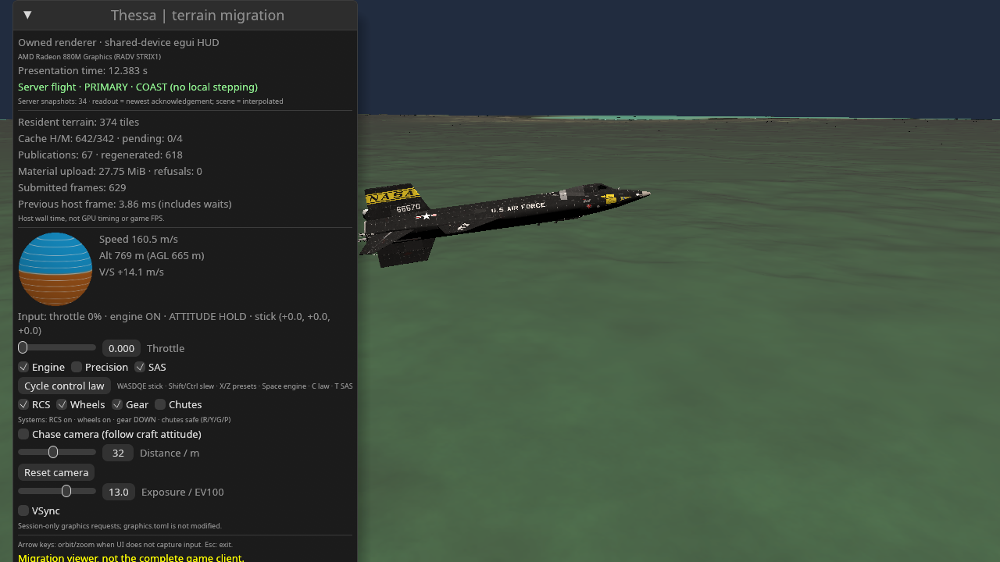

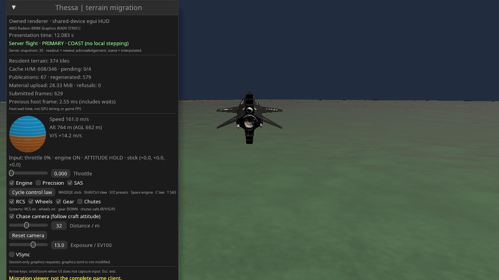

Remaining scope: fleet presentation, prediction/reconciliation, celestial map
camera, richer replicated resources/Welcome validation, external networking,
reconnect and joined-worker shutdown; PBR/effects/production UI and device-loss
recovery also remain unported. This does not establish full Bevy displacement,
visual parity, blind aesthetic acceptance or a renderer/network speedup.

### Native fleet-observer continuation (2026-10-16)

This slice adds **read-only fleet observations, not fleet mesh rendering or
prediction**. The old Bevy client had no fleet consumer to extract. Native now
consumes the server's existing `FLEET_SNAPSHOT` kind through the same GPL
`EmbeddedLink` reader; no second transport, worker or physics path is added.
The existing receive-timestamp/generation/two-arrival inbox is generalized for
both payload types, retaining the PRIMARY interpolation algorithm unchanged.
Fleet and PRIMARY generations and receive ages remain independent.
Per kind, retention is bounded by two pending ingress packets plus the drained
previous/latest history, not by an unbounded per-ID history or event queue.

Fleet membership is complete, sorted and unique, with no PRIMARY entry and at
most 63 secondaries. The 64-vehicle total cap moves to the shared wire-policy
constant; the server's split admission fixes an off-by-one that formerly counted
only secondaries despite documenting a total including PRIMARY. A rejected split
leaves vehicle mass/topology and membership unchanged (rejection telemetry is
still published). No payload field, message kind or protocol version
changes. The server now broadcasts empty membership too: suppressing empty
packets would leave an observer unable to distinguish no vehicles from no data.
Outbound slots are independently latest-wins, not an atomic PRIMARY/fleet pair.

`flight-net::presentation::fleet_poses` checks the entire membership and every
consumed pose/telemetry value before the native host replaces its registry.
Persistent IDs cannot rewind tick or simulation time. Births/removals are explicit
set changes, without cross-ID blending or extrapolation. Each pose subtracts the
chosen reference ephemeris at its **own** sample time: secondary authority debt
can differ from PRIMARY. The inspector shows that time, tick, reference-body
radius and stopped status. It does not present a mixed-time primary-to-secondary
distance as a simultaneous physical separation. Resource state/control intent
and the primary mesh/body/light/camera publication are untouched by fleet updates.

The native HUD distinguishes no packet yet, fresh explicit empty membership,
stale membership and a stopped session. Fleet silence uses its own reader age
and the existing native snapshot timeout; stale rows are withheld while
last-known membership is retained, without stopping a still-live PRIMARY or
inventing despawn. Invalid fleet payload/membership closes the shared link;
invalid/backwards consumed poses use the existing native freeze/no-fallback path.
The cap bounds retained member count, not arbitrary nested wire strings or all
transient decoder allocations; existing frame-byte limits still apply.

No vehicle design, model key or reference-body identifier is present in these
lean per-vehicle snapshots. The observer therefore adds no duplicate X-15s,
fabricated proxy geometry, GPU resources/passes or secondary simulation. Its
HUD works on the existing shared device/target, is absent outside server mode,
and copies at most 63 checked small observations for a HUD frame. With HUD
disabled that UI copy/window work is absent. The Bevy host still ignores fleet
observations; transport retention remains bounded even if never drained there.

Regression coverage includes independent demultiplexed generations/receive ages,
capacity and sorted-ID checks, malformed payload closure, empty transitions,
reader flood bounds, per-vehicle ephemeris times, atomic malformed/backwards
rejection, ID birth/removal and PRIMARY/input isolation, stale fleet alongside
fresh PRIMARY, and physical server separation followed by complete mailbox
publication. A real default server verifies **empty** fleet reception. The
multi-vehicle screenshot uses a framed synthetic peer through the actual native
CLI/link/HUD; it is not a real separation replay or acknowledgement/physics test.
Evidence is recorded in `artifacts/native-fleet-observer-2026-10-16.json`.

Local gates passed: fmt, all-workspace/all-target/all-feature clippy with warnings
denied, no-default-feature viewer clippy, **1,805** workspace lib/bin + **53**
integration + **24** Bevy-CBT GPU + **1** mesh-shader GPU + **4** native GPU +
**1** real-server CPU + **1** 63-member fixture CLI/GPU + **5** native-window
tests = **1,894 Rust tests**, five agent-QA tests and the 12-crate architecture
check. GPU suites ran on Radeon 880M / RADV STRIX1. The HUD GPU regression keeps
its original full-right-column preservation oracle without the inspector and
checks an exact untouched lower-right patch with the right-anchored inspector,
whose shadow legitimately reaches part of that edge. It uses no pixel tolerance.

The debug 63-member fixture frame is deliberately **not** a physics/terrain
acceptance frame: synthetic PRIMARY placement reaches AGL zero and its camera
intersects terrain occlusion. It tests the bounded observer table, own-time
readouts and absence of fabricated secondary meshes. Real-server captures below
are separate from that fixture and must not be treated as a matched replay.

Release local-flight A/B/B/A against exact `8c614da` measured medians
**3.207 / 3.235 / 3.283 / 3.205 ms** (1280×720, HUD, 600 measured + 30 warmup
frames, 10 s pre-stream). Final trajectory and geometry remain identical at
10.5 s. New medians are about **0.9–2.4% higher** in this small sample, with
asynchronous publication/tail variation; no speedup, zero-overhead or isolated
adapter-cost claim is made. Actual-server HUD/no-HUD runs measured **3.180 /
2.800 ms**, adopting **31 / 29** fleet updates with explicit empty membership,
without stale data, stops, closed links or capacity rejections. Their different
completed wall-time epochs and geometry preclude a matched inspector-cost
comparison; child CPU work is concurrent. The old Bevy pilot also captured and
exited cleanly while linked to the actual server through 12 s / 1,441 ticks;
audio remains unverified due to device warnings.

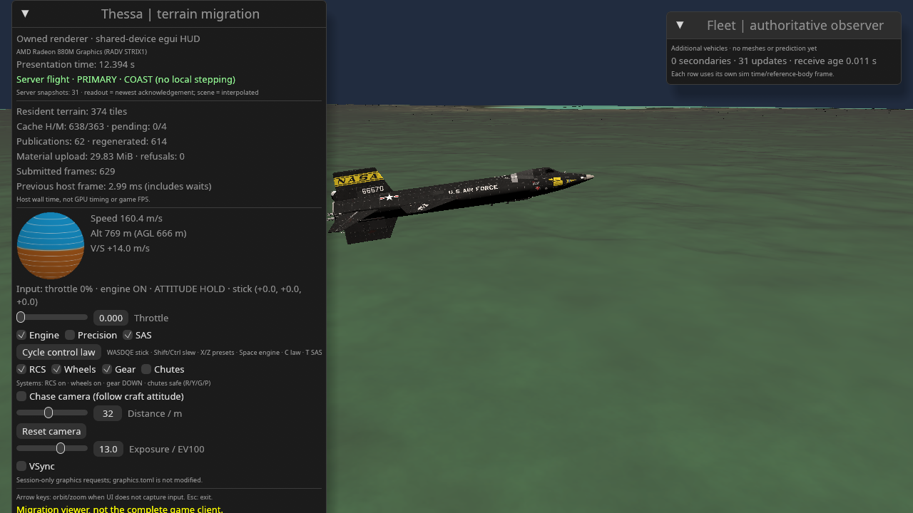

Still missing: design/resource replication, real multi-vehicle visual replay,
fleet mesh rendering/common render epoch, remote interpolation policy,
prediction/reconciliation and the other migration gaps above. No whole-client
replacement, visual acceptance or speedup is established by this slice.

### Native fleet contact-geometry continuation (2026-10-16)

This follows the observer above; it is **not** fleet beauty/world rendering.
`flight-net::geometry` now defines a bounded immutable `FleetGeometry` catalogue
of stable non-primary IDs, display names and authoritative contact shapes/poses.
Names are not design hashes, asset keys or model identity. No path, URL, bulk
GLB, client-supplied geometry or executable loader crosses this boundary.
The existing `CollisionGeometry` contract is reused, including its material,
shape and unit-quaternion validation. No second physical model or tessellated
collision source is introduced. Split clusters supply the actual definition's
recentered contact parts, not a copy of the compatibility X-15.

Wire **v8** adds kind 10 and `FleetSnapshot::geometry_revision`; all peers must
be rebuilt. A v7 envelope is explicitly rejected, not optimistically decoded.
The server compares cached descriptors with borrowed authoritative definitions;
only a changed label/member/available contact shape or pose creates a new
monotonic catalogue revision and encoded Arc-shared frame. New subscribers get
the current catalogue even when nothing changed. A per-mailbox revision marker
suppresses retransmission after its one latest catalogue slot has been drained.
Snapshots remain small and reference the matching catalogue revision, rather
than retransmitting static geometry at 20 Hz. Independently coalesced slots may
skip revisions and are not an atomic primary/fleet scene packet.

The existing single stdio reader also demultiplexes catalogues. They reuse the
bounded inbox, with immutable Arc payloads (including through HUD stats). Because
catalogues are on-change publications, this ingress takes the short queue lock:
unlike periodic snapshot ingress it must not discard the only update on mutex
contention. No lock is held during pipe IO, no extra worker/device is created,
and geometry is not deep-copied every frame. Reader retention is at most two
pending plus drained previous/latest catalogues, not an unbounded ID cache.

Native observation poses keep their previous own-time validation. Geometry only
attaches when both revision and complete ID set match. Either delivery order is
supported; a temporarily different revision shows **waiting**, not an old hull
on a new pose. Reusing a revision with different data, backwards references or
same-revision member mismatches fail through the existing no-fallback path.
No geometry receive-age timeout is imposed on a correctly referenced immutable
catalogue: unchanged geometry need not arrive again. Fleet kinematic staleness
still withholds all rows, including the geometry inspector.

Wire-policy budgets are **128 UTF-8 bytes per display label** (producer strips
control characters) and **64 contact parts per secondary**, with the existing
63-secondary membership limit. A source with more parts publishes an explicit
`OmittedBudget`; a source without parts publishes `Absent`. Neither truncates
or changes the authority hull. Oversized/invalid *received* catalogues fail
validation, not silent truncation. Existing 8 MiB framing still bounds bytes;
these are post-deserialization limits, not a complete hostile-decoder memory
proof. Changes hidden behind `OmittedBudget` need not revise an identical
omission descriptor. The current branch still has no beauty-mesh/model registry.

The native HUD shows the label and contact availability per row; the first
row opens an auto-fit, isometric, **body-frame contact wireframe** when available.
Cuboid edges are exact; sphere great circles use 16 chords (maximum arc sagitta
`1-cos(pi/16)`, about 1.93% of radius), and capsule half-circle arcs use 16
chords (about 0.49% of radius). This is a diagnostic UI projection, not a
physics reduction, production graphics effect, camera/world mesh or an
appearance LOD. Scaling is done in f64 before narrowing to UI pixels; geometry
outside a representable preview scale is reported rather than overflowing.
Collapsed rows do no projection; `--no-hud` does none of this UI work. No new
scene targets, GPU mesh resources, passes or runtime readbacks are introduced.

The bounded CPU benchmark (`cargo bench -p thessa-flight-net --bench fleet_geometry`)
uses 63 members × 64 contact parts. A catalogue frame is **364,718 bytes**;
the borrowed unchanged-source scan measured **9.237 μs** median, compared with
**246.419 μs** for rebuilding/encoding every time (200 samples each, without
concurrent build/test jobs; earlier contended measurements discarded). The latter
is a diagnostic alternative, **not** the previous production implementation;
this is neither a network throughput nor frame-time speedup claim.

Tests cover catalogue roundtrip/budgets/labels, exact authoritative geometry,
changed/recentered source detection, no periodic retransmission, late
subscribers, coalesced mailbox revisions, on-change inbox contention, revision
pairing in either order, malformed/reused/backwards catalogues, and unchanged
PRIMARY state/intent. Hardware HUD tests exercise actual contact previews across
resize/DPI/recreation, preserving the existing exact untouched-background oracle.
The default real server still verifies empty fleet plus input acknowledgement;
a server test produces a separate physical-separation wire replay with conserved
world part placement (below 1 mm absolute inertial error), for native inspector
capture. That frozen replay is not a live separation-input acknowledgement or
whole-scene beauty test; the compatibility PRIMARY model remains X-15.

Gates passed: **1,814** workspace lib/bin + **53** integration + **24** Bevy-CBT
GPU + **1** mesh-shader GPU + **4** native GPU + **1** real-server CPU + **1**
capacity-fixture CLI/GPU + **5** window tests = **1,903 Rust tests**, all-feature
workspace clippy and no-default-feature viewer clippy with warnings denied,
five agent-QA tests and the 12-crate architecture check. GPU/window tests ran on
the Radeon 880M / RADV STRIX1, not an adapter-less skip. The frozen real-server
split replay reached native with one secondary, one geometry publication and
matching revision 1, without stale rows or local steps. Its primary scene is
dark/incomplete and still uses the compatibility model, so only the inspector
and provenance are evaluated here.

One concurrent-build verification attempt hit the existing 250 ms startup-test
PID-publication race in two embedded-link cleanup fixtures. Its failure log is
retained. The complete lib/bin suite passed on retry without competing cargo
jobs, without relaxing product timeouts or test assertions; scheduling-sensitive
startup fixtures remain a known test-infrastructure limitation, not a claim that
every attempted run or remote CI was green.

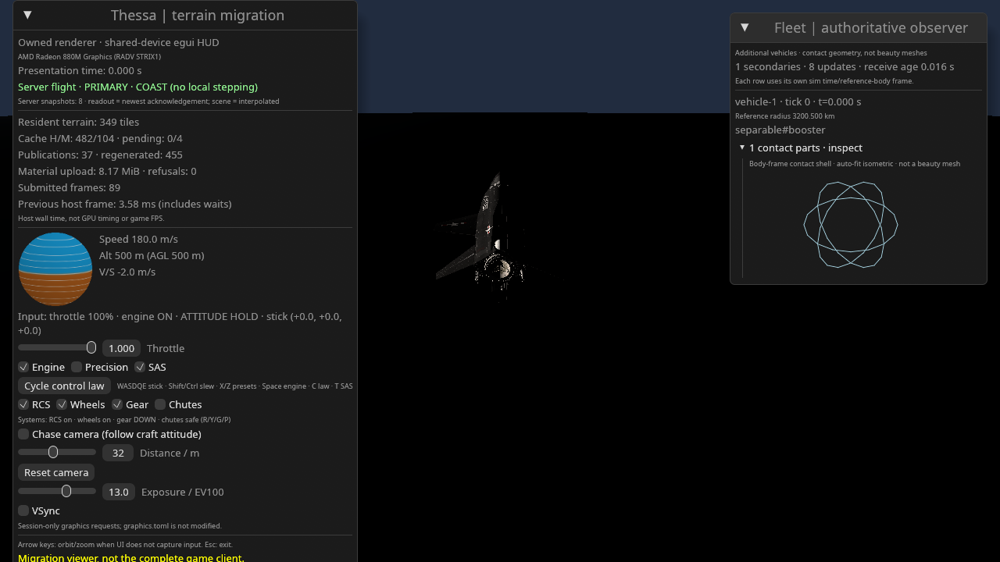

Release local A/B/B/A medians against exact `4221ba1` were **3.203 / 3.251 /
3.202 / 3.141 ms** (1280×720, 600 measured + 30 warmup frames, 10 s pre-stream).
All four ended at the identical 10.5 s trajectory and geometry counts; asynchronous
material residency/publication counts and tails vary. The mean of the two new
per-run medians is about 1.7% higher; no speedup or zero-overhead claim is made.
All final measurements were repeated after the last membership-revision guard;
earlier worktree runs are retained separately, not pooled with final-binary data.
Real default-server HUD/no-HUD runs measured **3.081 / 2.751 ms**, adopting
**33 / 30** fleet updates and exactly **one** matching immutable catalogue each,
without stale rows, stops, closed links or capacity rejection. Their different
wall-time epochs/geometry and concurrent child CPU prevent an isolated HUD or
network-overhead comparison. The rebuilt legacy Bevy pilot captured and exited
on the real v8 server (last logged 10 s / 1,200 ticks), without local fallback;
audio remains unverified due to device warnings.

Commands, hashes, check results and diagnostic captures are recorded in
`artifacts/native-fleet-geometry-2026-10-16.json`. Remaining work includes actual
authored render-design/model identity, split render ownership, world fleet
instances at a coherent presentation epoch, fuller resources and
prediction/reconciliation. This catalogue does not claim to solve those gaps.

### Retained render ownership (2026-10-16)

The first continuation after the contact catalogue introduces optional MIT
`vehicle-core::RenderGeometry`, re-exported by `sim-core`. It is backend-neutral
appearance data, not GPL game policy moved into an engine crate. No device,
entity, asset loader, texture URL or physics law is added. Mesh payloads are
Arc-shared (serde rc support), with f64 local positions/normals, u32 triangles
and explicit rigid part poses/body ownership. See `details/06_ATTACHMENT_MODEL.md`
for validation, COM-shift and split contracts. Legacy JSON defaults to empty.
Partitioning follows existing authoritative cluster reconstruction, preserving
world vertex placement within 1 mm at 3e12 m and leaving all physical output
identical to a mesh-free definition. No wire/pixels change in this slice.

Reproduction: `cargo test -p thessa-vehicle-core -p thessa-sim-core --lib` and
`cargo bench -p thessa-vehicle-core --bench render_geometry`; logs under
`/tmp/opencode/render-ownership-{focused,bench}.log`. The benchmark compares
64 shared part clones against copying a single 65,536-vertex mesh; it is an
allocation/copy diagnostic, not a previous-production or frame-time speedup.
Focused tests passed; the diagnostic measured **1.092 μs** median for 64 part
clones versus **421.215 μs** for one deep mesh copy (3,932,160 payload bytes;
200 samples each, CPU-only). It does not measure a physics tick or GPU path.
Full workspace/gpu gates for the stacked continuation are recorded with the
following integration slice before branch publication.

### Procedural body appearance producer (2026-10-16)

The second stacked slice connects the retained contract to the **existing**
fuselage tessellator. The baker stores mesh-local buffers, solved assembly
rotation/translation and explicit part ownership, then applies only the final
COM translation to retained origins. It never builds appearance from contact
boxes. `[body_render]` controls offline sampling and can disable output entirely;
see `details/06_ATTACHMENT_MODEL.md`. Hand panels/wings, cockpit/interiors,
textures and physically authored appearance materials are not implemented.
No network schema or runtime pixels change in this slice.

The baker suite passes with new exact physical-equivalence, bounded sampling,
transformed ownership, JSON and real split regressions. Offline diagnostic:
`cargo test -p thessa-vehicle-baker body_render_bake_measurement -- --ignored --nocapture`;
100 debug-profile bakes of the two-body assembly, TOML parsing/JSON encoding
excluded, existing console diagnostics included. Mesh-off/on median bake times
were **7,853.092 / 7,817.856 μs**, and JSON grew **11,143 → 53,547 bytes**.
The noisy difference is not a speedup or isolated tessellator-cost claim.
Logs: `/tmp/opencode/body-render-baker-{tests,bench}.log`; validation/projection
precision is pinned by the tests, not inferred from these timings. Runtime
consumer and stacked workspace gates follow in the next slice.

### Bounded native fleet body rendering (2026-10-16)

The implementation/measurements in this subsection describe `2d26db0`. The
following COM-stable publication subsection supersedes its GPU rebuild/history
behavior for common translations; the dated measurements remain unchanged.

The third stacked continuation connects retained appearance to the existing
on-change catalogue and opaque mesh consumer. This supersedes the earlier
contact-only/world-mesh gaps **only for bounded retained body shells**, not full
authored vehicle designs/materials or complete Bevy replacement. The preceding
dated measurements remain snapshots, not current-protocol captures.

**Wire v9** adds `RenderAppearance::{Absent, Available, OmittedBudget}` to each
non-primary descriptor; kind 10 and revision pairing remain unchanged. v7/v8
envelopes are rejected. Available geometry is the actual retained mesh plus
body-local part poses. Authority has already partitioned/remapped assembly
ownership; display peers receive no ownership indices, executable loader,
texture path, GLB blob or right to replace authority. Part names are bounded
display labels, not asset hashes. Ordinary cached comparisons use Arc identity
before buffer equality; only a changed descriptor rebuilds/encodes geometry.
The server's existing shared frame/mailbox suppression applies equally to meshes.

The per-secondary appearance policy is **8 parts / 1,024 vertices / 4,096
indices**, including every part (shared payloads count per occurrence). Local
positions and part origins are bounded to ±1,024 m per component; rotated part
vertices are converted once at catalogue publication and checked for **≤1 mm
absolute f64→f32 error**. Larger sources publish explicit omission, not partial
triangles or a contact/X-15 substitute. Thus at most 64,512 appearance vertices
are admitted across 63 secondaries; the existing 8 MiB frame cap still applies.
Receiver validation remains post-deserialization, not a proof of bounded
transient hostile-decoder allocation. No source changes physical mass or forces.

Native combines admitted sources with the compatibility PRIMARY source on the
same device/queue, into the existing mesh renderer/pipeline/targets/pass. The
MIT wgpu consumer gains validated per-primitive instance ranges; the default
API still draws all instances of a homogeneous source. Only static catalogue
changes recreate the combined source; the current implementation also reuploads
PRIMARY on a nonempty source replacement/removal. This is bounded and counted,
not an incremental GPU asset/residency cache or a zero-upload claim. Empty
catalogues do not copy/upload PRIMARY again. Steady frames only update existing
view/lighting/matrix buffers and retained ranges. There is no second device,
scene copy, intermediate target, extra world pass or runtime scene readback.
Part-origin changes (including resource-driven COM recentering) also revise
the complete catalogue and may repeatedly transfer unchanged mesh buffers and
replace GPU sources. An incremental network mesh dictionary/residency contract
is not implemented; this slice does not establish production streaming efficiency.

World selection is separate GPL game presentation policy. Each available member
keeps two observed poses, sampling inertial linear positions and slerped f64
attitudes at **PRIMARY's current presentation epoch**, before subtracting the
reference body's ephemeris there. Geometry revisions reset histories. An exact
sample is enough; without a bracketing interval the world mesh is withheld,
never extrapolated from another vehicle's clock or sent through local physics.
Observer rows retain their own times. Stale or unmatched catalogues withhold
world draws without inventing despawn. This is basic bounded interpolation,
not prediction/reconciliation, a fleet-authority clock change, or a trajectory
accuracy guarantee between snapshots. The CPU oracle checks the moving-reference
subtraction to <1 mm and attitude axes independently from X-15 calibration.

The shared settings resolver supplies `renderer.fleet_meshes` and
`fleet_quality`. Disabled creates no fleet GPU source or track history and does
no world-mesh track/draw work; the independent contact inspector remains. The
basic triangle backend requires no optional capability. Low/Medium/High use
the same mesh with estimated angular-footprint
culling at **8/2/0.5 pixels**; near/intersecting bounds are not size-culled.
These are representation budgets, not physics/model switches. Settings apply
at renderer creation; metadata marks them restart-required. Counters expose
source publications, epoch-withheld and size-culled objects plus submitted
instances/draw calls/triangles/uniform+instance upload bytes. Appearance currently
has an explicitly neutral untextured finish: no material/texture/PBR parity,
wing/control-surface appearance, interior or full design registry is implied.

Verification and reproducible evidence are recorded in
`artifacts/native-fleet-body-rendering-2026-10-16.json`. The deterministic GPU
oracle uses two distinct retained triangles and synthetic poses against a black
target, checking heterogeneous instance ranges, repeated-frame exactness,
resize, stale/epoch withholding, disabled work and atomic invalid-range failure.
Its 63-member overlapping-triangle diagnostic is a bounded workload, not a
physical fleet or beauty/visibility benchmark. A separate frozen replay takes
the **baked example assembly** through actual authority separation and driver
encoding into the real native CLI/link/world consumer; it is not live separation
input acknowledgement. PRIMARY still uses the compatibility X-15 appearance
even for custom fixture authorities. Captures are implementer diagnostics,
not a blind preference review, native/Bevy matched scene or production parity.

Final stacked gates passed: **1,823** workspace lib/bin + **53** integration +
**24** Bevy-CBT GPU + **1** mesh-shader GPU + **5** native GPU + **1** real-server
CPU + **1** framed-fixture CLI/GPU + **5** window tests = **1,913** Rust gate
tests. The offline bake diagnostic and generated baked-authority replay add
two distinct ignored CPU tests (**1,915 including diagnostics**). Formatting,
workspace all-target/all-feature clippy, no-default native clippy (warnings
denied), five agent-QA tests and the 12-crate architecture guard passed. Gates
ran sequentially and hardware/window tests actually executed on Radeon 880M /
RADV Vulkan; this is not an assertion that remote CI has run.

At 63 members × 64 contact parts plus 1,024 appearance vertices / 4,095 indices
per member, the complete catalogue measured **3,982,242 bytes**. Borrowed cached
comparison was **10.380 μs** median versus **2,539.718 μs** rebuilding/encoding
(200 samples each, no competing builds/tests). The latter is an alternative
implementation diagnostic, not the old production path or a frame-time win.
The 63-overlapping-triangle GPU diagnostic measured **229.538 μs** median for
CPU selection/update + test-only target clear + submit/GPU completion at
320×240 (100 samples, 10 warmup). It excludes source replacement and readback
and uses exact epochs, not the interpolation path or a full-size/physical fleet.

The generated two-body example passed real authority separation and driver
serialization: **12,731-byte** initial Welcome/transaction, **411-byte** subsequent
kinematic packets. Native adopted one catalogue/source publication and drew
**2 instances / 3 draw calls / 78,785 triangles**, including the actual **320**
capsule triangles; no stale rows, withheld epoch, size cull or local step.
The screenshot still overlaps the capsule with the incorrect compatibility
PRIMARY and has an incomplete dark terrain scene; it is a provenance/consumer
check, not a visually correct split scene.

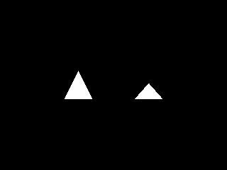
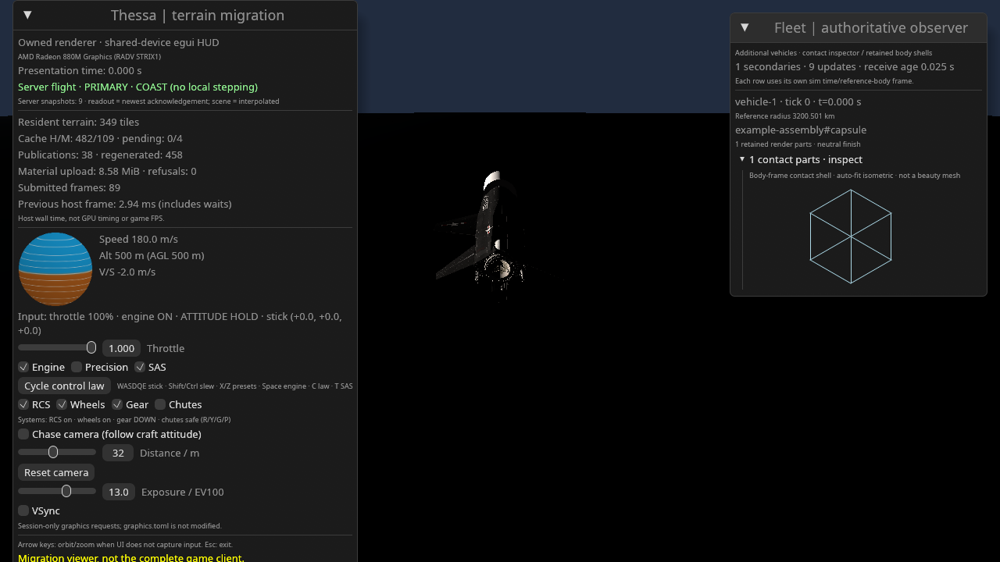

Release local A/B/B/A against exact `e5efb98`: **3.151 / 3.197 / 3.380 /
3.247 ms** medians, 1280×720, 600 measured + 30 warmup frames, 10 s pre-stream.
All four retained the identical 10.5 s trajectory and final geometry counts.
The mean of the two new per-run medians is about **2.8% higher**; asynchronous
publication counts/tails vary, and no zero-overhead or speedup claim is made.
Real default-server HUD/no-HUD medians were **3.063 / 2.772 ms**, adopting
**30 / 28** fleet updates, one matching empty catalogue and zero fleet GPU source
publications each. Different wall-time epochs/workloads and concurrent server
CPU prevent an isolated HUD/network-cost comparison. The rebuilt legacy Bevy
pilot also linked to the real v9 server and captured/exited without local
fallback; audio remains unverified due to device warnings.

### COM-stable native GPU publications (2026-10-16)

This is the `e09e6ba` snapshot. The following wire-v10/PRIMARY continuation
supersedes its remaining full-mesh COM retransmission and compatibility-PRIMARY
limitations; these dated measurements remain unchanged.

The `feat/native-render-origin` continuation retains a catalogue Arc with the
GPU publication. On a matched revision, native compares IDs, part counts,
orientations, mesh/normal/index payloads and **relative** part origins. Labels
and contacts do not determine GPU layout. Arc identity accelerates in-process
comparison; independently decoded but equal payloads also reuse the source.
This retains one bounded decoded catalogue publication, potentially older than
the observer's latest catalogue; it is an Arc retention, not a deep mesh copy or
an unbounded revision cache.
True layout changes still rebuild the combined source, reupload PRIMARY and
reset tracks. Explicit empty membership retires sources/history; stale or
revision-mismatched observations still withhold draws, and disabled remains free
of fleet GPU source/history work.

For common translations, each incoming body pose is transformed to the body
frame retained at source publication: `root = observed_position + rotation *
(current_first_part_origin - published_first_part_origin)`. Source vertices stay
in that publication's body frame. This preserves the existing inertial-linear /
attitude-slerp interpolation, including across a COM-only revision; interpolating
the first part's offset position instead would incorrectly replace rotation arcs
with chords. No physics state, clock, wire layout, device, pass or target changes.
The **1 nm** relative-layout subtraction allowance is always measured against the
retained publication, not successive packets, preventing accumulated drift. The
f64→f32 local vertex check reserves that allowance inside **1 mm**; culling radii
include it. The large-coordinate CPU oracle checks the COM correction to <1 mm
at `3e12 m`, including intermediate epochs and changed attitudes.

This is not a network mesh dictionary or a general incremental GPU asset cache:
every COM change still revises/retransmits the full wire-v9 catalogue. Per-part
relative pose changes, splits/membership changes and actual mesh changes retain
the full combined-source replacement path. Custom PRIMARY appearance and authored
materials remain unimplemented.

Reproduction and measured checks are recorded in
`artifacts/native-render-origin-2026-10-16.json`. The deterministic hardware oracle
checks identical pixels before/after a COM shift and inside a retained bracket,
temporary revision mismatch, independent decoded-equivalent buffers, source
retirement and disabled behavior. A 63-member / 8-part / 1,024-vertex / 4,080-index
per-member workload compares reuse against forced source invalidation in ABBA
order. It is a synthetic overlapping-triangle diagnostic, not a physical fleet,
blind subjective review, exact old executable or production FPS comparison.
The debug-profile diagnostic measured **4,236.468 / 95,544.766 μs** median for
reuse / forced rebuild (20 measured samples per mode, three warmups per block),
including layout scan, update, test clear, submit and GPU completion but excluding
packet construction/decoding and readback. Reuse made **zero** source publications
over 26 COM revisions; forced invalidation made 26. The original two-triangle
oracle PNG remains byte-identical to the archived image.
The same optimized test measured **3,091.306 / 13,349.746 μs** for reuse / forced
rebuild; the 63-small-triangle steady-source case was **111.618 μs**. These are
scoped local diagnostics, not production frame-time or network-efficiency claims.

Checks passed: **1,826** workspace lib/bin + **53** integration + **24** Bevy-CBT
GPU + **1** additional mesh-shader GPU + **7** native ignored (five GPU, one
real-server CPU, one framed CLI/GPU) + **5** window tests = **1,916** distinct Rust
gate tests. Formatting, workspace all-target/all-feature clippy, no-default native
clippy, native/server builds, five QA tests and the 12-crate architecture guard
passed. Hardware tests actually ran on Radeon 880M / RADV Vulkan; these are local
checks, not a remote CI result or new legacy visual/audio acceptance.
One later workspace rerun hit the existing fleet-silence fixture's five-second
receive deadline. Its focused retry and another complete default-thread workspace
run passed without changing the fixture or product code. The failure/retry logs
remain recorded in the artifact; hardware/window gates needed no retry.

### Wire-v10 mesh epochs and authoritative PRIMARY (2026-10-16)

`feat/primary-appearance-mesh-wire` resolves the two remaining blockers from
`e09e6ba` together under one incompatible wire revision. `FLEET_GEOMETRY` (kind 10)
now carries labels, contacts, part poses and mesh references; `FLEET_MESHES` (kind
11) carries an immutable bounded active mesh epoch. PRIMARY has an explicit
descriptor alongside up to 63 secondary descriptors. Both PRIMARY `Snapshot`
and `FleetSnapshot` reference the exact descriptor revision. v7/v8/v9 peers fail
version checking rather than partially decoding these payloads.

The producer deduplicates exact mesh values, using Arc identity first, and
preserves active-set ordering across reordered/split parts. Pose/contact/label
changes reuse the cached encoded payload frame and epoch. **COM-only updates
send zero mesh frames** to an existing subscriber, although complete lightweight
contact/pose descriptors still change. Each new subscriber receives the current
complete dependency. Actual active mesh-set changes create a new complete epoch,
including unchanged survivors; arbitrary per-asset deltas, network asset requests
and an unbounded content cache are deliberately not implemented.

Per-vehicle budgets remain 8 parts / 1,024 vertices / 4,096 indices / ±1,024 m
local components, now including PRIMARY. The mesh table is bounded to 512 entries
/ 65,536 vertices / 262,144 indices. Reference occurrences still count against
each vehicle's budget; deduplication cannot bypass it. Validation remains
post-deserialization, not a hostile-allocation safety proof. No filenames,
loaders, renderer handles, full designs or extra network workers are introduced.

The existing mailbox gains one latest payload slot and persistent epoch marker.
Payload and descriptor slots update under one mutex; the writer drains payloads
before descriptors. A newer pose descriptor therefore cannot evict its only
unsent mesh dependency. A single reader retains one payload epoch and latest
descriptor, resolves either arrival order, and exposes the existing Arc-shared
`FleetGeometry` application API only after exact dependency resolution. Skipped
epochs never reinterpret another epoch's integer IDs. Changed/reused/backwards
revisions, unknown matching-epoch IDs, malformed buffers and exceeded budgets
fail closed. Complete fleet membership now also takes the short inbox lock: a
one-shot birth/removal is not lost merely because the host drains concurrently.

The GPL standard authority constructor alone declares `StarterX15` provenance
and a body-local asset origin, which follows the existing resource-frame shift
pipeline. A custom constructor—even with an identical X-15 name/definition—and
every split constructor start without that identity. Retained appearance takes
precedence. The descriptor's built-in identity is a closed enum, never a display
name/path heuristic or missing-geometry fallback. No game asset policy is moved
into MIT simulation/render crates.

Native server mode initially allocates **no** mesh renderer/source. Once a
declaration arrives it builds only the declared PRIMARY and enabled fleet sources
in the existing device/queue/opaque pass/targets. A custom or split PRIMARY uses
its own retained geometry, not a simultaneous or hidden X-15 draw. Unknown,
absent, over-budget or revision-mismatched PRIMARY appearance draws nothing;
HUD and telemetry expose `primary_appearance`. PRIMARY is independent of
`renderer.fleet_meshes`: disabled allocates no fleet GPU source/history and does
not retain an old fleet catalogue in GPU source state, while PRIMARY still works.
Actual render-layout changes still replace the combined source, including PRIMARY;
this is not a general incremental GPU residency cache.

Common-publication-frame COM correction applies to PRIMARY as well as secondaries.
Snapshots also carry a separate PRIMARY appearance/frame revision, advanced only
when PRIMARY render state changes, not on unrelated fleet metadata. PRIMARY
presentation never interpolates body positions across such frame revisions that
can have different COM origins: it selects a whole newer sample at that boundary.
Fleet-only descriptor changes retain PRIMARY interpolation. Continuous PRIMARY
interpolation across actual COM revisions remains a gap,
not an invented intermediate body frame. Secondary histories retain their existing
common-publication-frame interpolation. Both paths finally transform inertial
render axes into the **current rotating body frame** used by the camera/terrain;
the nonzero-epoch GPU oracle covers this conversion, which epoch-zero captures
could not verify. No authoritative physics, prediction or clock policy changes.

Verification, replay/capture commands, measurements and remaining scope are
recorded in `artifacts/native-primary-mesh-wire-2026-10-16.json`. The tests are
deterministic provenance/geometry checks, not a blind subjective review or a
complete native/Bevy visual-parity claim.

### Receiver transaction correction (2026-10-17)

`GeometryReceiver::accept` now stages both descriptor and mesh candidates,
reconstructs and validates the prospective matching epoch, and only then
commits dependency slots and the delivered-revision marker. Every `Err` leaves
all three fields unchanged; no whole receiver or mesh payload is cloned on the
production path. Regression tests assert exact state retention after unknown
mesh references and final application validation failures, then accept a
corrected packet at the same revision. The inverse descriptor-first case also
rejects an insufficient mesh dependency without reserving its epoch. Successful
unmatched packets remain bounded pending dependencies, not errors; genuine
already-accepted revision reuse remains forbidden. No wire format changed.

### Native surface-lighting and shadow continuation (2026-10-17)

Branch `feat/native-surface-lighting`, baseline `3443689`. This supersedes the
diffuse-only native mesh limitations in the dated static-mesh checkpoint; it
does **not** declare the production client replaced. No Bevy dependencies,
new device/queue, scene copies or runtime readbacks were added.

**State and integration.** Backend-neutral `render-core::shadow` builds f64,
texel-snapped, camera-relative directional covers. `render-wgpu` owns a single
Depth32Float array shared by the existing terrain and opaque mesh consumers.
Each active stellar source gets 1–4 concentric covers. Radii follow
`distance * 40^((i+1)/count - 1)`; the outer radius is the configured distance.
Casters use finite light-space depth cover with reach based on that distance.
The outer 10% of each cover blends toward the next cover (or unshadowed beyond
the last). Per-source visibility affects direct diffuse and stellar specular,
not ambient light. Terrain casters use the existing full resident 33×33 vertex
grid, independent of the camera-culled triangle list, and inactive slots do
not cast. Mesh casters consume the existing vertex/index/instance buffers.
Fleet angular-size culling conservatively retains potential nearby casters;
fleet disable still disables only secondaries, never PRIMARY.

The native window and headless paths update this atlas after camera/instance
uploads and encode it before the normal terrain/opaque/HUD draws. The normal
terrain shader uses a named surface-hook block; the legacy default hooks are
unshadowed and preserve the existing Bevy path. No BRDF or statement text is
rewritten in the native adapter. Engine crates remain MIT, scene/asset/quality
policy integration remains GPL; no new dependency or unsafe code was added.

**Materials and reflection boundary.** The existing ocean GGX/Smith kernel
now accepts RGB Fresnel F0; its scalar ocean wrapper preserves legacy callers.
Native opaque meshes consume base color, metallic/roughness factors, sRGB base
textures, linear G/B metallic-roughness maps, derivative tangent-space normals
(including mirrored/degenerate UV handling), and R-channel ambient occlusion.
AO attenuates indirect lighting only. Metals do not acquire a fake diffuse
term when specular reflection is disabled. The environment fallback is the
explicit existing isotropic `ambient_lux / PI`; native celestial presentation
currently supplies zero ambient. This is directional-source and ambient
reflection, **not** SSR, scene-object reflection, a sky cubemap or ray tracing.

**Requested → resolved → consumers.** All controls are in `graphics.toml` and
the typed settings/GUI descriptors, with resolved capture metadata:

| Setting | Behavior |
| --- | --- |
| `renderer.surface_quality = "low"` | Factor-only material with F0 diffuse/ambient Fresnel approximation; retains stellar reflection and metallic energy partition. |
| `"medium"` | GGX material factors and isotropic environment; no normal/MR/AO maps uploaded. |
| `"high"` | GGX plus authored normal, metallic-roughness and AO maps. |
| `renderer.specular_reflections = false` | No stellar/environment specular contribution for native terrain or meshes; no extra reflection pass/resources. |
| `shadows.enabled = false` | No atlas, shadow pipelines, passes, frame uploads or shadow receiver bindings. |
| `shadows.quality` | Low: one comparison per lookup; Medium: 3×3 PCF; High: 5×5 PCF. |
| `shadows.cascades`, `max_distance_m`, `map_size`, `normal_bias_m` | Shared existing cascade/bias intent, now consumed by native raster shadows. |
| `renderer.shadow_memory_mib` | Default 64 MiB. Resolution is halved until all three sources/cascades fit; default resolves 4096 requested to 1024 native, 48 MiB. |

Presets expand surface quality to Low/Medium/High/High. The atlas uses portable
depth sampling/render attachments, not ray-query/subgroup/vendor capabilities.
Device texture limits also bound atlas dimensions; malformed public resolved
inputs fail before allocation. Resolution changes accuracy, not scene physics.
Telemetry reports actual atlas bytes, active shadow passes and material mode.
These settings require native renderer recreation (restart), not live UI edits.

**Verification and cost.** Four deterministic GPU tests cover independent
colored-source occlusion, mesh and terrain casters, retired geometry, disabled
allocation, astronomical origins, GGX normal-incidence output (≤2 sRGB codes),
linear MR channels, tangent normals, zero-strength and degenerate-UV fallback,
and AO isolation. Projection narrowing is bounded by 3 mm in projection-space
over the tested 24 km interval at a 3×10¹² m origin; this is not a universal
world-space shadow error bound.

`cargo test --release -p thessa-render-wgpu --test surface_lighting
fixed_source_shadow_frame_cost -- --ignored --nocapture` measures fixed 1024
terrain patches and 64 quad instances, 1280×720, 30 warm-up + 120 frames on the
Radeon 880M/RADV Vulkan adapter. It includes CPU encode/submit and GPU completion:

| Same source/quality | Median | p95 | Atlas / passes |
| --- | ---: | ---: | --- |
| Shadows disabled | 0.870 ms | 1.045 ms | 0 / 0 |
| Default three-source, four-cover shadows | 22.349 ms | 22.955 ms | 48 MiB / 12 |

This exposes a substantial remaining cost, **not** a performance win or game
FPS claim. The first implementation casts every retained grid into every
active cover; light-volume compaction and measured shadow LOD are future work.
An actual live-stream X-15 preview measured 15.587 ms median / 17.691 ms p95,
349 final terrain tiles plus 78,465 mesh triangles; the disabled-shadow run
measured 2.852 / 4.104 ms. Live async material populations differed, so those
numbers are diagnostics, not a controlled isolated shadow-cost comparison.
Full commands, gates, captures and limits are in
[`artifacts/native-surface-lighting-2026-10-17.json`](artifacts/native-surface-lighting-2026-10-17.json).
Final gates passed: fmt, workspace all-target/all-feature clippy, native
no-default clippy, **1,836** workspace lib/bin + **57** integration + **24**
Bevy-CBT GPU + **1** mesh-shader GPU + **8** native ignored GPU/server + **5**
native-window tests (**1,931** distinct Rust gate tests), the additional
release fixed-source diagnostic, five agent-QA tests and the architecture
guard. Rebuilt legacy debug client also completed its process-local muted
runtime smoke successfully. No remote CI result is claimed.

**Still missing.** Off-cover/unresident terrain cannot cast; no shadow-specific
stream demand exists. There is no alpha-masked/transparent caster path, contact
shadows, temporal denoising, HDR/tonemapping, atmosphere/cloud transport or
occlusion, eclipses, scene-object reflection, directional sky IBL, mip chains,
emissive/local-light materials or complete authored material/Bevy parity.
The existing metre-scale terrain bias is configurable but not automatically
calibrated for every small craft. Captures can be very dark without physically
modeled atmospheric indirect light; no invented ambient was added to disguise
that gap. Deterministic checks are not blind aesthetic or production-quality
acceptance. The legacy client stays runnable during this partial migration.

### Native ray-query scene reflections (2026-10-17)

Branch `feat/native-surface-lighting`. This replaces the "directional-source
and ambient reflection, not scene-object reflection" boundary above with a
Thessa-owned ray-query reflection path for **scene objects only**. No Bevy
dependency, new device/queue, scene copy or runtime readback was added; the RT
scene is built from buffers the native renderer already owns.

**Enablement.** `renderer.ray_tracing = "off" | "local" | "full" | "auto"`
plus the `[raytracing]` participation/budget block (`terrain`, `vehicles`,
`landmarks`, `atmosphere`, `clouds`, `max_distance_m`, `scene_memory_mib`,
`max_instances`, `reflection_bounces`, `ray_bias_m`). `auto` resolves to local
RT only when the adapter reports ray query before device creation. An explicit
`local`/`full` request is never silently downgraded: the resolver keeps the
request, publishes the participation flags and notes the limitation, and
`Backend::bring_up_for_graphics` fails fast with `BackendError::Device` when
the negotiated device lacks `EXPERIMENTAL_RAY_QUERY` (wgpu's consent-gated
experimental feature, requested only for this case). `resolve_graphics`
re-resolves the resolved settings against the **negotiated device**, so
metadata/captures describe what the device actually carries rather than the
adapter's unrequested features. `limits_for` raises the acceleration-structure
limits only when ray query was negotiated.

**Scene.** `render-wgpu::ray_scene` owns one BLAS per primitive over a
consolidated 16-byte-stride position copy plus a 4-byte index copy, so raster
vertex/index buffers keep their existing usage and layout. **A TLAS instance
references a whole BLAS**, so per-primitive instancing requires per-primitive
BLASes; a single shared BLAS placed every primitive at every instance
transform (this was observed as a real defect before the split). TLAS
instances are the renderer's live mesh instances filtered by the existing
per-primitive instance ranges; the TLAS is rebuilt only when transforms,
ranges or pairing change, the BLAS once. Scene primitives are flagged `OPAQUE`
because a derived ray query has no any-hit stage and a non-opaque candidate
intersection is never committed — the traversal then reports nothing at all.
Hit `custom_data` carries the TLAS slot, and a `pairs` storage buffer returns
the primitive plus the three rows of that instance's camera-relative 3×4
transform, so hit points and normals leave asset-local space without depending
on driver object-to-world conventions. The scene is rejected (with a reason)
rather than truncated when it exceeds device limits or
`raytracing.scene_memory_mib`; the budget counts the exact vertex/index copies
plus bounded per-BLAS and per-instance planning terms, not the driver's own
size query.

**Shading.** `mesh.wgsl` calls one named hook, `rt_reflection(...)`. The RT
build substitutes the `ray_scene.wgsl` implementation; the raster build
substitutes `ray_scene::FALLBACK`, which is exactly
`ambient / OCEAN_PI * fresnel * occlusion` — the operand order of the
environment term it replaces. The original miss oracle proved byte identity
only for a **white mirror**, not for general materials; the environment
follow-up below corrects double-applied Fresnel exposed by a dielectric oracle.
A hit is shaded with the material's linear base-color and metallic factors,
the geometric normal
(one-sided assets still shade their reflection) and the existing surface
illumination model: ambient plus per-light N·L with the shared cascaded shadow
atlas. Stored hit roughness is unused; textures and UVs are **not** sampled
in the hit path. The chain is
single-sample mirror specular, faded to the isotropic environment term by
`ROUGHNESS_CUTOFF = 0.6`: above it a mirror direction cannot represent the
lobe, so the hook returns the same environment term as raster instead of
inventing a highlight. `reflection_bounces` (default 2, clamped 1–4) bounds
the chain. `specular_reflections = false` or `ray_tracing = "off"` allocates no
acceleration structure, no extra shader module and performs no AS work.

**Verification.** `crates/render-wgpu/tests/ray_scene.rs` pins three
deterministic GPU oracles on the real renderer: (1) a mirror facing a red quad
returns a red-dominant center pixel (≥32 red, <8 green/blue) where the raster
render is black — reflection is replaced by scene geometry, not by an ambient
highlight; (2) a white-mirror ray that hits nothing reproduces the raster frame
byte-for-byte; (3) RT off performs zero acceleration-structure work.
`crates/render-wgpu/tests/ray_probe.rs` additionally pins the stack contract in
isolation on a one-triangle BLAS: opaque geometry is traceable, instance
`custom_data` round-trips, the instance transform is the row-major 3×4 affine
the renderer writes (verified with a translation), and barycentrics/primitive
index address the hit triangle. `rt_stats()` reports active/instances/
triangles/bytes/passes; `rt_reason()` reports a rejection, and the native
reporting path prints both plus the environment-only fallback.

**Cost.** `cargo test --release -p thessa-render-wgpu --test ray_scene
fixed_source_ray_query_frame_cost -- --ignored --nocapture` renders the same
device, scene, lights and 48 MiB shadow atlas twice in one process at
1280×720, 30 warm-up + 120 measured frames, with a screen-filling mirror quad
over a 16-patch terrain (the assertion requires that the two configurations
differ in more than 10,000 pixels, and they differ in all 921,600):

| Same fixed source/scene | Median | p95 | RT scene |
| --- | ---: | ---: | --- |
| RT off | 1.078 ms | 1.181 ms | 0 B / 0 builds |
| RT local | 2.947 ms | 5.431 ms | 1,200 B / 0 steady-state builds |

That delta is a **worst-case per-pixel traversal + hit-shading** cost (every
pixel reflects, and the hit path samples the shadow atlas), not a typical
scene cost and not a game-FPS claim; the acceleration structure is only four
triangles, so it does not measure BVH-size effects. Live-stream X-15 preview
observations, 120 frames after a 3 s pre-stream, same binary/scene/machine,
Radeon 880M/RADV Vulkan: RT off medians 11.499/11.853/12.000 ms, RT local
medians 13.479/12.559/12.896 ms — an observed ≈ +0.7…+2.0 ms median shift on
single runs with 0.4 ms run-to-run spread and overlapping p95/p99, reported as
a diagnostic because it mixes terrain streaming and material populations.
Steady state reports `as_builds = 0` (no per-frame acceleration-structure work
when instances are static); the retained two-stage replay rebuilds the TLAS
once per frame while poses interpolate, which is the designed behavior for
moving bodies. The RT scene for the canonical vehicle is 2.32 MiB of
renderer-owned buffers over 78,465 triangles.

**Captures are not reflection evidence.** The preview captures with RT on and
off differ by ≈ 20–50 pixels at ≤ 5/255, which is the same magnitude as the
**same-config run-to-run floor** (22–53 pixels, ≤ 5/255) measured
interleaved on this machine: these captures are not deterministic at that
level and the delta is indistinguishable from noise. The physical reason is
recorded rather than patched over, and it was **corrected by measurement**
after this slice landed: the trace gate uses the *primary textured* roughness
(`roughness = material.factors.y * metallicRoughness.G`), and the canonical
X-15's two 2048² MR textures (256² sampled texels each) measure 0.333/0.325
median roughness with 99.9 %/100.0 % of samples below
`ROUGHNESS_CUTOFF = 0.6`, so the trace is eligible over essentially
the whole aircraft — the earlier "factor roughness 1.0 skips the craft" note
was wrong. The same textures have a 0.000 median metallic (only
3.5 %/14.6 % of samples above 0.5): most primary surfaces are dielectric,
with `f0` near 0.04, rather than perfect mirrors. The native presentation
publishes `ambient_lux = 0`, so environment misses have no content, and
terrain/ocean are absent from the RT scene. These facts are consistent with
the negligible delta, not a measured attribution of individual changed pixels.
The hit path still uses material factors, not textures: primary-texel colour
statistics must not be used to infer hit radiance. Making reflections visible
therefore needs environment radiance and textured hit shading — not a
change to the (already textured) roughness gate. Deterministic oracles, not
captures, are this slice's correctness evidence; no blind aesthetic review
was performed.

Full commands, oracle results, the negotiated-feature notes, the fixed-source
measurement and the noise-floor analysis are in
[`artifacts/native-ray-query-reflections-2026-10-17.json`](artifacts/native-ray-query-reflections-2026-10-17.json).
Gates passed in this slice: fmt, workspace all-target/all-feature clippy,
native no-default clippy, **1,839** workspace lib/bin + **61** integration
(+6 ignored) + **24** Bevy-CBT GPU + **1** mesh-shader GPU + **8** native
ignored GPU/server + **5** native-window tests (**1,938** distinct Rust gate
tests: the RT oracles and the stack probe are inside the integration count),
the release fixed-source RT diagnostic, five agent-QA tests and the
architecture guard over its 12 guarded crates. No remote CI result is claimed.

**Still missing.** Terrain, ocean, atmosphere, cloud and landmark geometry are
not in the RT scene (`raytracing.terrain/atmosphere/clouds` remain
participation flags without a consumer); RT shadow rays are not implemented
(visibility still comes from the raster shadow atlas, so hits are not
occlusion-tested against unshadowed geometry); no texture/UV/normal/AO sampling
in the hit path; no alpha/transparent casters; no temporal or spatial
denoising, reservoir reuse or ray-budget policy beyond the single mirror
sample; no HDR/tonemapping/auto-exposure; mip chains, atmospheric indirect
light, COMPLETE authored material/Bevy parity, prediction/reconciliation and
external TCP/reconnect remain open. FastRT's ray-budget allocator, visibility
correction and sparse RT correction are still unimplemented; this slice is a
correct, bounded, removable step toward them. The atmosphere/indirect-light
gap in this checkpoint is partially superseded by the follow-up below.

### Native environment radiance (2026-10-17, follow-up)

The native presentation now evaluates the existing `thessa-atmosphere`
single-scattering model, rather than inventing an ambient colour. Body radius,
gravity, pressure and mixture gas constant come from the baked body. Optical
scale height uses the flight authority's 288.15 K reference temperature.
The model is still the shared N2/O2 optical baseline, not a composition-resolved
spectroscopic model. Stellar directions and the planet-centric camera are in
body-fixed axes; the same 93 lm/W presentation conversion scales direct light
and sky radiance. Ambient is a cosine-weighted integral about the camera's
**local radial up**, not the body's polar axis. Using that single ambient for
all diffuse normals retains the existing isotropic-diffuse approximation.

`render-core::environment::EnvironmentRadiance` defines a validated full-sphere
equirectangular direction grid. Sampling wraps azimuth, clamps pole rows and
bilinearly interpolates. The grid axes stay body-fixed; camera rotation does
not rotate the sky. Grid storage uses 16-byte RGB-padded texels. Mesh raster
environment reflections and each RT-chain miss sample the same WGSL function.
The miss now applies accumulated Fresnel **once**: the previous implementation
multiplied by an environment contribution that already contained primary
Fresnel. Its white-metal oracle (`F0=1`) could not detect this error; the new
dielectric/roughness/AO oracle does.

Policy consumes the **resolved** existing `[atmosphere]` settings:

| Quality | Grid | View steps | Sun steps | Minimum refresh interval |
|---|---:|---:|---:|---:|
| Low | 8×4 | min(requested, 8) | min(requested, 4) | 8 frames |
| Medium | 16×8 | min(requested, 12) | min(requested, 6) | 4 frames |
| High | 32×16 | clamp(requested, 4, 32) | clamp(view/3, 2, 8) | 2 frames |

Steps are first clamped to 4…32. `density_scale` multiplies scattering betas,
not authoritative density or absorption. Resolved `airglow` controls the shared
model's weak emission term independently: zero scattering still permits
airglow when requested. `multi_star=false` evaluates the
brightest source only. Otherwise all sources contribute and each is checked
for invalidation independently (a moving secondary cannot hide behind a fixed
primary). A field refresh needs a ≥250 m camera displacement, >0.002 rad source
direction change, >1% per-channel weighted source change, or changed budget.
The first evaluation and budget changes are immediate. These are visual cache
thresholds, **not** a globally proven atmospheric error bound. Frame cadence
bounds evaluation frequency, not latency. Independent rows use existing Rayon.
The native telemetry reports evaluation latency, counts, grid bytes, ambient
and upload counts. Static 150-frame preview: one evaluation, **one** 8192-byte
grid upload; fleet renderer replacement forces a fresh binding of the current
revision. No unchanged per-frame grid staging remains.

`atmosphere.enabled=false` performs no sky integration or grid upload, uses
the explicit isotropic `ambient/PI` fallback, and releases any formerly bound
grid. Only a 32-byte metadata uniform and 16-byte binding placeholder remain.
Buffer growth/release rebuilds the frame bind group, never the shader/pipeline.
An airless body has no field.

Final silent application checks confirm that a fresh disabled-atmosphere
vehicle preview performs **zero** grid uploads and reserves **zero** grid
bytes while scene-object RT remains active. A separate default **5 km survey**
with `--sweep` (0.006 rad/frame, final angle 0.894 rad; 30 warm-up +120
measured frames) performs 17 evaluations including pre-stream, with the last
evaluation taking 3.05 ms. It also makes 34 geometry publications. This survey
has no vehicle mesh/RT scene: it checks sky-cache invalidation under motion,
not RT performance. Its whole-frame median/p95 were 12.984/19.548 ms;
they are not comparable to the static vehicle preview as a rendering win.

**Measured CPU diagnostic**, release build on this development machine, 21
same-process samples after warm-up, 1000 W/m² white source at `(0.6,0.8,0)`,
camera 1 km above radius 3200 km, `mu=5.02e13`, 24 requested view steps:

| Quality | Evaluation median / p95 | Max / mean absolute interpolation+integration error |
|---|---:|---:|
| Low | 0.071 / 0.096 ms | 0.141794 / 0.027661 × direct E/π |
| Medium | 0.240 / 0.282 ms | 0.118275 / 0.020992 × direct E/π |
| High | 1.017 / 1.751 ms | 0.094580 / 0.010381 × direct E/π |

Reference: 128 view ×64 solar steps at 128 upper-hemisphere directions,
including near-horizon rays. Error is absolute radiance normalized to a
decision-independent direct-light scale, not divided by near-zero sky radiance.
The regression bound is 0.25×E/π **for this fixture only**; no global
quality/parity claim is made. Near-horizon gradients and the Mie forward lobe
are still poorly resolved by a coarse grid. Single evaluation of the three-star
streaming preview was 3.84 ms (not comparable to the isolated one-star test).

GPU oracles cover unset/disabled identity, uniform-field equivalence (measured
0 changed bytes), correct directional reflection, RT-miss directional identity,
dielectric/AO miss equivalence (≤1/255), and release/rebind after resolution
changes. Commands and further measurements are in
[`artifacts/native-environment-radiance-2026-10-17.json`](artifacts/native-environment-radiance-2026-10-17.json).

**Still missing:** physical sky-background rendering (the existing clear is
unchanged), terrain/ocean directional environment consumers, ground-emitted
radiance, sun disks, aerial perspective, multiple scattering and
eclipse visibility in native celestial presentation. Below-horizon rays include
only atmosphere along the path to the opaque datum, **not** reflected ground.
RT hits remain factors-only with geometric normals; their roughness field is
not yet used to filter specular continuation. No prefiltered rough environment
lobes, denoising, RT terrain/ocean membership or RT shadow rays are added by
this slice. No blind aesthetic review or complete Bevy replacement is claimed.

Local verification for this follow-up passed workspace fmt, all-target /
all-feature clippy, native no-default-feature clippy, workspace lib/bin and
integration tests (1856 lib/bin and 67 integration), the real Bevy-CBT GPU
(24) and mesh-emission (1) regressions, native ignored GPU/server/CPU
diagnostics (10), five window tests, both release render-cost
diagnostics, the 12-crate architecture guard and five agent-QA tests. Test and
application runs use null ALSA output and inaccessible PulseAudio/PipeWire
endpoints; system audio configuration is unchanged. The complete commands
and unmeasured boundaries are retained in the artifact, not presented as
remote CI or production-parity acceptance.

### Native textured hits and scene-object RT shadows (2026-10-17, follow-up)

This partially supersedes the factors-only-hit/no-RT-shadow limits in the dated
checkpoints above. It does **not** add terrain/ocean RT membership or complete
client replacement.

**One material source.** RT consolidates a 48-byte vertex record (padded
position, smooth normal and UV) instead of positions alone. The BLAS reads
the position at that same 48-byte stride. A committed hit uses its triangle
indices and barycentrics to interpolate UVs and smooth normals; the existing
rigid/uniform-scale pair transform places both in the camera-relative frame.
The geometry normal faces the incoming ray and is retained for continuation
origin bias. Hit normals are not derivatives of the primary camera ray.

The shader reuses the raster GPU texture views and the existing sampler
construction (wrap, nearest/linear, sRGB versus linear roles). Base colour is
sampled at every quality; **High** also samples metallic/roughness (B/G),
normal and AO, while **Low/Medium** preserve their factor-only fallback.
Shared images used as both base colour and MR retain separate colour-space
views. No texture resizing, packing, extra image upload or bindless feature
negotiation is introduced. A generated static switch selects explicit
texture/sampler bindings, not a dynamically indexed binding array.

The planner reserves four primary-material texture/sampler slots plus the
shadow atlas. If the hit bindings cannot fit the **negotiated device** limits,
the whole RT scene is rejected with a visible reason and raster fallback;
it is never truncated or given another material's texture. The consolidated
storage buffers are also checked against device size/binding limits before
allocation. Budget accounting now includes 48 bytes per vertex, 4 per index,
16-byte ranges and 48-byte material records per primitive, plus the existing
AS/pair estimates; shared raster textures are not counted or allocated twice.
These are planning bytes, not a driver AS allocation query.

**Hit shading.** The shared tangent-frame function accepts raster derivatives
or RT triangle edges/UV differences; mirrored UVs and degenerate UV fallback
therefore follow one implementation. Base colour is decoded from sRGB before
GPU filtering; MR/normal/AO remain linear. Samples use **explicit LOD 0**:
there are no ray differentials/cones or mip chains yet. Hits use the existing
GGX stellar reflection function, Fresnel/diffuse metallic partition, and AO
only on indirect terms. Primary AO is applied once to the complete reflected
chain, not just misses: a secondary surface's directly lit radiance is still
indirect at the primary. A zero/half-strength primary-AO hit oracle pins this
previously uncovered case alongside the existing dielectric miss oracle.
Hit roughness now fades continuation to the same
environment approximation used by raster instead of treating every secondary
surface as a perfect mirror. That is still a single-direction rough-lobe
approximation, not a prefiltered environment convolution. The configured
1–4 reflection-bounce cap still truncates the chain; this is not path-tracing
convergence or full material parity.

**Visibility.** Mesh primary surfaces and reflected hits use one named
`surface_visibility` hook. With resolved `shadow_enabled` and active RT it
tests opaque scene-object geometry toward the stellar direction up to
`raytracing.max_distance_m`, then combines it with the existing atlas:
`visibility = 0` on an RT blocker, otherwise the atlas visibility. Thus rays
can add occlusion outside the atlas cover but cannot unshadow terrain that
the atlas sees. No camera shadow receiver or extra AS copy is required.
Diffuse and GGX direct terms reuse the same per-source visibility result.
The raster substitute is exactly the existing atlas function.

There are no shadow rays when the shared shadow effect is disabled.
RT scene allocation is now needed when **either** specular reflections or
shadow rays consumes it; `specular_reflections=false` no longer implies zero
AS work if RT shadows remain enabled. Disabling both consumers or RT itself
allocates/builds no RT scene. Unsupported/over-budget scenes retain the
atlas-only fallback. Shadow-only RT retains 16-byte positions, not 48-byte
hit attributes, and allocates no hit-material/range/pair buffers or hit texture
bindings; too many material textures therefore cannot disable shadow-only RT.
The two-quad oracle pins 944 planning bytes for shadow-only versus 1584 for
textured reflections. Stars are directional sources in this native slice:
RT shadows are hard opaque visibility, not finite-disk penumbrae or transparent
transmittance. Ray intersections still treat geometry as two-sided opaque,
including a material that raster draws single-sided; full facing/alpha parity
is not claimed. The atlas still owns terrain and all other non-RT casters.

**GPU regressions.** Numeric fixtures compare the reflected pixel with an
independent analytic normal-incidence diffuse+GGX/sRGB result within **2/255**,
not merely "some pixels changed". They cover non-central barycentric UVs,
sRGB decode before bilinear filtering, clamp/repeat/mirror addressing,
one source image used as sRGB base colour and linear MR, G/B channel roles,
hit-roughness continuation, normal maps, AO strength, degenerate UVs and
Low/Medium map omission. The old pure-red assertion was corrected: a rough
red dielectric under a white star also has a white GGX lobe. Expected linear
RGB after 0.5 exposure is `(0.485,0.005,0.005)`, not pure red.

Visibility oracles put an off-camera blocker on a primary surface's light
ray with **reflections disabled**, and separately block a reflected hit's
stellar ray without blocking the reflection ray. RT-off/shadows-off controls
remain lit and perform no AS work when neither consumer needs it. A binding
exhaustion oracle verifies a reported whole-scene reflection fallback without
rejecting shadow-only RT; a distance-cap control leaves a farther blocker
untraced. The previous
environment/miss/AO oracles remain in the same GPU suite.

Commands, measured cost and remaining gaps are recorded in
[`artifacts/native-textured-hits-shadows-2026-10-17.json`](artifacts/native-textured-hits-shadows-2026-10-17.json).
No blind aesthetic review or production/Bevy parity is implied by these oracles.

### Shared sky background and native performance capture (2026-10-17)

This supersedes the missing-background claim in the dated environment slice,
not its single-scattering/error limitations. There is still no terrain/ocean
RT membership or complete replacement.

**Shared publication, no second sky.** The scene now owns one
`EnvironmentBinding` and publishes it only on a field revision. The mesh/RT
consumer adopts cloned GPU handles, not another grid upload or CPU clone.
Replacement terrain and mesh renderers adopt the current publication even
when its revision is unchanged. Growth and disabling rebind both consumers;
same-sized writes update the shared storage. Standalone mesh users still have
the existing independently-owned `update_environment` API.

The terrain renderer lazily creates a background consumer only for an enabled
field. It draws one full-screen triangle **after terrain in the same pass**,
at depth 1 with `LessEqual` and depth writes disabled. Foreground terrain
rejects the sky samples; later opaque meshes load/overwrite normally. There
is no sky render target, prepass, depth copy, CPU ray march, extra submission
or per-frame upload. The shader unprojects each pixel with the inverse
projection at finite clip z=0.5 (safe for infinite-far projections), rotates
the direction into body-fixed field axes, then uses the same bilinear sampler
as reflected rays and the existing manual exposure. Translation is excluded
before narrowing. This is a **coarse single-scattering sky-grid background**,
not sun disks, aerial perspective, ground radiance, multiple scattering,
tonemapping or physically calibrated automatic exposure. Normal LDR target
clipping remains a limitation.

`[atmosphere]` resolved enable/quality/steps/density/multi-star/airglow settings
remain the sole production source policy. Low/Medium/High background accuracy
follows the existing 8×4 / 16×8 / 32×16 fields and 8/4/2-frame minimum refresh
cadence. An absent/disabled field drops the background pipeline/bind group,
issues no sky draw and retains the previous clear-colour fallback exactly.
After disabling the shared publication holds only metadata and its 16-byte
binding placeholder; no grid allocation remains after consumers adopt it.
Airless bodies still have no field, not an invented atmosphere.

**Numeric and cost evidence.** GPU tests compare every pixel against the CPU
direction sampler within 2/255, for all three resolutions, rotations across
the azimuth seam and poles, large translations and infinite-far projection;
they exercise growth/shrink publications. A foreground test verifies
byte-identical terrain pixels with sky on and exact restoration after off.
The native scene test verifies one shared upload through camera-only frames,
both renderer replacements and disable/release. This does not bound the
underlying atmospheric approximation: the earlier fixture's coarse-grid
error envelope and forward-lobe/horizon limitations still apply.

The initial isolated full-uncovered-frame 1280×720 benchmark on Radeon 880M /
RADV Vulkan, 30 warmup +120 measured frames per run, alternated off/on over
three pairs. Median CPU encode/submit + GPU completion was
0.127738/0.130182/0.127417 ms off and
0.239326/0.234226/0.232383 ms on. Paired median differences were
0.111588/0.104044/0.104966 ms; this is a diagnostic **whole-span difference**,
not an isolated GPU timestamp or a game-FPS claim. The producer uploaded the
8,192-byte High grid once; the test retains that source for both controls,
but an off consumer performs no sky draw. Normal disabled publication releases
the grid, covered by separate tests.

**Performance before more render architecture.** Headless
`--perf-capture PATH.json` adapts to `thessa-perf`, not a second capture schema.
It writes JSON and sibling CSV after rendering; only measured frames after
30 warmup are retained, up to the existing 1800-frame ring. Stable timestamp
query + encoder-write features are negotiated **only** for this explicit
diagnostic; absent support leaves GPU data unavailable, not CPU-derived.
Normal runs allocate no profiler queries, readback buffers or collector.
CSV now exports the sorted GPU-scope union with blank absent/unavailable values
and a distinct measured zero; existing CPU columns are unchanged.

Five GPU marks bound four command intervals: shadows, terrain+sky (including
classification), meshes+RT (including dirty AS builds), and UI. Their sum is
the captured GPU command span. Queue-write uploads before the first mark and
separate egui command buffers are outside it; barriers and scheduling inside
the intervals are included. These are **not** isolated sky, upload, BLAS/TLAS
or individual reflection/shadow-ray timings. Frame CPU is host wall time
through submit; whole host frame includes GPU completion. Timestamp mapping,
RSS sampling and capture writing are outside frame samples, but can perturb
the next frame's scheduling. This serial offscreen diagnostic does not insert
a new stall into the native window; asynchronous window profiling remains open.
Only a subset of world counters is populated, and authoritative sim-budget
defaults are not new native telemetry. Captures name these boundaries and
store actual adapter/backend/driver, requested/resolved settings and scenario.
Build identity remains `unknown` unless supplied through the existing build
metadata mechanism; an artifact records the exact working-tree boundary.

Opaque shadow queries also use terminate-on-first-hit and skip back-lit
sources: visibility cannot contribute when both diffuse and GGX direct terms
are zero. Closest-hit queries remain unchanged for reflections. Correctness
oracles pass; no isolated throughput win is inferred from unrelated runs.

Reproduction, final verification and native GPU interval summaries:
[`artifacts/native-sky-performance-2026-10-17.json`](artifacts/native-sky-performance-2026-10-17.json).
Terrain/ocean RT integration, finite-disk shadow filtering, upload A/B and
finer asynchronous GPU profiling are **not** implemented by this checkpoint.

### Exact native shadow-depth reuse (2026-10-17)

The new native GPU intervals identified a **static** cost before any change:
in the 349-tile X-15 preview, the atlas interval median was 6.48–6.56 ms across
the off/local/shadow-only controls. These sequential captures are recorded in
the sky-performance artifact; they do not establish individual shader costs.
Rather than lower shadow resolution, remove casters or introduce a cadence,
the renderer now retains already-rendered atlas depth when its actual inputs
are unchanged.

This extends the existing atlas/terrain/mesh owners, not a new scheduler or
shadow backend. Light matrix and source-activity changes increment an atlas
depth revision; unchanged matrices also avoid redundant atlas uniform uploads.
Terrain camera-origin changes, dirty height pages, anchor/slot/membership
changes and removal invalidate depth after successful validation. An unchanged
partition publication does not. Meshes compare their exact uploaded
camera-relative instance bytes and primitive ranges; the immutable source's
instance-buffer identity also distinguishes replacement renderers at the same
revision. Removing the mesh source changes that key. Instance-history storage
is allocated only for shadow casters and grows with actual instance bytes
(64 bytes/instance, at most the existing 65,536-instance constructor cap),
not all source vertices. Disabled shadows perform no such comparison/storage.
Light intensity/ambient or primary projection/orientation changes alone do
not change opaque caster depth; light directions/source activation do.

There is no approximate matrix hash, epsilon, time threshold, lower-quality
proxy or reuse across a changed camera origin. The first encoded frame draws
the active atlas layers; subsequent exact matches issue **zero depth passes**.
The normal submission ordering contract still applies: encoders that publish
these draws must be submitted before receivers; external source/atlas changes
must invalidate the owner. `invalidate_shadows()` is also the forced-redraw
diagnostic control, not a new graphics mode. Shadow resolution/filter/bias,
cover, fallback and requested/resolved settings remain unchanged. RT scene
shadow rays remain live visibility queries, not results cached by this change.

GPU regression fixtures compare cached frames **byte-for-byte** against forced
redraw and verify refresh on mesh motion/range changes, renderer replacement,
large camera-origin changes, stellar direction/activation, dirty terrain
pages and retired casters. An unchanged instance resubmission/partition retains
depth. Diagnostics report potential `shadow_active_layers` separately from
actual `shadow_rendered_passes`; GPU timings bound the skipped or rendered
atlas stage normally. The fixed 1024-patch /64-instance diagnostic now alternates
three forced-redraw/cached pairs with identical settings and verifies identical
images outside its timer; its disabled control remains a separate workload.
This is a static-reuse comparison, **not** a claim of faster moving-caster or
moving-camera shadow rendering, and does not improve off-cover terrain residency.

On Radeon 880M /RADV Vulkan, the controlled fixed-source runs measured
23.420/24.328/24.400 ms forced-redraw medians versus
3.464/3.488/3.730 ms cached medians (same enabled atlas and byte-identical
frames); the disabled control was 0.804 ms, so receiver shadow sampling remains
a real cost. These are host encode/submit + GPU-completion spans, not GPU-only
measurements. In the separate static native X-15 preview, the Local-RT host
upper median changed from 15.025 to 7.766 ms, and the hardware GPU atlas interval
median from 6.560946 to 0.001643 ms. The latter is an empty-stage timestamp /
command interval with zero depth passes, not a claim that timestamps are free.
Native captures are sequential and not the same-process cache-toggle control;
the fixed-source test supplies that comparison. No whole-game-FPS inference.

Final silent moving-camera survey control (5 km, no vehicle, 120 measured
frames) retained all 12 last-frame atlas passes; GPU atlas p50/p95 was
8.464342/11.330769 ms, host median/p95 13.851/20.281 ms. Streaming ended at
370 resident tiles /373,248 drawn terrain triangles, so this is not an equal
static-X-15 workload. Atmosphere-disabled Local-RT X-15 retained RT and exact
static depth reuse while reporting zero grid bytes/uploads and no sky draw.
Final local fmt/clippy/no-default checks, 1858 lib/bin tests, 80 integration
tests, the real GPU/native/display/capture diagnostics, release build and
architecture/agent-QA gates passed; artifacts enumerate the actual suites and
omissions. No adapter-less skip, remote-CI or visual-parity claim.

Measurements, commands and final verification are in
[`artifacts/native-shadow-depth-cache-2026-10-17.json`](artifacts/native-shadow-depth-cache-2026-10-17.json).

### Resident generated terrain in mesh ray queries (2026-10-17)

This supersedes the earlier **terrain membership absent** statements for mesh
queries only. `TerrainRenderer::ray_source()` exposes retained GPU resource
identity, not a CPU mesh. `MeshRenderer::with_surface_and_terrain` extends the
existing `ray_scene` planner/TLAS; `sync_rt_terrain` publishes the validated
partition after height/mesh updates and before encode. Both native hosts do
this, including replacement fleet sources. `adopt_rt_terrain` carries unchanged
terrain BLAS handles across unrelated mesh/fleet source replacement when source
identity and the new admission capacity agree; only the new mesh BLASes/TLAS
build. No second TLAS/traversal service,
generic geometry scheduler, readback or expanded vertex copy is introduced.

Each resident slot has one lazily allocated opaque BLAS referencing its **existing
32-byte, 1089-vertex tile-local generated buffer** and a shared 24,576-byte index
grid. The 2048 surface triangles are exactly the classifier's step-one cell
diagonals, without view-selected LOD, raster seam skirts or frustum rejection.
Tile-anchor minus camera subtraction happens in f64 before narrowing the TLAS
translation. Camera movement rebuilds the TLAS, **not BLAS geometry**; height,
anchor or reused-slot changes rebuild only their affected BLASes. Retirement
removes instances and releases slot structures. Ordered geometry submissions
precede AS builds on the same queue. Consumers must synchronize and submit
encoded builds before querying; externally replacing the terrain source requires
recreating the mesh consumer, and a mismatched source is rejected explicitly.

Reflected hits interpolate the original normals/positions and use the **shared
world-addressed material directory, ancestor/residency-edge kernel, sRGB albedo
and linear roughness texture array**. Material-only publications need no BLAS,
TLAS or hit-table update. The globe fallback is the native renderer's existing
linear `[100,130,70]/255` / roughness-one constant, not an invented environment.
Explicit zero material footprint currently matches mesh hits' LOD-zero limit;
this is not a ray-cone/mip-filtering solution. Hits reuse the existing dielectric
GGX/direct/ambient and reflection-continuation kernels. The clamped sea datum
can intersect rays, but **these are terrain material hits, not completed ocean
optics or displaced ocean waves**. Primary terrain still receives raster atlas
visibility and has no mesh-scene RT reflection consumer.

The requested/resolved `[raytracing] terrain`, distance, memory and instance
budgets remain the policy; disabling terrain adds no BLAS-input usage or ray
source. Vehicle and terrain membership are independent: `vehicles=false` omits
mesh BLASes/geometry copies while primary mesh receivers can still query terrain.
An empty terrain-only partition builds an empty TLAS once, so receivers safely
miss instead of binding an unbuilt structure. Reflections plus terrain need nine storage bindings; negotiation requests
up to nine where supported, otherwise mesh RT survives with a reported terrain
fallback. Shadow-only terrain needs neither terrain hit bindings nor textures.
The planner reserves mesh pair capacity first and admits a bounded terrain count
from remaining memory/instance limits. A terrain slot conservatively charges
35,232 planning bytes (including its borrowed vertex data, not a duplicate GPU
allocation), plus the shared grid. These are **planning reservations, not measured
driver AS memory**. If the complete active partition exceeds admission, all terrain
RT instances are removed and a visible reason reports raster fallback; no stale
or arbitrarily partial blocker set survives. Recovery rebuilds newly admitted
slots. `RayStats` adds terrain instance/build counts; native logs report them and
fallback reasons separately. Raster shadows remain active under the same settings.

GPU oracles verify reflected red/blue terrain radiance (two encoded-level fixture
tolerance around the dielectric result), byte-identical cached versus identical
regenerated geometry, shared material refresh with zero builds, camera-only TLAS
changes, actual height displacement, retirement, whole-partition rejection and
recovery, disabled participation and shadow-only visibility without hit tables.
The retained release diagnostic uses **1024 patches /2,097,152 terrain triangles,
one mirror instance, 1280×720, five warm-up +30 measured frames per mode**, with
unchanged output bytes across cached, one-dirty and all-dirty cases. On Radeon
880M/RADV Vulkan, one sequential run measured GPU AS+mesh/RT interval medians
**0.778 /1.287 /74.229 ms**, and host encode/submit/completion medians
**0.964 /1.580 /97.680 ms**. Height regeneration, setup and readback are excluded;
prepare/sync medians were **10.259 /9.658 /39.363 µs**. These are scoped costs,
not game FPS or proof of improved moving-camera rendering. Full reconstruction
is expensive and not an acceptable per-frame ocean update strategy.

Silent static native X-15 integration retained 349 terrain +2 mesh TLAS instances,
793,217 source triangles, zero steady-state AS builds and exact cached atlas
depth. Host upper median/p95 was 9.150/9.730 ms; that is a **new feature cost**,
not a speedup claim against mesh-only captures. Detailed commands, controls and
limitations: [`artifacts/native-terrain-ray-membership-2026-10-17.json`](artifacts/native-terrain-ray-membership-2026-10-17.json).

#### Ocean direction after inspecting `large_cbt` (design, not implemented)

Upstream `AnisB/large_cbt` revision
`7351e6fc603b9b2c2ab4da399b13a9ab0f327398` separates multi-band spectral
evolution/two-pass inverse FFT, displacement, and mipmapped surface gradients.
Its deformer consumes the active indexed CBT bisectors through indirect dispatch
and maps displacement into a planetary local frame. Relevant references are
`demo/src/water/water_simulation.cpp`, `demo/src/water/water_deformer.cpp`,
`shaders/Water/WaterSimulation.compute`, `WaterDeformation.compute`, and
`shaders/shader_lib/water_utilities.hlsl`. The full demo is **not vendored** and
upstream still has no license grant; no upstream implementation was copied or
linked into runtime. Inspecting these files establishes architecture, **not** an
equal-workload performance advantage. The primary algorithm reference for an
independent implementation is Jerry Tessendorf, *Simulating Ocean Water* (2001).

Useful principles for Thessa's goal rather than Bevy parity:

- Reuse the terrain/CBT topology/update contract; one body-fixed spectral field
  feeds displacement, shading gradients and ray representation. It must not be
  an independently phased cosmetic ocean mesh or a second generic topology system.
- Separate resolvable large-wave displacement from filtered fine gradients;
  carry unresolved slope variance into the optical lobe instead of simply
  deleting distant-wave energy. Geometry refinement and optical footprint differ.
- Initialize spectra only when physical inputs change; evolve with simulation
  time. Use local gravity, wind/fetch and water depth, with deep-water
  `omega²=g*k` as a special case of `omega²=g*k*tanh(k*depth)`, not hard-coded
  Earth gravity or a wall-clock animation speed. Test zero mode, conjugate
  symmetry, flat-water limits and bounded phase precision.
- Share f64/floating-origin/body-frame mapping across cube boundaries; test
  seams, stationary/paused fields, orbit-to-surface transitions and coast masks.
  An ocean datum does not substitute for bathymetry or shoreline geometry.
- Do not rebuild every terrain BLAS for every small ripple. Keep fine-wave
  optics in the shared filtered field; a future displaced ray representation
  needs a measured update/refit/proxy policy with an intersection error envelope.
  The present static full-grid oracle provides no such displaced-water guarantee.
- Add the missing ocean feature through `RequestedGraphics -> resolved settings`
  with disabled/cheap/high-quality tiers and common physics inputs. Benchmark
  FFT, deformation, topology updates, ray updates and final frame **separately**
  on the same scene/error target before choosing it over the analytic fallback.

### Native spectral sea (2026-10-17, implemented follow-up)

The ocean direction above is now partially implemented independently, not copied
from the unlicensed upstream demo: shared backend-neutral spectral state, portable
multi-band GPU FFT, slope-moment filtering and bounded near-slot displacement in
the existing generated terrain pool. Raster/atlas/mesh RT share the displaced
vertices and water field. Unchanged paused samples reuse field, AS and atlas;
near admission/camera fade or material changes can rebuild only admitted slots.
The default is disabled; Low/Medium/High and optical-only whole-partition fallback
are explicit `[ocean]` controls. This supersedes earlier absent-FFT/displaced-ocean
claims only for this **render-only bounded native slice**. Primary ocean/terrain
mesh-query reflections, exact displaced far-ocean intersections, bathymetry,
nonlinear waves, foam/wakes and authoritative water physics are still absent.
Full state/consumer contracts, tolerances, resource/quality budgets and evidence:
[`56_NATIVE_SPECTRAL_OCEAN.md`](56_NATIVE_SPECTRAL_OCEAN.md).

### Native manual HDR display (2026-10-18)

[Doc 59](59_NATIVE_HDR_DISPLAY.md) supersedes the earlier direct-LDR/no-tonemapping
limitation without rewriting those dated measurements. Both window and headless
paths now consume resolved `[renderer].hdr`: supported HDR renders the existing
terrain/opaque-mesh/sky pass into one pre-exposed RGBA16Float target, then applies
RGB Reinhard and a single SDR/sRGB output transfer **before** egui/FastNavball.
Exposure remains the existing manual EV100 convention and is not multiplied
again by the display pass. Ray-hit/material/environment transport is unchanged.

HDR off, or a known unsupported render/sample target, retains the direct output
path without an intermediate allocation, pass, copy or shader. Resize retains
pipelines and updates only the float target/binding, alongside the existing
depth/surface lifecycle. No temporal render state or readback is added to normal
window frames. The new `render.display_transform` GPU interval is separate from
scene raster and UI; v3 metadata records format/bytes/actual application, not
just requested settings. This is SDR presentation, **not** HDR-monitor output,
AgX/ACES/Bevy parity, automatic exposure, bloom or temporal AA/upscaling.

### Corrective topology/cache and sky audit follow-up (2026-10-18)

[Doc 64](64_NATIVE_OPTIMIZATION_REVIEW.md) retains the rejected intermediate
optimization's counterexamples and unaccepted timings. The corrective doc 63
follow-up uses completed GPU full-rank zero-request/zero-commit feedback instead
of a fixed convergence counter, restores the current camera origin for terrain,
ocean and mesh/shadow consumers, and invalidates on actual shadow matrices and
caster bytes. Moving views conservatively emit new geometry and rebuild RT;
there is no new moving-camera speedup claim or dirty-chunk/refit implementation.

[Doc 65](65_NATIVE_SKY_AUDIT.md) is the pre-implementation audit for richer native
sky, background stars, clouds and aurora. Shared optics/cloud transport/emission
already exist, but the Bevy star spheres/material shells are adapters/proxies,
not portable native effects. The native follow-up now adds a flux-normalized
catalogue/source-disc pass and shared depth-clipped cloud transport, receiver
shadows and reflected rays outside that coarse grid. Primary aurora now clips
to foreground depth with ordered cloud extinction. Richer magnetic/emission
inputs, temporal/equal-error and independent visual/platform acceptance
remain open; doc 65 records the implemented boundaries and numerical fixtures.

## 15. FastRT

FastRT is not a path tracer and not simply a "hybrid renderer".

Its core rule is:

> **Use ray tracing only where cheaper methods are not good enough.**

The generic path is:

```text
cheap estimate
      ↓
validity / confidence
      ├── good enough → keep result
      └── insufficient
               ↓
              RT
```

This can operate at sample/event granularity, not only effect granularity.

Examples:

```text
SSR hit valid
    → use SSR

SSR invalid / off-screen / unstable
    → trace only those reflection rays
```

```text
shadow map result reliable
    → keep it

thin geometry / difficult penumbra / invalid approximation
    → ray visibility correction
```

```text
cache/probe/history reliable
    → reuse

uncertain GI sample
    → sparse RT correction
```

RT is treated as a limited compute budget.

---

## 16. FastRT infrastructure

`FastRtPlugin` should provide infrastructure, not an all-or-nothing lighting solution:

```text
FastRT
├── BLAS/TLAS service
├── RT geometry classification
├── fallback/candidate queues
├── confidence/validity data
├── ray-budget allocator
├── temporal feedback
└── indirect/adaptive dispatch
```

Effects consume that service independently:

```text
ReflectionPlugin
ShadowPlugin
GiPlugin
EmissiveLightingPlugin
```

Critical performance invariant:

```text
ray_count == 0
    ⇒
RT-specific frame cost ≈ 0
```

Connecting the RT subsystem must not itself cause a large frame-time penalty.

The current ~15% FPS loss observed with Solari present but without useful RT work is an **anti-baseline**: the replacement must not reproduce this behavior.

---

## 17. RT scene ownership

The raster scene and RT scene are not required to match.

Geometry may be classified as:

```text
RasterOnly
RtFull
RtProxy
RtConditional
Ignore
```

Procedural systems can provide cheaper RT proxy geometry independently of raster LOD.

This is especially important for planetary terrain, where the engine already knows:

- topology;
- LOD structure;
- static/dynamic state;
- distance;
- procedural source;
- whether a full triangle representation is useful for the current RT effect.

Do not blindly mirror all visible raster geometry into the TLAS.

---

## 18. Unreal / Lumen as a reference implementation

Unreal Engine is not a migration target.

Lumen/Nanite/UE renderer are useful as:

- production reference implementations;
- architecture references;
- performance/quality baselines;
- benchmark targets;
- a source of already explored trade-offs.

Study concepts such as:

- screen-space first, fallback later;
- cached surface lighting;
- software vs hardware tracing;
- selective hit-lighting;
- RT instance culling;
- far-field approximations;
- async compute;
- dynamic-geometry budgets;
- temporal reuse.

Then implement the concept independently for:

```text
Rust
Vulkan
Thessa procedural workloads
FastRT
Thessa world model
```

The objective is to reuse engineering knowledge, not implementation code.

---

## 19. Temporal rendering and upscaling

Do not build the next temporal system directly around a Bevy/DLSS-specific API.

Define a backend-neutral contract:

```text
TemporalInputs
├── color
├── depth
├── motion vectors
├── jitter
├── exposure
├── history validity/reset
├── render extent
└── output extent
```

Possible implementations:

```text
Native TAA / TAAU
DLSS
OpenSuperSampling
future FSR / XeSS / other backends
```

Bevy's current DLSS integration is useful as a migration reference because it already demonstrates the required temporal inputs and device-level integration, but its API must not become the Thessa API.

---

## 20. Assets

Bevy assets may remain during the bootstrap period, but engine-owned runtime state must not require Bevy handles.

Introduce engine-owned resource identities and cache/streaming APIs for:

- procedural resources;
- shader resources;
- streamed terrain data;
- generated meshes/data;
- network/server-visible content;
- headless tools.

Bevy `AssetServer` and `Handle<T>` become bridge concepts.

---

## 21. Platform and UI

Do **not** write a custom window/input platform layer.

There is little value in owning:

- Wayland/X11 plumbing;
- Win32 plumbing;
- IME;
- clipboard;
- DPI handling;
- focus/input-method integration.

The selected shell is winit + egui. winit owns application/window lifecycle,
system decorations and native input. egui-winit bridges widget input/focus,
clipboard, IME and DPI; egui supplies HUD and future editor/debug widgets.
The terrain migration viewer implements the first single-window slice above.
Production flight/menu/editor UI remains unported.

UI state is not the game ECS.

```text
egui state != simulation world
```

Platform migration is deliberately late and independent from renderer/ECS migration.

---

## 22. Migration phases

### Phase A — Freeze Bevy debt

Effective immediately:

- no new engine APIs exposing Bevy types;
- no new engine APIs exposing wgpu types;
- no new Solari-specific architecture;
- no new Bevy Tasks dependency for engine work;
- no new procedural subsystem whose canonical output is a Bevy object.

This is the highest-priority phase because it prevents double work.

### Phase B — Engine-owned boundaries

Create or stabilize backend-neutral boundaries for:

```text
app/plugins
jobs
terrain/procedural
render
GPU memory/resources
temporal
RT
```

Implementations may still internally call Bevy/wgpu.

Public interfaces may not.

### Phase C — Native Vulkan memory/resource path

Start where Vulkan gives immediate value:

1. allocator;
2. shared/UMA buffers;
3. procedural/streaming buffers;
4. indirect argument buffers;
5. GPU resource lifetime/synchronization;
6. RT infrastructure.

Benchmark each path against the existing wgpu implementation.

### Phase D — FastRT infrastructure

Implement:

1. AS management;
2. RT geometry classification;
3. sparse candidate queues;
4. ray budgeting;
5. GPU timing/feedback;
6. effect-independent ray-query services.

Then migrate effects incrementally away from Solari.

### Phase E — Renderer ownership

Move behind Thessa-owned APIs:

- terrain rendering;
- atmosphere;
- stellar lighting;
- temporal/upscaling;
- materials;
- render extraction;
- streaming;
- RT.

At the end of this phase, `bevy_render` is an implementation detail of `bevy_bridge`, not part of engine architecture.

### Phase F — ECS and scheduler

After subsystem boundaries are stable:

- introduce Thessa ECS/world;
- introduce dependency scheduler;
- run CPU work through Rayon;
- keep a temporary Bevy ECS adapter if useful.

Simulation code must already be independent enough that this is mostly integration work.

### Phase G — Platform shell

Incrementally replace the production platform integration using the validated
migration-viewer path:

```text
Bevy window/input/UI
        ↓
winit + egui + owned renderer
```

Do not block renderer migration on this.

### Phase H — Remove Bevy

Final state:

```text
project-thessa
├── thessa-engine
├── thessa-game
└── optional bevy_bridge
```

Deleting `bevy_bridge` should be dependency cleanup, not another engine rewrite.

---

## 23. Pull-request policy during migration

Every PR adding a substantial engine feature should answer:

### A. Does this code survive removal of Bevy?

If not, explain why the code belongs specifically in `bevy_bridge`.

### B. Does the public API describe the Thessa problem or the current library?

Bad:

```text
API mirrors wgpu/Bevy because that is what currently implements it.
```

Good:

```text
API expresses memory, render, topology or scheduling intent;
the backend chooses the implementation.
```

### C. Can the temporary integration be deleted as one unit?

If a Bevy integration cannot later be removed without modifying the subsystem core, the boundary is wrong.

### D. Is the work likely to be rewritten by a scheduled migration phase?

If yes, implement only the minimum bridge needed now.

---

## 24. Work that should be avoided right now

Until the relevant engine boundary exists, avoid spending significant time on:

- richer Solari integration;
- Bevy-specific RT abstractions;
- Bevy-only temporal/upscaler APIs;
- complex Bevy render-graph architecture for new systems;
- Bevy-specific procedural mesh ownership;
- optimization work whose result cannot be used by the native Vulkan backend;
- adding gameplay/simulation logic directly to Bevy ECS if it belongs in shared simulation;
- expanding Bevy Tasks usage.

The intent is not to stop development.

The intent is to ensure new work lands on the side of the strangler fig that survives.

---

## 25. Definition of done

Bevy is removable when all of the following are true:

- simulation runs without `bevy_ecs`;
- CPU scheduling runs through the Thessa scheduler + Rayon;
- renderer runs without `bevy_render`;
- native Vulkan backend is fully functional;
- wgpu backend does not require Bevy;
- terrain/RCBT/procedural systems expose engine-owned data;
- atmosphere and stellar lighting use engine-owned render APIs;
- FastRT no longer depends on Solari;
- temporal/upscaling uses a backend-neutral contract;
- assets/runtime resources do not require Bevy handles;
- platform/windowing runs independently from Bevy;
- headless server uses the same simulation crates;
- plugins register through the Thessa application layer;
- remaining Bevy code is contained in a dedicated bridge crate/module.

At that point:

```text
remove bevy_bridge
```

must not trigger a rewrite of any engine subsystem.

---

## 26. Short version for contributors

> Bevy bootstrapped Project Thessa and remains a temporary host while the game stays runnable.  
> It is no longer the architecture that new engine systems target.  
> New renderer, procedural, scheduling, RT, temporal and resource work must use Thessa-owned APIs, with Bevy implemented only as a bridge.  
> Native Vulkan is the reference GPU backend, wgpu is the portability backend, Rayon is the CPU execution backend, and winit + egui is the selected platform/UI shell.
> The migration is incremental: replace one subsystem at a time and never create work that must be rewritten merely to remove Bevy.
