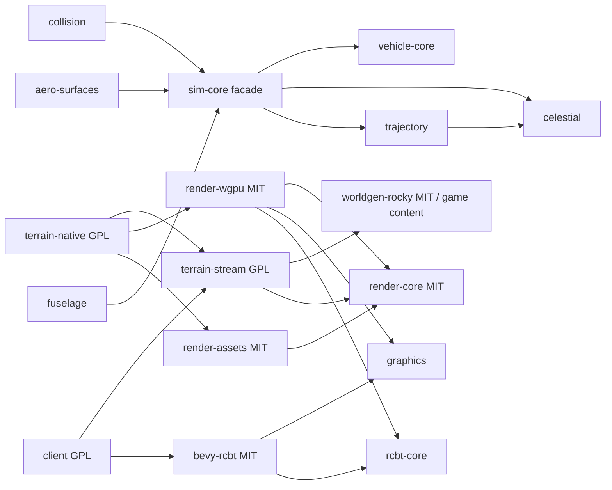
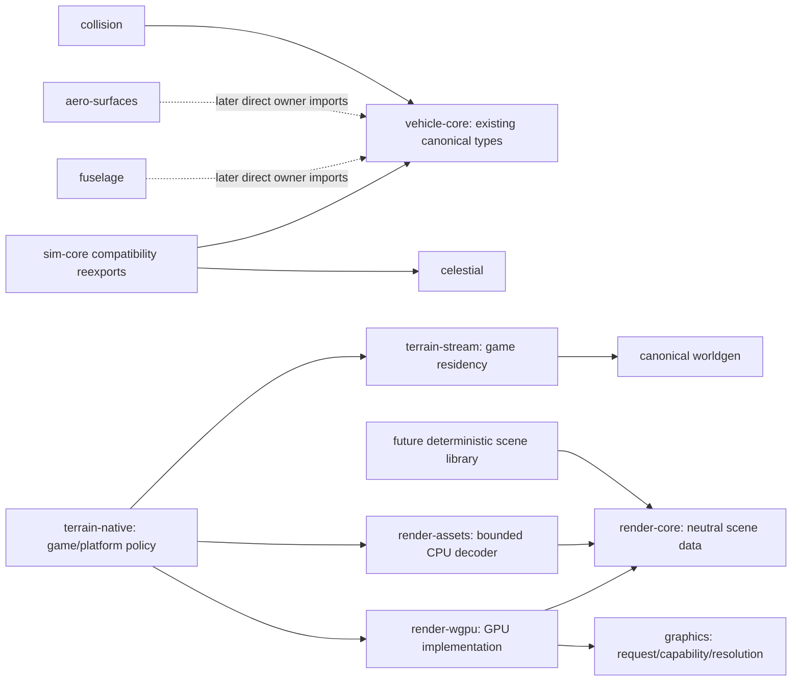

# 88 — Engine boundaries and reference-scene progression

Status: R1–R4 implemented; R5 capture/scenes staged. No new scenes or benchmark assets.

## Audit baseline

The 2026-10-29 audit uses development branch `feat/surface-visual-engineering`,
source `5ad0a7ab5560384e261190252c0c429dd43aae40`. Implementation is isolated on
`refactor/engine-boundaries` in the same repository/workspace. Existing user
changes in the development checkout are preserved. The prior uncommitted cloud
experiment is quarantined separately and is not part of this refactor.

`cargo metadata --offline --format-version 1 --all-features` resolves 43
workspace packages (735 including external packages). The graph below includes
runtime/build edges; target predicates are conservatively included across
platforms. Development edges are not inherited by consumers. MIT does not imply
generic: `worldgen-rocky` is canonical game content. Celestial/trajectory are
reusable orbital-domain libraries, not generic rigid-body primitives. Protocol
has an opaque codec but a Thessa version/kind registry.
See [ADR-0012](adr/0012-engine-boundaries-reference-scenes.md).

## Ownership matrix (all workspace packages)

| Package | Classification | SPDX | Current responsibility |
| --- | --- | --- | --- |
| `thessa-audio-core` | Engine infrastructure | MIT | Audio events/acoustic routing |
| `thessa-audio-synth` | Engine infrastructure | MIT | Procedural DSP |
| `thessa-microstore-core` | Engine infrastructure | MIT | Residency/storage/filtering representations |
| `thessa-perf` | Engine infrastructure | MIT | CPU/GPU sampling and capture data |
| `thessa-protocol` | Engine infrastructure | MIT | Opaque codec; current version/kind registry is Thessa-specific |
| `thessa-simd` | Engine infrastructure | MIT | Numeric kernels |
| `thessa-aero-core` | Generic physics | MIT | Aero state/forces and solver contracts |
| `thessa-aero-surfaces` | Generic physics | MIT | Aero geometry compiler; facade edge staged |
| `thessa-atmosphere` | Generic physics | MIT | Composition-aware atmosphere |
| `thessa-collision` | Generic physics | MIT | Rapier contacts; facade edge staged |
| `thessa-fuselage` | Generic physics | MIT | Body/structure compiler; facade edge staged |
| `thessa-propulsion` | Generic physics | MIT | Engine/chamber/propellant/tank models |
| `thessa-vehicle-core` | Generic physics | MIT | Canonical rigid-body, vehicle, contact and actuator types |
| `thessa-bevy-rcbt` | Generic rendering/assets | MIT | Bevy extraction/render adapter |
| `thessa-fastrt` | Generic rendering/assets | MIT | Neutral RT representation classification |
| `thessa-fastrt-wgpu` | Generic rendering/assets | MIT | GPU FastRT implementation |
| `thessa-graphics` | Generic rendering/assets | MIT | Requested/capability/resolved settings policy |
| `thessa-plume-core` | Generic rendering/assets | MIT | Exhaust field/optical contracts |
| `thessa-rcbt-core` | Generic rendering/assets | MIT | Topology, conforming surface, page/light contracts |
| `thessa-rcbt-wgpu` | Generic rendering/assets | MIT | GPU topology/state kernels |
| `thessa-render-assets` | Generic rendering/assets | MIT | Bounded static GLB decoder |
| `thessa-render-core` | Generic rendering/assets | MIT | f64 frames, camera, meshes/materials/instances |
| `thessa-render-wgpu` | Generic rendering/assets | MIT | Device, GPU resources/passes/timestamps |
| `thessa-wgpu-exp` | Generic rendering/assets | MIT | Isolated experimental-feature consent |
| `thessa-celestial` | Celestial/simulation domain | MIT | Ephemerides/gravity; reusable orbital domain |
| `thessa-maneuver` | Celestial/simulation domain | MIT | Orbital planning/execution; simulation dependency intentional |
| `thessa-sim-core` | Celestial/simulation domain | MIT | Compatibility facade over numerical owners |
| `thessa-trajectory` | Celestial/simulation domain | MIT | Propagation; celestial dependency intentional |
| `thessa-autopilot` | Game simulation | GPL-3.0-or-later | Game automation graphs |
| `thessa-autopilot-js` | Game simulation | GPL-3.0-or-later | Game script host |
| `thessa-flight-authority` | Game simulation | GPL-3.0-or-later | Authoritative game state/fixed-step scheduling |
| `thessa-flight-control` | Game simulation | GPL-3.0-or-later | Pilot/guidance integration |
| `thessa-flight-net` | Game simulation | GPL-3.0-or-later | Game payloads, snapshots, fleet integration |
| `thessa-terrain-stream` | Game worldgen/streaming | GPL-3.0-or-later | Game terrain demand/jobs/publication policy |
| `thessa-worldgen-rocky` | Game worldgen/streaming | MIT | Canonical planet/biome/material generation (MIT, game-specific) |
| `thessa-client` | Application integration | GPL-3.0-or-later | Bevy app/input/UI/extraction |
| `thessa-server` | Application integration | GPL-3.0-or-later | Dedicated authoritative server |
| `thessa-terrain-native` | Application integration | GPL-3.0-or-later | Native window/headless/input/scheduling/capture |
| `thessa-rcbt-ffi` | Developer tools | MIT | Dev libcbt oracle bridge |
| `thessa-rcbt-large-ffi` | Developer tools | MIT | Dev large_cbt oracle; upstream quarantine remains |
| `thessa-rcbt-ref` | Developer tools | MIT | Independent test oracle |
| `thessa-system-baker` | Developer tools | MIT | Ephemeris baking CLI |
| `thessa-vehicle-baker` | Developer tools | MIT | Vehicle compiler CLI |

## Current dependency diagram (audit baseline)

Arrows mean consumer → dependency. The full runtime/build edge list follows.



<details>
<summary>Complete direct workspace runtime/build edges at audit baseline</summary>

```text
thessa-aero-core -> thessa-simd
thessa-aero-surfaces -> thessa-sim-core
thessa-autopilot -> thessa-flight-control
thessa-autopilot -> thessa-sim-core
thessa-autopilot-js -> thessa-autopilot
thessa-autopilot-js -> thessa-flight-control
thessa-autopilot-js -> thessa-sim-core
thessa-bevy-rcbt -> thessa-fastrt
thessa-bevy-rcbt -> thessa-graphics
thessa-bevy-rcbt -> thessa-microstore-core
thessa-bevy-rcbt -> thessa-rcbt-core
thessa-celestial -> thessa-aero-core
thessa-client -> thessa-atmosphere
thessa-client -> thessa-audio-core
thessa-client -> thessa-audio-synth
thessa-client -> thessa-bevy-rcbt
thessa-client -> thessa-collision
thessa-client -> thessa-flight-authority
thessa-client -> thessa-flight-net
thessa-client -> thessa-graphics
thessa-client -> thessa-perf
thessa-client -> thessa-plume-core
thessa-client -> thessa-protocol
thessa-client -> thessa-rcbt-core
thessa-client -> thessa-render-assets
thessa-client -> thessa-render-core
thessa-client -> thessa-sim-core
thessa-client -> thessa-terrain-stream
thessa-client -> thessa-worldgen-rocky
thessa-collision -> thessa-sim-core
thessa-fastrt-wgpu -> thessa-fastrt
thessa-flight-authority -> thessa-collision
thessa-flight-authority -> thessa-flight-control
thessa-flight-authority -> thessa-sim-core
thessa-flight-authority -> thessa-worldgen-rocky
thessa-flight-net -> thessa-autopilot
thessa-flight-net -> thessa-flight-authority
thessa-flight-net -> thessa-flight-control
thessa-flight-net -> thessa-protocol
thessa-flight-net -> thessa-sim-core
thessa-fuselage -> thessa-sim-core
thessa-maneuver -> thessa-sim-core
thessa-plume-core -> thessa-fastrt
thessa-plume-core -> thessa-rcbt-core
thessa-propulsion -> thessa-aero-core
thessa-rcbt-core -> thessa-fastrt
thessa-rcbt-wgpu -> thessa-microstore-core
thessa-rcbt-wgpu -> thessa-rcbt-core
thessa-render-assets -> thessa-render-core
thessa-render-wgpu -> thessa-fastrt
thessa-render-wgpu -> thessa-graphics
thessa-render-wgpu -> thessa-rcbt-core
thessa-render-wgpu -> thessa-rcbt-wgpu
thessa-render-wgpu -> thessa-render-core
thessa-render-wgpu -> thessa-wgpu-exp
thessa-server -> thessa-autopilot
thessa-server -> thessa-autopilot-js
thessa-server -> thessa-flight-authority
thessa-server -> thessa-flight-control
thessa-server -> thessa-flight-net
thessa-server -> thessa-maneuver
thessa-server -> thessa-protocol
thessa-server -> thessa-sim-core
thessa-sim-core -> thessa-aero-core
thessa-sim-core -> thessa-celestial
thessa-sim-core -> thessa-propulsion
thessa-sim-core -> thessa-trajectory
thessa-sim-core -> thessa-vehicle-core
thessa-system-baker -> thessa-sim-core
thessa-terrain-native -> thessa-atmosphere
thessa-terrain-native -> thessa-audio-core
thessa-terrain-native -> thessa-audio-synth
thessa-terrain-native -> thessa-collision
thessa-terrain-native -> thessa-flight-authority
thessa-terrain-native -> thessa-flight-net
thessa-terrain-native -> thessa-graphics
thessa-terrain-native -> thessa-perf
thessa-terrain-native -> thessa-plume-core
thessa-terrain-native -> thessa-rcbt-core
thessa-terrain-native -> thessa-render-assets
thessa-terrain-native -> thessa-render-core
thessa-terrain-native -> thessa-render-wgpu
thessa-terrain-native -> thessa-sim-core
thessa-terrain-native -> thessa-terrain-stream
thessa-terrain-native -> thessa-worldgen-rocky
thessa-terrain-stream -> thessa-rcbt-core
thessa-terrain-stream -> thessa-render-core
thessa-terrain-stream -> thessa-worldgen-rocky
thessa-trajectory -> thessa-celestial
thessa-trajectory -> thessa-simd
thessa-vehicle-baker -> thessa-aero-surfaces
thessa-vehicle-baker -> thessa-fuselage
thessa-vehicle-baker -> thessa-sim-core
thessa-vehicle-core -> thessa-aero-core
thessa-vehicle-core -> thessa-propulsion
thessa-worldgen-rocky -> thessa-rcbt-core
```

</details>

## Target boundaries (staged)



No renderer dependency points back into the application or canonical worldgen.
No separate repository, engine framework or replacement physics engine is needed.

## Source findings and renderer ownership

| Responsibility | Owner | Policy/adapter |
| --- | --- | --- |
| Camera/projection data, f64 rebasing | `render-core::{ViewParams, BodyFrame}` | Native camera/survey and Bevy extraction choose pose/time |
| Authoritative rigid-body state | `vehicle-core::RigidBodyState` | `flight-authority`; `sim-core` compatibility reexport |
| CPU mesh/material/texture/instances | `render-core::mesh` | Worldgen and application producers |
| Static asset decoding/input bounds | `render-assets::decode_glb` | App chooses files; unsupported semantics fail |
| Device, resources, pass encoding | `render-wgpu`; topology kernels in `rcbt-wgpu` | Apps own surfaces/submission lifecycle |
| Light/environment transport | `rcbt-core::lighting`, `render-core::environment` | App derives canonical stellar/weather inputs |
| Requested settings/capability vocabulary/fallbacks | `graphics` | Backend probes capabilities; app loads config |
| RT representation selection | `fastrt` | Acceleration structures in GPU adapters |
| Terrain/biome/material generation | `worldgen-rocky` | Game domain, not a mandatory renderer input |
| Terrain demand/jobs/residency publication | `terrain-stream` | Native/Bevy hosts supply demand |
| Frame scheduling/presentation/input | Native `main.rs`/`window.rs`, Bevy app | Not neutral renderer data |
| GPU timestamp resources | `render-wgpu::timing` | App collects `perf` samples |
| CPU/frame profiling/capture policy | `perf` data + native integration | Explicit diagnostic opt-in |

`collision/src/lib.rs` imports `CollisionAxis`, `CollisionGeometry`,
`CollisionMaterial`, `CollisionShape`, `CompiledLandingLeg`,
`CompiledWheelChassis`, `FlightForces`, `LandingLegState`, `RigidBodyProperties`
and `RigidBodyState` from `sim-core`. All already belong to `vehicle-core`;
`sim-core` only reexports them. Collision examples/benches/tests also use
vehicle/contact types. R2 can change imports/Cargo edges without moving types,
arithmetic, integration order or Rapier state. An adapter would add no value:
existing facade reexports are identical Rust types.

Renderer manifests already separate concerns: `render-core` has only `glam`,
`render-assets` depends on neutral mesh data, and `render-wgpu` does not require
`sim-core`, `worldgen-rocky` or `terrain-stream` at runtime. APIs consume neutral
frames, instances, lighting and page contracts, not game `Scene`/`PlanetField`.
RCBT includes terrain-specialized contracts and is not a general scene graph.
Its dev oracle dependencies do not propagate into consumers.

R3 moved duplicate native/Bevy mesh capacity requirements into the existing
`rcbt-core::shaders` WGSL ABI owner. Both adapters now import 96 output vertices,
32 output primitives, 32 invocations and 7 storage buffers. Bevy also imports
the existing 256-wide dispatch ABI; its adapter-specific dispatch-limit tests
remain in place. Feature detection still belongs to each backend, and fallback
policy remains in `graphics`. No game state or GPU handle was moved into the
neutral core. Native frame publication is consolidated in R4: `SceneMeshes::prepare_frame`
updates source/epoch state, applies primary jitter and synchronizes borrowed
terrain RT state in that order for both window and headless hosts. The view
supplies the exposure used for mesh preparation. This remains GPL application
integration; no game Scene type enters a neutral renderer contract.

## Architecture gate: enforced and staged

`tools/agent-qa/check_architecture.py` uses the complete resolved Cargo
all-features graph and rejects:

- Backend frameworks in the closure of 19 neutral foundation packages,
  including `render-core`, `render-assets`, `collision` and `fastrt`.
- MIT → GPL **workspace** dependencies, directly and transitively.
- Runtime/build library → application dependencies.
- Mandatory runtime/build `worldgen-rocky`/`terrain-stream` dependencies in
  reusable renderer packages; test-only scene producers remain permitted.
- New generic-physics → `sim-core`/`celestial`/`trajectory` paths.

Only two exact existing compiler edges remain staged: aero-surfaces → sim-core
and fuselage → sim-core. Collision → sim-core was removed in R2. Removing these edges must
eliminate every forbidden path; a second path through a new helper still fails.
R2 removed collision's allowance with its dependency. Orbital libraries are not
subject to a blanket celestial ban. Root dev edges are checked for neutral
backend/license rules; downstream dev edges are never inherited. Build and
target-specific paths are conservatively checked.

This gate does not prove type-level/API isolation, inspect dynamic loading,
evaluate every external SPDX expression, or resolve every possible feature
combination. All-features is a conservative union, not an all-platform compile.
Source review and normal Cargo checks remain necessary.

## Minimal sequence

1. **R1:** gate and audit/ADR; no production Rust/assets changed.
2. **R2:** direct collision → vehicle-core imports, all auxiliary targets,
   unchanged sim-core API, existing numeric cases and downstream compile checks.
3. **R3:** renderer ownership and confirmed mesh capability duplication only;
   preserve graphics resolution/fallbacks and dispatch constraints.
4. **R4:** one meaningful native integration duplication, both paths verified;
   no universal application framework.
5. **R5 capture first:** extend existing offscreen/PNG/perf tools with scene
   identity/provenance, then B01 generated PBR geometry and bounded B02 CC0
   Fern02/Moss01. No asset downloads or scenes before this milestone.

Future capture metadata must include commit, verified asset/scene hashes,
pose/projection, resolution, resolved settings, lighting/environment, simulation
epoch, backend/GPU/driver, warmup and available CPU/GPU/pass metrics. Preserve
linear HDR where supported plus display output; mark unavailable data explicitly.
Reuse `tools/agent-qa/arena.py`. Physical correctness, visual preference,
performance and temporal stability remain separate. No B03/B04 or cross-engine
adapters are implemented by this refactor.

## R1 milestone record

- **Source commit:** `5ad0a7ab5560384e261190252c0c429dd43aae40`.
- **Resulting commit:** the commit introducing this section (self-identifying in
  Git; no circular hash embedded in its own content).
- **Architectural/dependency changes:** full graph gate, exact staged exceptions;
  no Rust dependency changes.
- **Changed files:** checker/tests, tooling README, this audit/ADR, root README,
  status index and doc 55.
- **Tests executed:** real graph gate: 43 workspace packages, zero errors,
  three staged paths; 15 Python tests; `git diff --check`.
- **Tests not executed:** Rust rebuild, GPU render or runtime benchmark for this
  tooling/docs-only milestone; no production runtime code changed.
- **Numerical/visual/performance evidence:** not applicable; no runtime or
  reference-renderer equivalence claimed.
- **Imported assets/licenses:** none; existing MIT/GPL split unchanged.
- **Known limitations:** gate scope above; three facade edges staged.
- **Next smallest useful change:** R2 collision → vehicle-core imports.

## R2 milestone record

- **Source commit:** `91a32c5` (R1).
- **Resulting commit:** the commit introducing this section.
- **Architectural change:** collision imports the existing vehicle-core owners
  directly; sim-core compatibility reexports remain untouched. No extracted
  crate, adapters, type copies, arithmetic or physics-law changes.
- **Affected dependencies:** collision → sim-core replaced by collision →
  vehicle-core; collision no longer requires celestial/trajectory. The existing
  vehicle-core → aero-core/propulsion dependencies remain intentional.
- **Changed files:** collision manifest, lib/tests/examples/bench imports,
  Cargo.lock, architecture allowance/regression test, docs 03/40/88, README,
  status index and tooling README.
- **Tests executed:** `cargo test --offline -p thessa-collision --lib` before
  and after the move (26 each); also `--no-default-features` and
  `--no-default-features --features enhanced-determinism` (26 each).
  `cargo check --offline -p thessa-collision --all-targets` includes examples
  and the contact bench. Downstream `cargo check --offline -p
  thessa-flight-authority -p thessa-server -p thessa-terrain-native --all-targets`
  passed, as did `cargo fmt --all -- --check`, the real architecture gate and
  all 16 Python quality tests. The 720-step settling example is unchanged:
  `y=0.499930 m speed=0.000000 m/s omega=0.000000 rad/s`.
  Actual workspace runtime closure is collision/vehicle-core/aero-core/
  propulsion/simd, with no celestial/trajectory/sim-core.
- **Tests not executed:** GPU rendering and performance benchmarks; this change
  does not alter renderer code or arithmetic.
- **Numerical evidence:** unchanged existing physical/regression envelopes,
  including deterministic input-sequence replay; baseline contact result saved
  before changing imports. No new error envelope is invented for an import move.
- **Visual evidence / GPU/CPU measurements:** not applicable; no performance or
  visual improvement claimed.
- **Imported assets/licenses:** none; MIT/GPL ownership unchanged.
- **Known limitations:** aero-surfaces/fuselage facade edges remain staged.
- **Next smallest useful change:** R3 shared terrain mesh shader ABI thresholds.

## R3 milestone record

- **Source commit:** `6e02463` (R2; R1 is `91a32c5`).
- **Resulting commit:** the commit introducing this section.
- **Architectural change:** existing shared shader module owns terrain mesh ABI
  capacities used by both backend adapters. Ownership table above clarifies
  cameras, transforms, instances, lighting, GPU resources, settings, residency,
  scheduling and profiling without restructuring valid public APIs.
- **Affected dependencies:** none; both adapters already depend on rcbt-core.
- **Changed files:** rcbt-core shaders module, render-wgpu capability imports,
  Bevy mesh probe/dispatch imports, docs 22/88, README/status and ADR status.
- **Tests executed:** 75 rcbt-core tests (including the host/WGSL contract
  guard); 51 graphics resolution/fallback tests; 8 Bevy render tests with
  `--features mesh-shaders`, including Naga geometry/raster/classifier/mesh
  validation and dispatch fallback limits. `cargo check --offline -p
  thessa-render-wgpu -p thessa-bevy-rcbt --features
  thessa-bevy-rcbt/mesh-shaders --all-targets` passed; real graph gate,
  formatting and diff whitespace checks passed.
- **Tests not executed:** GPU draw/performance capture; WGSL byte strings,
  shader arithmetic, settings and all numerical thresholds are unchanged.
- **Numerical evidence:** host/WGSL ABI regression guard; no physics changes.
- **Visual evidence / GPU/CPU measurements:** none claimed; no render behavior
  or performance change is intended.
- **Imported assets/licenses:** none; ownership/license boundaries unchanged.
- **Known limitations:** existing native/Bevy feature negotiation differences
  and hardware-only mesh validation remain; two physics facade edges staged.
- **Next smallest useful change:** R4 shared app-level mesh frame publication.

## R4 milestone record

- **Source commit:** `c8fadd8` (R3).
- **Resulting commit:** the commit introducing this section.
- **Architectural change:** one shared mesh-frame publication entry point in
  the existing app-owned SceneMeshes, used by window/headless hosts. Source
  replacement/epoch checks precede jitter and RT terrain synchronization.
  Existing lower-level helpers and their validation/error propagation remain.
  Simulation clocks, input, target allocation, scheduling, profiling, streaming
  and renderer pass order are unchanged.
- **Affected dependencies:** none; no new crate/framework or public engine API.
- **Changed files:** native main/window/fleet_mesh modules; existing heterogeneous
  mesh/epoch pixel fixture exercises the new entry point; docs 77/88, README,
  status and ADR status.
- **Tests executed:** native unit suite: 133 passed, 43 GPU/diagnostic tests
  ignored by default. The heterogeneous mesh/epoch pixel fixture was then
  explicitly run with isolated software Vulkan: 1 passed. Feature-off
  `cargo check --offline -p thessa-terrain-native --no-default-features --all-targets`,
  strict `cargo clippy --offline -p thessa-terrain-native --all-targets -- -D warnings`,
  formatting, real architecture gate and 16 Python quality tests passed.
  The explicit fixture initially exposed stale pre-frustum-culling count
  assertions, reproduced on unmodified R3. They now distinguish 3 candidates
  from 2 submitted shapes (and 64 from 63 in the synthetic fleet), preserving
  all pixel equality, COM-frame, source-publication and epoch assertions.
  The test artifact directory was bound writable in isolation; no display or
  physical GPU was exposed.
- **Tests not executed:** interactive window/input session, physical-GPU timing,
  moving-camera reference comparison; no frame-time improvement is claimed.
- **Numerical evidence:** application integration only; no physics arithmetic,
  solver state or simulation scheduling changes.
- **Visual evidence:** existing software-Vulkan pixel/instance/epoch regression
  passed, including exact COM reuse/rebuild image equality. No subjective
  visual acceptance or reference parity.
- **GPU/CPU measurements:** no benchmark claim; test durations are not frame times.
- **Imported assets/licenses:** none; existing fixtures and GPL app boundary retained.
- **Known limitations:** a shared entry point does not unify the entire app loop;
  capture provenance and standalone reference scenes remain R5 work.
- **Next smallest useful change:** extend existing capture provenance before B01.
